---

## 引言:概率软件会在你最不注意的地方悄悄坏掉

先讲一个让你后背发凉的场景,它来自 MLflow 的工程文档,一句话就够:

> 模型返回 HTTP 200、零报错、延迟甚至更低。但答案在事实上是错的。

这就是概率软件和传统软件最本质的区别。你改了一行 prompt,CI 全绿、接口无异常、日志干干净净,可线上用户开始收到胡说八道的答案,而且这种劣化可以**持续数小时不被任何人察觉**。触发它的甚至不一定是你的代码:换个模型供应商、改一版帮助文档、甚至模型厂商在后台悄悄升级了行为,都可能让一个昨天还好好的 agent 今天开始跑偏。

传统工程的三板斧,单独拎出来都不够:

- **单元测试**守的是代码正确性,但 agent 的行为不由代码决定,由"代码 + prompt + 模型"三者共同决定。代码没坏,行为可以坏。
- **日志**给你的是平铺的事件流,但 agent 一次执行是一棵决策树。它为什么调这个工具、为什么放弃检索、为什么绕了三圈才回来,平铺日志里全是断点。
- **监控**告诉你"活着还是死了",但 agent 的问题几乎从不表现为"死了"。它是**活着但不对**。

于是问题变成:当"对错"本身不再确定时,工程上靠什么守住质量?

这篇教学的回答是四个字:**分层设防**。把质量防线拆成三层,每层用不同的工具、不同的时延、不同的成本,守不同的东西:

| 层 | 回答的问题 | 时延 | 成本 | 什么时候跑 |
|---|---|---|---|---|
| **测试层**(unit/integration) | 我们写对软件了吗? | 秒级 | 免费 | 每次 PR 的 CI |
| **Eval 层** | 模型在这个变更下还可靠吗? | 分钟级 | 有 API/推理成本 | CI 回归子集 / 发布前 / 换模型时 |
| **可观测层** | 线上真实分布里它还好吗?坏了怎么快速发现和缩回? | 持续 | 全量/抽样 | 上线后每一秒 |

三句话记住分工:**测试守确定性代码,evals 守模型行为回归,观测守线上真实漂移**。缺一层,概率系统就会在你最不注意的地方悄悄坏掉。

但还有一层更深的道理,Anthropic 的工程师用"瑞士奶酪"模型讲清楚了(图 F12):**没有任何一层是密不透风的**。离线 eval 跑得再漂亮也可能给虚假信心(它没见过线上的真实输入分布);生产监控能抓到真实失败,却给不出"对错"的打分基准(它只告诉你坏了,不告诉你多坏、坏在哪);用户反馈最真实,却稀疏、滞后、从不解释 why。所以成熟团队的姿势是六层防线叠着用。automated evals(launch 前 + CI,第一道防线)→ production monitoring → A/B testing → user feedback → 人工读 transcript → 系统化人工研究(只用来校准)。每层有洞,但洞不对齐,错误就穿不过去。Anthropic 的原话是:"The most effective teams combine these methods."

这篇教程就沿着这条主线展开:

1. 第 1 章先统一词汇。一次 agent eval 到底由什么组成(不统一词汇,后面全白讲);
2. 第 2 章讲最底层的测试层:确定性底座怎么做;
3. 第 3 章讲 eval 层:怎么从 20 个真实失败起步,建起一套能贯穿开发周期的评估体系;
4. 第 4 章讲可观测层:trace 树怎么还原 agent 的决策过程,生产失败怎么回灌成新的 eval case;
5. 第 5 章讲发布:shadow → canary → 全量,把改动安全地送上线;
6. 第 6 章把三层咬合起来看,并抛一个开放问题:当 agent 学会自己改自己,eval 怎么办?
7. 第 7 章给你一条按成本排序的落地路线图。

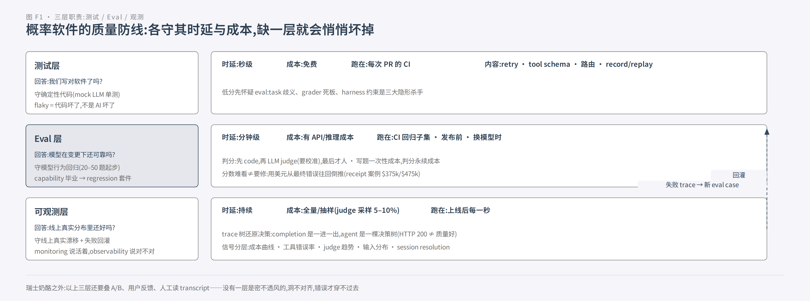

*图 F1:三层各守其时延与成本。测试层秒级免费、每次 PR 进 CI;eval 层分钟级有价、守模型行为回归;可观测层持续全量或抽样、守线上真实漂移,并把失败 trace 回灌成新 eval case。*

---

## 第 1 章 先统一词汇:一次 agent eval 由什么组成

任何工程领域要能对话,第一步都是统一词汇。Anthropic 的《Demystifying evals for AI agents》给了 agent eval 一套干净得可以直接抄走的术语表,我们用"考试"的比喻把它们串起来讲:

| 术语 | 定义 | 考试比喻 |
|---|---|---|
| **task**(problem / test case) | 有明确输入和 success criteria 的单个测试 | 一道考题 |
| **trial** | 对 task 的一次尝试执行 | 一次作答(模型有随机性,同一道题要多答几次才有统计意义) |
| **grader** | 给表现打分的逻辑;一个 task 可有多个 grader,每个 grader 含多个 assertion(检查点) | 阅卷人(可以好几个,一人判一个维度) |
| **transcript**(trace / trajectory) | 一次 trial 的完整记录:输出、工具调用、推理、中间结果 | 考试全过程录像 |
| **outcome** | trial 结束时**环境里的最终状态** | "卷面说订好了"≠"数据库里真有订单" |
| **evaluation harness** | 端到端跑 eval 的基础设施:发指令、给工具、并发跑 trial、记录、打分、聚合 | 考场本身 |
| **agent harness**(scaffold) | 让模型能当 agent 行动的系统(处理输入、编排工具调用) | agent 的身体骨架 |
| **evaluation suite** | 为测特定能力聚合的 task 集合 | 一套试卷(客服套件 = 退款 + 取消 + 升级…) |

这套词里藏着 agent eval 和普通 LLM eval 的第一个分水岭,也藏着最容易犯的错,值得单独拆开讲。

### 1.1 outcome ≠ transcript:说得对,不等于做成了

假设你做一个航班订票 agent。transcript 是它"说"的话:"好的,我已经为您预订了 9 月 12 日的 CA1831。"这句话完美、礼貌、符合所有对话规范。但 outcome 是环境里的最终状态:数据库里**到底有没有**那条 reservation 记录?

这两个可能不一致。agent 可能在最后一步工具调用失败后,没有检查返回结果就编了一句"订好了"(模型会自信地补全它以为发生的事);也可能它订对了航班但订错了舱位。反过来也可能:transcript 磕磕绊绊、绕了远路,但 outcome 是对的。

所以 Anthropic 反复强调:**judge 判分要分清你在判什么**。对"状态变更类"的 agent(写库、下单、改配置),正解是**终态评估(end-state evaluation)**。判最终环境状态,或者把复杂流程拆成"离散检查点",逐个验证该发生的状态变化发生了;而不是去评判中间路径走得好不好看。Anthropic 自己的多 agent 研究系统就是这么干的:agent 可以走完全不同的合法路径到达同一个目标,传统 eval 假设"每次走同样的步骤",对 agent 根本不成立("Even with identical starting points, agents might take completely different valid paths")。判分原则一句话:**grade what the agent produced, not the path it took**(判产出,别罚路径)。

这个区分还带出一个反直觉的推论:**你说要测的东西,可能根本不是被测对象**。

### 1.2 你评估的从来不是"模型",是"harness + 模型"的组合

当我们说"评估这个 agent"时,Anthropic 提醒:我们评估的是 agent harness(脚手架:prompt、工具编排、上下文处理)与模型**协作的合体**。这意味着两件事:

第一,**换 scaffold 等于换了被测对象**。同一个模型,套上不同的工具编排逻辑,表现天差地别。你改的 prompt、加的工具、调的顺序,全都在改变被测系统。所以 eval 里的 agent 必须和生产里的 agent 行为一致(用同一个 harness),否则测了个寂寞。

第二,分数上不去时,**低分先怀疑 eval,再怀疑 agent**。Anthropic 有一个堪称铁证的三连案例:
- Opus 4.5 在 CORE-Bench 上只有 42%,研究员排查发现:判分器死板("96.12" 判错,因为它期望 "96.124991…")、题目说明有歧义、随机任务无法复现。修完 eval 的 bug、换更少约束的 scaffold 后,直接跳到 95%。
- METR 的时间跨度基准里,grader 要求"超过某阈值",而 task 让 agent"优化到某阈值"。照指令做的模型反被罚分。
- Terminal-Bench 审计发现 task 让 agent 写脚本但没说文件路径,测试却假设了某个路径,agent 无过错地拿 0 分。

结论很朴素:**0% pass@100 大概率是题坏了,不是 agent 无能。** 这也是为什么 S1 的 roadmap 里有一整步是"读 transcript"。只有读了考试录像,你才知道分数上不去到底是 agent 不行还是 eval 不行。

### 1.3 capability evals 和 regression evals:要爬的山,和不许忘的事

很多团队把 eval 当成一个池子,这是第二个常见混淆。其实按用途,题要分成两个池子,通过率基线完全不同:

- **Capability evals**(能力评估)回答:**这个 agent 能做什么?** 起跑通过率低。它专挑 agent 做不好的难任务,给团队一座"要爬的山"(hill to climb)。爬山过程就是改进过程。
- **Regression evals**(回归评估)回答:**它原来会的,现在还稳不稳?** 应该接近 100% 通过,作用是守护。防止一次 prompt 改动、一次换模型,把已经修好的能力悄悄打回原形。

两个池子之间有**毕业机制**:一个 capability task 被 agent 攻克、稳定通过后,可以"毕业"转正进回归套件。它从"测能不能做到"变成"测是不是还能稳定做到"。这个机制解释了为什么成熟团队说"能力测试是临时的,回归测试是永久的":能力题是开发期的爬坡工具,回归题是上线后的守门人。

反向的坑也要说:当回归套件**全过**时,它只剩防守价值,不再提供改进信号。这就是 eval 饱和。Qodo(一家代码评审创业公司)最初对某个新模型不以为然,因为 one-shot coding evals 捕捉不到长任务上的收益;他们自建 agentic eval 框架后才看到清晰进步。**eval 饱和会掩盖大进步**,就像一台永远满分的考试,考不出学生的真实水平。所以套件要持续注入新题(来源见第 3 章),保持挑战性。

### 1.4 对付非确定性:pass@k 和 pass^k,选哪个由产品决定

模型输出有随机性,所以一次作答不能代表真实水平。Anthropic 给了两个互补的统计口径,名字只差一个上标位置,含义截然相反:

- **pass@k**:k 次尝试中**至少一次**成功。k 越大越容易过。"多射几脚门",总有一脚进。
- **pass^k**(读作 pass-to-the-k):k 次尝试**全部**成功。k 越大越难过。"每次都稳定"是更高的杠。

举个例子:单次成功率 75%,跑 3 次"至少一次成功"的概率 ≈ 98%;但"3 次全过"的概率 = 0.75³ ≈ 42%。

选哪个不是技术问题,是产品问题:内部工具类 agent("帮我查一下这个")用 pass@k 就行。成功一次就够;但面向用户的 agent,用户拿到的每一次都该好,该盯的是 pass^k:那才对应"用户拿到坏结果的概率",也就是线上真正要监控的可靠性指标。这个连接先记下,第 4 章可观测层会回来接上。

### 1.5 grader:阅卷人分三种,选型看"判什么"

最后是阅卷人。Anthropic 把 grader 分成三类,各有明确的优劣(第 3 章会给完整的"打分工具箱",这里先给全景):

| grader 类型 | 手段 | 优点 | 缺点 |
|---|---|---|---|
| **Code-based** | 字符串/正则匹配、fail-to-pass、静态分析、outcome 校验、工具调用校验 | 快、便宜、客观、可复现、好调试 | 对合法变体脆弱、缺 nuance、判不了主观任务 |
| **Model-based** | rubric 打分、自然语言断言、pairwise 比较、多 judge 共识 | 灵活、能抓 nuance、处理开放任务 | 非确定、比 code 贵、**必须与人类打分校准** |
| **Human** | 专家评审、抽查、A/B | 金标准、贴近专家判断、校准模型 grader | 贵、慢、需要专家规模 |

选择的总原则(Anthropic 文档原话):**选最快、最可靠、最可扩展的**。这个排序本身就是设计准则。能写成确定性检查的,别用模型判;能用模型判的,别用人判。

三个前置概念讲完,词汇就齐了:task 是考题,trial 是作答,transcript 是录像,outcome 是结果,grader 是阅卷人,harness 是考场。第 2 章我们开始谈第一层防线。确定性测试;但在那之前,请把本章两个最反直觉的点刻进脑子:**outcome ≠ transcript,低分先怀疑 eval**。它们会贯穿后面所有章节。

---

*本章来源:*
- Anthropic《Demystifying evals for AI agents》https://www.anthropic.com/engineering/demystifying-evals-for-ai-agents
- Anthropic《How we built our multi-agent research system》https://www.anthropic.com/engineering/multi-agent-research-system
- MLflow《What is Canary Deployment for AI》https://mlflow.org/articles/what-is-canary-deployment-ai/

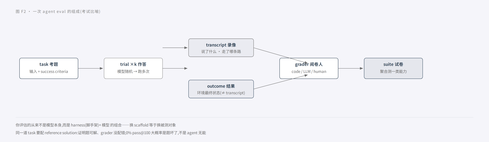
】
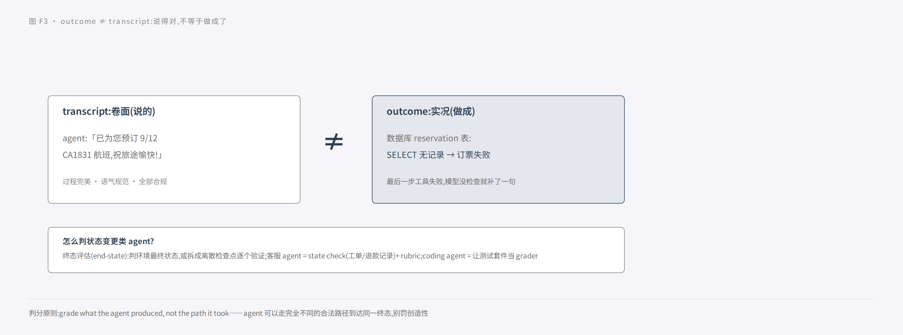
*】

## 第 2 章 测试层:确定性底座

先从最不像"AI 工程"的一层讲起,因为它最反直觉:**agent 项目里,传统单元测试不但没有过时,反而是整个质量体系的承重墙**。

Block(做 Cash App 那家公司)的测试负责人 Angie Jones 写过一篇被业内当纲领的文章,核心观点一针见血:传统测试金字塔成立的前提是"同样输入 → 同样输出",而 **agent 从第一秒就打破了这个假设**。LLM 非确定、多步流程、工具在代码库外、输出"技术上对但非所愿"。所以 agent 的测试金字塔不再按测试类型分层(unit → integration → e2e),而是按**你愿意容忍多少不确定性**分层:

```
         ▲ 容忍不确定性 ↑ · 成本 ↑ · 跑动频率 ↓
    ┌─────────────────────────────┐
    │  顶层:Vibes and Judgment    │  rubric + LLM judge,规则化的人工
    ├─────────────────────────────┤
    │  上层:Probabilistic Perf.   │  多次跑 + 聚合,结构 benchmark
    ├─────────────────────────────┤
    │  中层:Reproducible Reality  │  record/replay:录真实交互,回放一辈子
    ├─────────────────────────────┤
    │  底座:Deterministic Found.  │  mock LLM 的单元测试 。 每次 PR 都跑
    └─────────────────────────────┘
```

### 2.1 底座:mock 掉 LLM,测你的代码

底座是**传统单元测试的完整保留**:retry 行为、max turn 上限、tool schema 校验、工具解析与路由、subagent 委派逻辑……LLM 一律用 mock provider 返回 canned response。快、免费、完全确定。

为什么这一层必须 mock 而不是真调模型?因为你要测的根本不是模型。你要测的是**你自己写的编排代码**。而且 mock 有一个真模型给不了的超能力:**能轻松触达真实模型很难触发的失败模式**。比如注入 provider error、返回畸形 JSON、工具超时。这些边界恰恰是 agent 最容易崩的地方。

这一层回答的问题是:**"我们写对了软件吗?"** 记住 Block 的判断标准:**这层 flaky,一定是我们的代码问题,不是 AI 问题**。如果 mock 输入固定、输出固定,测试还在抖动,那只能是你的代码有状态泄漏或时序 bug。这层是最干净的信号,别浪费它。

### 2.2 中层:录真实交互,回放一辈子

集成测试在 agent 世界遇到了两难:外部工具/MCP server 独立演化,全 mock 会掩盖真实行为(你 mock 了一个和真工具行为不一致的假工具,测了等于没测);真连又不稳定(网络抖动、第三方限流,测试变 flaky)。

Block 的解法是 **record/replay(录制/回放)**:record 模式跑真 MCP server,把 stdin/stdout/stderr 抓下来;playback 模式**确定性重放**。对 LLM 同样做。recording 模式把"请求-响应"按输入 hash 存成 JSON fixture,playback 模式直接返回 fixture。

这里有个精心设计的取舍,值得品一品:模型升级后,录制的 session 不会反映新模型的行为。但**测"我们的代码在合理模型输出下表现如何"时,这恰恰是你要的**。你刻意把"模型行为漂移"这个变量从这层测试里关掉了,让它只测代码。模型变没变好,是 eval 层(第 3 章)和观测层(第 4 章)的事,不该让集成测试替它们背锅。

**不断言精确输出,断言"工具调用序列与交互流"**:用对了工具、顺序对、正确处理了响应。agent 的"过程正确性"比"字面输出正确性"更接近它的本质。

### 2.3 上层:单次跑说明不了什么

到了这层你开始放真模型,但要记得第 1 章的 pass@k 与 pass^k。单次执行说明不了任何问题。所以要**多次跑 + 聚合**:完成任务了吗?选对工具了吗?产出物对吗?

这层定义了一个非常重要的心智转变:**回归 ≠ "输出变了",而是"成功率掉了"**。模型输出每次都不一样是正常的,你要盯的是统计意义上的通过率有没有跌。这就是为什么传统 diff 审查在 agent 世界失灵。你不能 diff 两个 prompt 版本的输出文本说"这次改坏了",你要跑 20 遍看成功率从 90% 掉没掉到 70%。

### 2.4 顶层:如果没人测"感觉",用户就会替你测

总结、研究、解释类输出无法用严格相等判。但 Block 拒绝躺平,他们的做法是把主观判断**形式化**:清晰 rubric + 另一个 LLM 当 judge,每条评 3 次取多数,3 次全不同再加第 4 轮决胜。两句金句值得背下来:

> "It doesn't remove judgment, it just makes the judgment explicit and repeatable."(它没有消除判断,只是让判断变得显式、可重复。)
> "If we don't test vibes, our users will."(如果我们不测"感觉",用户就会替我们测。)

### 2.5 这条线最重要的一个工程决策

Block 文章里最关键的一句话,直接支撑了全书的"三层职责"分工:

> "one thing we don't do is run live LLM tests in CI. It's too expensive, too slow, and too flaky. The benchmarking framework runs on demand, not on every pull request. This is a deliberate choice. **CI validates the deterministic layers. Humans validate the rest when it matters.**"

翻译:**CI 只守确定性层;其余的部分,在该验证的时候由人来验证。** 这不是偷懒,是把每一层的时延与成本花在最擅长的信号上。live LLM 测试太贵、太慢、太 flaky,塞进每次 PR 只会让团队学会无视红叉;确定性底座秒级免费,才配得上每次都跑。

*本章来源:* Block Engineering《Testing Pyramid for AI Agents》https://engineering.block.xyz/blog/testing-pyramid-for-ai-agents

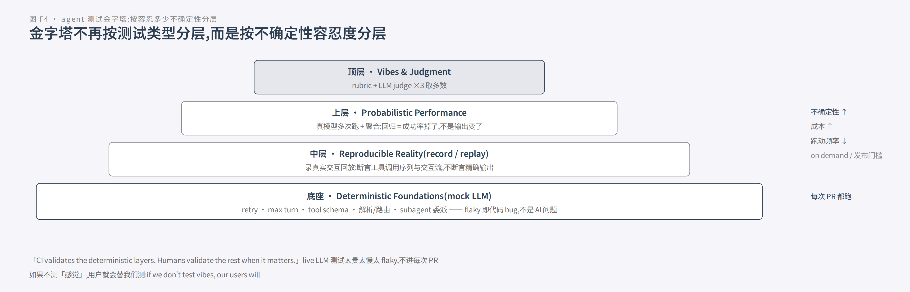

---

## 第 3 章 Eval 层:守住模型行为回归

如果说第 2 章是"把地基浇实",这一章是全书真正的主角:**eval 层**。它回答的问题只有一个:**模型在这个变更下,还可靠吗?**

先把最根本的态度摆正。OpenAI 那份 receipt-inspection 教程开篇的话,是所有 eval 工程的题眼:

> "把 evals 变成(开发流程的)核心过程,可以杜绝'戳一下看看运气'(poke-and-hope)式的瞎试和'凭印象判断准确率',强迫你用工程严谨性做事。"

以及那句更狠的:

> "在你有一个可以给自己打分的基准之前,不值得花太多时间做 prompt engineering。"

绝大多数团队的 prompt 迭代是"感觉流":改几个字,跑几个例子,肉眼看看"好像更好了"。eval-driven development 的全部主张就是反对这种 vibe:**先有尺子,再谈改进**。

### 3.1 eval 贯穿生命周期,不是上线前的门禁

receipt-inspection 是一个自动审报销单的真实项目(替代人工会计),它的 7 步生命周期把 eval 的位置讲得很清楚:**eval 不是最后一步的质检,它从 V0 一搭好就在场,并且一直长**:

1. **理解问题**:访谈现在干这活的人(领域专家)。既是任务细节来源,也是将来设计 eval 的靠山。注意:理解问题不会在开工前结束,会持续修正。
2. **收集数据**:现实项目几乎不会一开始就数据齐全。这个项目有系统输入(收据图片),**零标注**。
3. **搭端到端 V0**:越快越好,不求性能好,只求"输入对、输出类型对"。通常就是一个 prompt + 单模型 + 结构化输出。
4. **标注 + 建初始 eval**:没有 ground truth 时的标准做法:**用早期系统生成"草稿真值",交给领域专家批注修正**。专家怎么改、为什么这么改,直接变成 grader 和 prompt 改进的依据。专家的修正对话,本身就是规格。
5. **把 eval 映射到业务指标**:开工改错之前,先评估:这条 eval 的"失败"到底值多少钱?(3.7 细讲)
6. **持续改进系统和 eval**:注意是**双向**的。系统改好了,还要回头"改更好的 eval"(飞轮)。
7. **接入 QA 与上线后改进**:对线上服务打点,生产数据持续产出更好的测试/训练样本。这是模型上线多年仍保持性能的**唯一途径**。

注意第一步和第七步的呼应:**eval 是一头连着"人怎么理解这个任务",一头连着"生产里真实发生了什么"**。它不是开发中间的一个文件夹,是一条从规格到线上的连续管道。

### 3.2 起步:20 个真实失败,比 200 道漂亮题有用

几乎每家(Eval 领域)都给出同一个起点建议,反直觉但高度一致:

- **量级**:20–50 个 task 就够起步。Anthropic 的多 agent 系统从 **~20 条代表真实用法的 query** 开始;原因是早期改动效应量巨大。一个 prompt 微调可能把成功率从 30% 提到 80%。这么大的效应,几条用例就看得出信号。等攒够几百条精品题再开始,是团队最常见的拖延借口。
- **题源**:从 bug tracker / support queue 里挖**真实失败**,按用户影响排序转成测试用例。这和第 2 章"bug → 单元测试"是同构的,只是把"代码 bug"换成了"行为失败"。
- **每道题配 reference solution**:一个已知能通过所有 grader 的正确输出。它证明两件事:题可解,和 grader 没配错。没有它,你永远分不清是 agent 不行还是题坏了(第 1 章的 CORE-Bench 42%→95% 就是反面教材)。
- **均衡正负例**:行为该发生的(正向)和行为不该发生的(负向)都要测。Anthropic 的教训原话:**"One-sided evals create one-sided optimization."**(单边 eval 造成单边优化)。只测"该搜索时搜索",agent 会退化到什么都搜。Claude.ai 的 web search eval 就是这么踩出来的:同时建"查天气该搜"和"'谁创立了 Apple'不该搜",反复打磨 under/over-triggering。

Anthropic 对"为什么要趁早"的解释值得整段抄:**eval 拖得越久越难建**。早期产品需求还新鲜,天然能翻译成测试用例;等太久,你就是在从一个运行中的线上系统里**反向工程 success criteria**。

### 3.3 先定 success criteria:把形容词翻译成阈值

写 eval 之前,先回答:**什么算"成功"?** Anthropic 文档给了四个属性(SMAR),对照着检查你的定义:

| 属性 | 坏例子 | 好例子 |
|---|---|---|
| **S**pecific(具体) | 性能要好 | 情绪分类准确 |
| **M**easurable(可测) | 输出要安全 | 10,000 trials 中毒性标记 <0.1% |
| **A**chievable(可达) | (目标超出当前前沿模型能力) | 基于行业基准/既往实验设定 |
| **R**elevant(相关) | (与产品目的无关的指标) | 引文准确性对医疗应用是命门,对闲聊 bot 则不然 |

最反直觉的是 M:"安全"这种听上去模糊得没法量化的话题,都能被翻译成"10,000 次试验中,被内容过滤器标记毒性的输出少于 0.1%"这种可验收的阈值。**写 criteria 的本质,是把形容词翻译成计数、阈值、分布。**

criteria 还有一个隐性功能:它把产品需求 concretize 成**可验收的东西**。Anthropic 观察到:两个工程师读同一份 spec,会对边界 case 有完全不同的理解;而一套写清楚的 eval suite 能消除这种歧义:**eval 是团队对"什么算好"的唯一共识载体**。

配套三条 eval 设计原则(原文):① **Be task-specific**。eval 要镜像真实世界的任务分布,别忘了边缘案例;② **Automate when possible**。把题设计成能自动判分(选择题、字符串匹配、code-graded、LLM-graded);③ **Prioritize volume over quality**。多一点信号略低、可自动判分的题,好过少量高质量人工判分的题。第三条和"20–50 题起步"说的是同一件事:**别等凑齐几百道精品题,别迷信人工精判**。

### 3.4 链式系统必须分层测:端到端、中间层、字段层

单步 agent 很少见,现实系统大多是链式:提取 → 判断 → 决策。receipt-inspection 是"图片 → ReceiptDetails → AuditDecision"两步链。对这类系统,OpenAI 的忠告是:**既要端到端表现,也要每一步"在给定上一步输出条件下"的表现**。他们明确要答三个问题:

1. 给一张图,信息提取得怎么样?(**提取层**)
2. 给一组收据信息(哪怕是错的),审计判断好不好?(**判断层**。注意这里条件独立!)
3. 给一张图,最终审计决策成不成功?(**端到端**)

为什么要单独测 #2?因为给审计器错误数据时,它得出错误结论是**预期内**的;你要测的是"基于现有证据(哪怕有误导)做正确判断"的能力。如果不测 #2,你很可能把判断层**训成无视输入乱猜**(反正输入常常是错的,不如蒙一个)。整体反而退化。这是"中间层评测防止 agent 学会抄近道"的原始出处,**agent 评测里尤其重要**:你的 agent 可能学会了"反正用户信息不完整,随便给个答案"。

还有个配套的架构提醒:拆步有代价。receipt-inspection 故意不让审计器看原图,作者自嘲这是让 agent 玩"传话游戏"(信息逐级损耗)。拆成小步更容易检查、开发和评测,但每一步都在丢信息。**拆多细,是架构权衡,不是越细越好**。

### 3.5 grader 工具箱:先 code,再 LLM,最后才人

eval 的核心组件是 grader。OpenAI 给了一个漂亮的收敛:**整套系统 18 个 eval,只用了 3 种 grader**:

| grader | 类型 | 例子 | 适用 |
|---|---|---|---|
| **string_check** | 确定性 | Total Amount 精确比对 | 窄检查,逐字段比对 |
| **text_similarity** | 确定性/启发式 | Merchant Name,bleu,阈值 0.8 | 容忍写法变体(大小写、"Shell Gasoline" vs "Shell Oil #2144") |
| **score_model** | LLM 判分 | 漏项 0/1、错误 0-10 带 rubric | 宽松但需要语义判断的整段比较 |

对应 Anthropic 的"打分阶梯"总原则:**选最快、最可靠、最可扩展的**。code > LLM > human。人能不用就不用(human grading 文档原话 "Avoid if possible")。能写成确定性检查的,绝不用模型判。免费、毫秒级、每个样本都能跑;模型判分有误差率,是"要校准的仪器"不是"可信的钟",必须遵守纪律:

1. **rubric 详细无歧义**(例子:"答案第一句必须提到 'Acme Inc.',否则直接判 incorrect");
2. **输出要机读**:只许输出 'correct'/'incorrect' 或 1–5 分,别让它写小作文;
3. **先推理后给分,然后把推理丢掉**。这是 LLM-as-judge 性价比最高的提分技巧;
4. **给 "Unknown" 逃生口**,防它瞎猜;
5. **judge 与被测模型异体**(用 GPT-4 评 GPT-3.5 的答案,别让它自己评自己);
6. **先测可靠性再规模化**。大规模跑之前,用人工评测标定 judge 的误差率;之后周期性用人工校准;
7. 预算上有个参考刻度:**每个工程师每天花 $10+ 跑 evals 很正常,$100+/天/人不可持续**。所以优先用最强模型做裁判(开发期),生产期再用便宜小模型。

还有一个关键机制让 eval 从"测模型"升级成"测系统":**grader 模板变量**。item 里放 `correct_*` 与 `predicted_*` 全量数据,grader 用变量引用,而 prediction 函数**可以是任意系统,不限于单次模型调用**。这意味着你能 eval 一整条 RAG 管道、一个多 agent 编排,而不仅是单个 completion。

### 3.6 迭代节奏:修好一层,暴露下一层

receipt-inspection 里有一轮教科书级的迭代,值得完整看一遍它的节奏:

初始 prompt(故意不雕)在 20 张图上跑,2 个错误**都出在判断层**:一个买雪铲被判非差旅(但司机清挡风玻璃需要雪铲,领域专家认为算差旅),一个工具店购物该判非差旅却逻辑绕错(没推出"非差旅必须审计")。修 prompt 四招:差旅定义补"任何合理出差所需"条款 + 类比示例;数学错误判定给操作性步骤(逐行加总、±$0.01 不算错);反复强调非差旅必须审计;加 few-shot 示例。

**重跑:同样的 2 个错误还是错,但错因全变了。** 一张变成提取层漏了手写 "X"(审计器在错误数据上推理正确。说明判断层没毛病),另一张提取把 $0.35 藏了,新加的"逐项加总"指令反而让审计器正确发现了算不平。作者的结论值得背:**"这再次证明审计模型行为是对的,问题出在提取层。就这样一层层把问题挖出来继续迭代。这就是改进的循环!"**

这就是 eval 体系在工作:它让"修好了没有"和"**又暴露了什么**"同时可见。修好一个层次必然暴露下一层次的问题。不是体系坏了,是它真的在逐层逼近。这个系统还示范了两件后续要事:

- **模型降本**:先用最强模型立 baseline,自信后向下换更小更快的模型,**用同一套 eval 复跑对比**。换 gpt-4.1-mini 后提取精度基本不掉、决策正确率翻倍、推理成本省约 2/3。
- **改进瀑布**:永远先优化 prompt 再考虑微调。"在弱 prompt 上微调会把坏性能锁死,之后改 prompt 都难救"。顺序:模型选择/推理预算 → prompt → 示例与上下文 → 工具 → 辅助模型 → 微调。彩蛋:同一套 grader 还能复用于强化微调当 reward(一鱼多吃),但**训练数据与 eval 数据必须分开,别把 eval 数据集泄漏进训练**。

### 3.7 eval 经济学:写题是一次性成本,判分是永续成本

Anthropic 的 cookbook 给了整个 eval 领域最锋利的一条成本洞察:

> 写题和标准答案……通常是一次性固定成本。**判分则是每次重跑 eval 都要付出的、永续的成本。** 所以"能被快速廉价判分"应当成为 eval 设计的中心考量。

推论是:别设计依赖人工判分的 eval(每次重跑都要烧专家时间);优先自动化判分,哪怕单题信号略低(呼应 3.3 的 volume over quality)。

而 receipt-inspection 示范了更高级的一层:**用美元给 eval 排序**。他们搭了个朴素的成本模型:年处理 100 万张收据、每张审计成本 $2、该审漏审平均每张损失 $30、应审的抓到 97%、不需审的误审 2%。把 (假阳率, 假阴率, 单张成本) 换算成美元后,出现了一个反直觉的顿悟:

- **Merchant Name 错 85%**(最难看)。但大多是大小写、"Shell Gasoline vs Shell Oil #2144"这类,跟最终审计决策**零相关,不影响成本 → 不值得修**;
- 手写 "X" 漏检约一半。若 1% 收据含 X,50% 漏检 = **每年 $75,000**,必须修;
- OCR 错误导致"算不平"而误审,高达 20% 时 ≈ **每年 $400,000**,最高优先级。

初始未优化 prompt 外推到全年 = 漏审损失 **$375,000** + 误审浪费 **$475,000**。方法不是从"哪项分数低"开始修,而是**从最终决策错误往回倒推**,看哪些上游错误真正驱动了坏结果。

这一节要记住的结论,反直觉到值得加粗:**eval 分数难看 ≠ 要修;分数好看 ≠ 能上线。** 分数是手段,业务影响才是目的。而评估体系的最高形态,是 OpenAI 那句收尾:

> "生产数据是演化 eval/training 数据集**最真实**的来源。"

eval 不是一次建完就交付的静态资产,它会随着生产反馈**自己长大**。这正好引出第 4 章:可观测层如何给 eval 持续供血。

*本章来源:*
- OpenAI Cookbook《Eval-Driven System Design: From Prototype to Production》https://developers.openai.com/cookbook/examples/partners/eval_driven_system_design/receipt_inspection
- OpenAI Cookbook《Getting Started with OpenAI Evals》https://developers.openai.com/cookbook/examples/evaluation/getting_started_with_openai_evals
- Anthropic《Define success criteria and build evaluations》https://platform.claude.com/docs/en/test-and-evaluate/develop-tests
- Anthropic《Building evals》(Cookbook)https://platform.claude.com/cookbook/misc-building-evals
- Anthropic《Demystifying evals for AI agents》https://www.anthropic.com/engineering/demystifying-evals-for-ai-agents

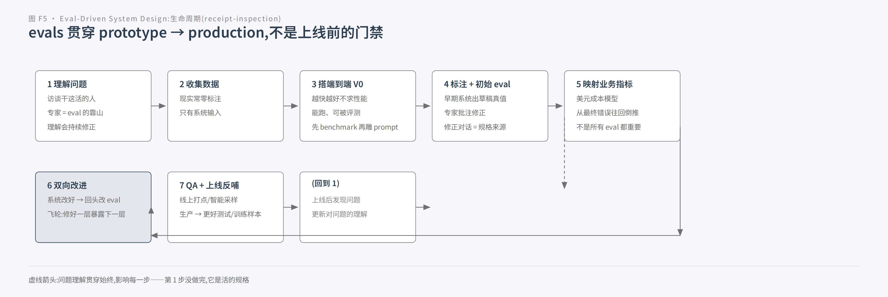

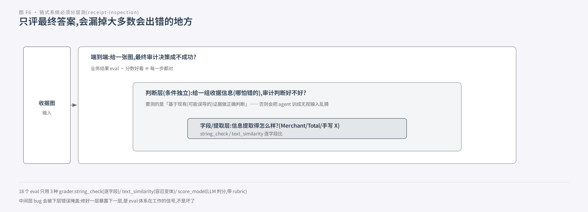

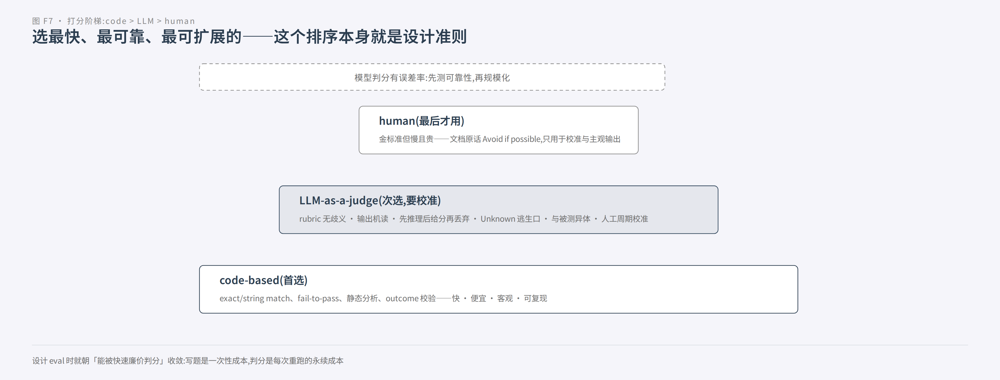

## 第 4 章 可观测层:线上真实漂移

第 3 章结束时我们停在一个关键句子上:"生产数据是演化 eval 数据集最真实的来源。"这一章就讲这句话怎么落地:**可观测层**,以及它怎么给 eval 持续供血,形成全书的闭环。

先看一组扎心的行业数据(LangChain 对 agent 工程的调研):

> **89% 的团队已经给 agent 埋了观测,但只有 52% 在跑 offline eval,37% 在跑 online eval。**

也就是说,绝大多数团队已经装了"摄像头",但摄像头拍下来的东西没有变成任何改进。观测本身不产生改进,**观测 × 评测闭环才产生改进**。这一章先讲清楚"为什么要这样观测",再讲"怎么把观测喂进 eval"。

### 4.1 为什么 agent 必须看一棵树,而不是一行日志

单次 LLM 调用是"一进一出":一个输入、一个输出,记一条日志就完了。**agent 不是。它是一棵决策树**。一次执行里,它会规划、调工具、看工具结果、再想、再调,可能跨多个轮次。Langfuse 用一个"考试"式的结构把这棵树讲清楚了,四个词,从大到小:

| 概念 | 白话:在 agent 调用链里对应什么 |
|---|---|
| **session** | 整段多轮对话(用户问 5 句、agent 答 5 次 = 1 个 session) |
| **trace** | **一个请求从进门到出门的完整一生**(处理"这个问题"的一次完整运行) |
| **span** | 内部一步动作:一次工具调用、一段检索、一个子 agent 流程(记自己的输入/输出/耗时) |
| **generation** | **真正打给模型的那一次请求**(含 prompt 全文、响应、token 计费)。agent 的一轮"思考" |

为什么必须保留这棵树?因为**不同质量问题挂在树的不同节点上,而它们几乎全部在最终答案文本里不可见**:

- 检索拿错了文档 → 挂在检索那个 span 上;
- 工具参数拼错、调用失败重试了三轮 → 挂在工具调用节点;
- 死循环反复调用同一个失败工具 → 挂在轨迹形状上;
- 最阴险的一种:**工具调错了但 agent 自己 recover 了**。最终答案完美无缺,谁看了都觉得没问题,**只有账单在流血**(重试烧掉的 token 和时间是你付的)。

还有一层用户体感:**用户感知的单位甚至不是 trace,是 session**。聊天机器人可以连续 5 轮单独看都合理,合起来没解决用户的问题。这是 session 级失败,单看任何一条 trace 都看不出来。第三轮的失败,可能肇始于第一轮引入的错误上下文。

对比一下传统 APM 为什么失灵,一句话点破:**代码定义 agent"允许"做什么,trace 记录它在某个输入、上下文、模型响应下"实际"做了什么**。传统服务代码路径有限、输入空间有界,固定信号集能解释大多数故障;agent 的自然语言输入让人几乎什么都能问,非确定模型对同一任务可走不同路径,上线前没人知道它会干什么。所以"平铺日志(每行一条 LLM 调用)"丢失了"谁调用了谁、先后因果"这一维,而这正是 agent 调试最需要的信息。

Monitoring 和 Observability 必须分开:monitoring 盯已知健康信号(延迟、错误率、token、成本),回答"系统活着吗";observability 保留轨迹,回答"**agent 干的事对吗**"。健康的延迟和错误率完全可以同时掩盖着:错误的工具调用、缺失的上下文、一个听起来对但实际错的答案。**monitoring 告诉你出事了,observability 告诉你它做错了什么。**

### 4.2 埋点什么:判据是"能否回答它为什么这么做"

既然要埋,埋多细?Langfuse 给了一个反直觉的判据:**不是越细越好,而是"能否回答'它为什么这么做'"**。三个实操约束:

1. **整次运行的摘要必须写在树根(root observation)上**。evaluator 判"任务完成没有"时,只看到它 target 的那个节点,看不到子节点。所以 root 上要有"输入 + 最终输出",judge 才有料可判。不写,judge 就是无米之炊。
2. **要被 judge/断言的数据,必须记在对应节点上**。检索到的文档、改写后的 query、工具返回。这些不记,线上 evaluator 无从判断 groundedness、工具选择对不对。
3. **先用框架自动埋点,缺什么补什么**。现代框架都有自动 patch(比如 OpenAI Agents SDK 一行 `instrument_openai_agents()`),框架自己知道内部结构,agent 的每一步(agent run → LLM 调用 → 工具调用)自动记录成嵌套 span。别上来就手写全链路埋点。那是最后的手段。

真实例子长这样(一个"查天气"的 agent 在 trace 视图里的样子):

```
trace: Agent workflow(整体)
  └─ span: Agent run '查柏林天气'
       ├─ generation: LLM 决定调工具
       ├─ span: Function: get_weather(工具执行)
       └─ generation: LLM 基于工具结果合成回答
```

精确看到时间花在哪一步、每个调用烧多少 token。这就是"还原决策过程"的实拍。

埋点还有两个工程细节:一是**无感是设计出来的**。SDK 本地排队、异步批量 flush,不增加用户延迟;代价是短生命周期程序(跑一次就退出的脚本/job)**必须显式 flush()**,否则 trace 随进程死亡一起丢。二是**隐私是旋钮,不是开关**。Anthropic 自己的原则是"监控决策模式与交互结构,不监控对话内容",Agent SDK 的遥测默认不导出 prompt 原文,逐级开关(用户 prompt → 工具入参 → 完整工具内容 → 全部 API body)按需打开,请求体默认截断 60KB。可观测 = 能见度 vs 隐私/成本的可调旋钮,不是"全录或全不录"。

### 4.3 心脏:观测喂 eval 的闭环回路

现在到了全章最关键的部分。可观测层存在的最终理由,是让下面这个五步回路转起来:

1. **观测层把每次 agent 执行记成 trace,并打上分数**(code check、LLM judge、用户 👎、报警);
2. **筛出失败/异常的 trace**;
3. **把它固化成 dataset item**:真实输入 + "修复后应满足的期望行为";
4. **在 dataset 上跑 experiment**:新版 vs 旧版(或新 prompt vs 旧 prompt)都跑一遍、打分、并排对比;
5. **修好就发布,失败案例永久留在 dataset 当回归测试**。下次任何改动,先过这一关。

这条回路成立有一个隐藏前提,值得单独强调:**生产 traces 和 experiment runs 必须共享同一数据模型、同一套 score**。"复现"就是把线上那次输入,在实验环境里用新版 agent 再跑一遍,分数并排对比。两套系统如果不通,这一步根本做不了。

为什么说"坏 trace 是最贵的 eval 素材"?因为它是**真实输入 + 真实上下文**。合成的测试数据造不出这种组合。你修一个线上事故,顺手就沉淀了一条新 eval case;每次修复 = 加一条哨兵。用 Langfuse 的比喻串起来:**trace 是原材料的矿,dataset 是精炼厂,judge 是质检员,CI 是出厂闸门,每一次生产事故都是往矿里补的一锹。** eval case 会随时间自己长大。不是你想长大,是生产在喂它。

这条回路有一个"先有鸡还是先有蛋"的实用答案,直接抄作业:**先埋点一个 agent,等第一条坏 trace 出现**。第一条坏 trace 天然给你"输入 + 状态 + 期望行为",那就是你的**第一个 dataset item + 第一个回归测试**。

### 4.4 线上评测三层法:code、judge、人,是层不是选项

在可观测层打分的具体做法,和第 3 章的 grader 工具箱同构,但强调"分层配合":

| 方法 | 成本 | 跑在哪 | agent 例子 |
|---|---|---|---|
| **Code evaluators** | 免费、毫秒级 | **每个采样 trace 都跑** | 必需工具调了没、参数过 schema、步数预算、输出是合法 JSON |
| **LLM-as-a-judge** | 有模型成本、秒级 | 语义要紧的**子集**(采样率控成本) | 无 ground truth 的任务完成、推理质量、groundedness |
| **Human annotation** | 专家时间 | judge 低置信度/争议案例 | 标注歧义轨迹、构建校准参照集 |

分工链条:**便宜的全量跑,贵的抽样子集跑,人只处理 judge 犹豫的**。而人的标签回流校准 judge,自动化层才不会越跑越偏。三个细节:

- **工具调用用结构化字段断言**(`tool_calls`: id/name/arguments),直接从解析好的 JSON 里查,别从模型文本里 parse。省掉一整类脆弱性;
- **judge 要喂对料**:任务完成的 judge prompt 只收 root 的 input + output(实验时加上 expected output 当 reference),别把整棵树的中间步骤塞给它。塞多了反而误导;
- **judge 需要被人工校准**:用 annotation queue 让领域专家标一批,回头调 judge prompt / 换 judge model,并定期复查 judge 分数与人工标签的吻合度。

四维独立失败,所以分数要**分维看**:trajectory(路径合理吗:步数、多余调用、循环)、tool use(工具选对没、参数合法没)、task completion(用户目标达成没)、multi-turn(跨轮质量保持没)。一个总分只告诉你"变差了",分维分数告诉你"**哪里**变差了"。RAG agent 尤其典型:检索决策(该搜没搜→code check)→ 查询改写 → context relevance → faithfulness → task completion,**每个指标挂在对应节点**。faithfulness 低但 context 相关 = 生成侧问题,改回答 prompt;context 不相关但 query 合理 = 检索侧问题,改 index/embedding。per-step 分数直接决定你该改哪一行。

### 4.5 生产里盯什么信号:五层仪表盘

可观测层最后要回答:**线上"变坏"长什么样?** 答案是分层的,每层有自己的信号:

1. **成本/延迟曲线**:单位任务 token/步数上升、step budget 频繁超限、retry 循环增多。"agent 变慢变贵"从 anecdote 变成 dashboard line。触发源常常不是你:工具行为变了、或 prompt 诱导它绕路;
2. **工具层**:tool error rate 上升、参数校验失败增多、必需工具漏调。那个"免费 boolean code check"每个采样 trace 都跑,是**最便宜的报警器**;
3. **质量层**:online judge 的 score 趋势下滑、用户 👎 聚集、新增的 failure-mode 聚类;
4. **输入分布**:online eval 抓 offline 抓不到的**漂移和没见过的输入**。healthy latency/error 之下完全可以藏着错工具调用、漏检索、听起来对但错的答案;
5. **session 层**:resolution 率下降、turns-to-resolution 变长。

关于 judge 的成本,工程界有个共识:全量 LLM-judge 会让推理成本翻倍,**标准做法是采样 5–10%**、部署/换模型时评 100%;告警**盯趋势斜率不盯单点**。0.85 → 0.72 的连续下滑,比一个孤立的 0.78 更该报警。

第 2 章的确定性测试、第 3 章的 eval、这一章的观测+闭环,三层到此齐了。但还有一个问题没答:**把修好的东西送上线,怎么保证不把线上搞坏?** 概率系统的劣化不产生任何工程信号。HTTP 200、零报错,只是答案在胡说。所以"上线"这个动作本身需要专门的纪律。这是第 5 章。

*本章来源:*
- Langfuse《Observability Overview》/《Data Model》https://langfuse.com/docs/observability/overview 、https://langfuse.com/docs/observability/data-model
- Langfuse《Evaluation Overview》https://langfuse.com/docs/evaluation/overview
- Langfuse Engineering《AI Agent Evaluation》https://langfuse.com/resources/engineering/ai-agent-evaluation
- OpenAI Cookbook《Evaluating Agents with Langfuse》https://developers.openai.com/cookbook/examples/agents_sdk/evaluate_agents
- LangChain《LLM Monitoring & Observability》https://www.langchain.com/resources/llm-monitoring-observability
- Claude Agent SDK《Observability with OpenTelemetry》https://code.claude.com/docs/en/agent-sdk/observability

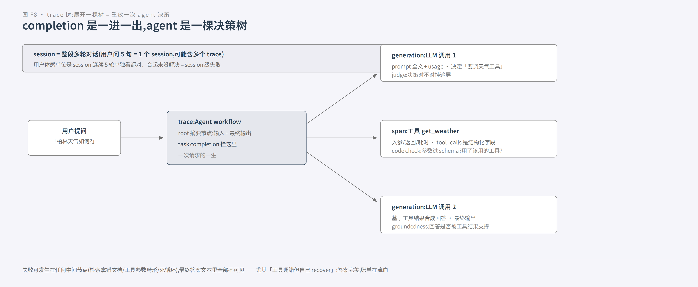

*图 F8:一次 agent 执行是嵌套的 trace 树。root 记输入与最终输出,子节点是每次 LLM 调用与工具执行;失败常藏在中间节点,最终答案文本里看不见。*

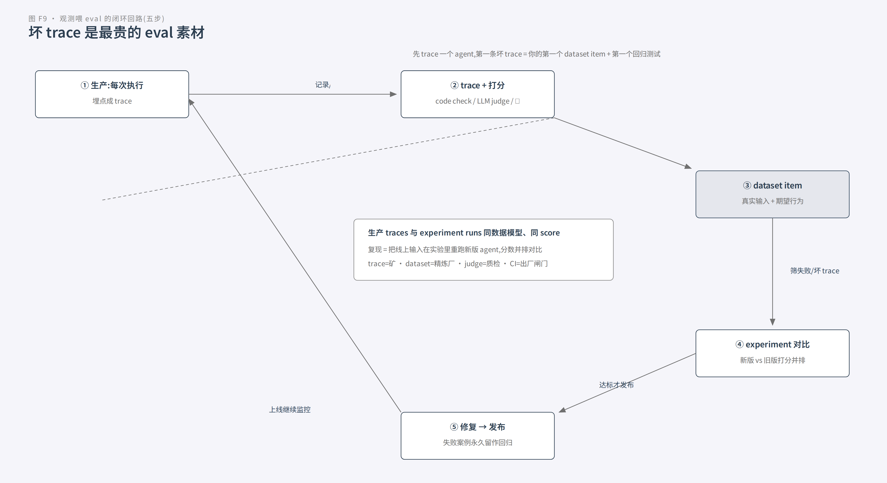

*图 F9:观测喂 eval 的五步闭环。生产 trace 打分层后筛出失败,固化成 dataset item,离线实验让新旧版本并排打分,修复后坏案例永久留作回归测试。*

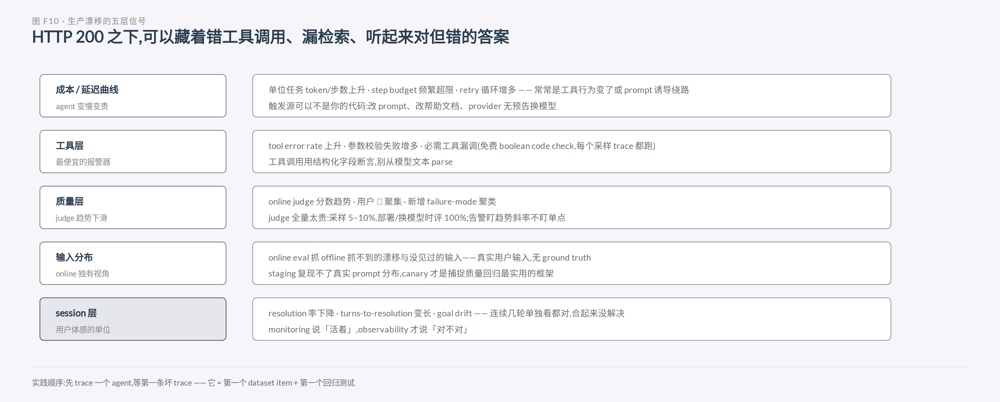

*图 F10:线上漂移分五层信号。成本曲线、工具错误率、judge 趋势、输入分布、session 分辨率;monitoring 说活着,observability 才说对不对。*

## 第 5 章 把改动安全送上线:灰度发布

前四章讲的是"改动之前怎么把关"(测试、eval)和"上线之后怎么发现"(观测)。但中间还有一个动作,传统软件工程有成熟答案、概率系统却要重想:**发布**。

先立一个直觉:**部署 ≠ 发布**。代码可以先躺进生产环境但默认"关"着(feature flag),功能再按百分比逐步"打开"。为什么概率系统特别需要这套?因为普通软件"坏了"是有工程信号的。错误率上升、延迟飙升、进程崩溃;而 **AI 模型可以技术指标完美。零报错、延迟更低。但推理质量悄悄变差、语气跑偏、幻觉变多**。MLflow 那句原话再放一遍,因为它值得被背下来:

> "A response can be grammatically correct, factually wrong, and still return HTTP 200."(一个回答可以语法正确、事实上错误,照样返回 HTTP 200。)

更糟的是,劣化的触发源可以完全不在你的代码里:改了一版帮助文档、换了 prompt、**甚至模型供应商无预告地在后台换了模型**。所以 staging 环境永远无法复现真实用户的 prompt 分布:**canary 是捕捉质量回归最实用的框架**。

### 5.1 三段式:shadow → canary → 全量

行业标准流程(Qwak、Flagsmith、MLflow 三家说法一致)分三个阶段,每个阶段解决不同问题:

**Shadow(影子部署)**:新版本上线,但**预测结果完全不被使用**,只有团队自己看。做法是复制 100% 生产流量,同时发给线上模型和影子模型,两边都记录。关键实操:两个模型各打一个 correlation id,才能把同一请求的两份输出配对。影子阶段回答三个问题:在真实流量下它表现如何?延迟扛不扛得住?(预测再准、太慢也没用)以及**配置对不对**。shadow 阶段的输出不进用户视野,错了也无害,是"让模型先干活但不发工资"的试岗期。

**Canary(金丝雀)**:新版本开始服务一小部分真实用户,慢慢加量。经典节奏 1% → 20% → 50% → 100%,**每一步都有 soak time**(观察期),soak 够了才放量,失败就回滚。canary 在 AI 场景的三个特化,务必记住:

1. **质量信号和基建信号双看**。不能只看错误率和延迟。MLflow 给了示例阈值:错误率 +1pp、P99 延迟 +20%、自动 eval 分数 -5%、coherence 分掉 >0.1、**任何 toxicity 上升都立即回滚**。原则是"先定阈值再上线",阈值本身按业务调;
2. **sticky routing(粘性路由)**。对话类 agent 必须按 user/session ID 确定性 hash 钉住版本,否则用户聊天中途可能上一轮在 stable、下一轮被切到 canary,**上下文错乱**。这是 agent 场景独有的坑;
3. **soak 更长**。web 服务 10 分钟能判断的阶段,LLM agent 可能要 **2 小时**:质量指标(幻觉率/coherence)计算贵且噪声大,需要攒够统计显著的评分样本。MLflow 给的参考表:1% ≥10 分钟只查基建 → 5% 追加自动质量指标 → 25-50% 深度质量检查 → 100% 人工评分抽样。所有指标**对并行的 baseline 比、别对历史均值比**(下午 2 点的 canary 跟上午 9 点的 baseline 比,流量形态不同会引入混淆变量)。阶段边界自动判断:过阈值自动推进、挂阈值自动回滚:**不需要人按按钮**,50% 全量前保留一次人工复核。

**全量(Production)**:100% 切到新版本后,**旧版本至少保留几天**用于随时回滚(Qwak:"如果你前面分析得够好,这个需求永远用不上")。随后清理退役版本,别让它一直跑着占资源。

**Feature flag / kill switch**:所有发布策略共享的两样东西:**秒级 kill switch**(出事翻开关即回滚,不用重新部署)和分阶段放量控制。Flagsmith 的心智模型:**代码默认"关"着部署,再按用户段(内部员工 → beta → 全员)逐步"打开"**。没有它,canary 出问题只能等团队重新跑一条发布流水线。CrowdStrike 式的全量发布事故就是"没留开关"的反面教材。

**Rainbow deployment(彩虹部署)**:agent 长任务场景的第四种特化,来自 Anthropic 的生产实践。agent 系统是"prompts + 工具 + 执行逻辑的高状态网络,几乎一直在跑",更新时**每个 agent 可能处于执行中任意位置**。不可能一刀切全部换新版本(那会打断正在跑的 research)。做法:**新老版本同时在线,流量从旧到新渐变**,让已经跑了大半任务的实例在新版本上完成,而不是从 checkpoint 重启。它的哲学和 5.2 的"修好一层暴露下一层"一致:**agent 是有状态的,错误会复合,别让它从头再来**。

### 5.2 evals-as-code:promptfoo 和 CI 里的 eval 闸门

灰度管"流量怎么过去",但放量之前,改动最好先在 PR 阶段就被拦一道。这里引出 eval 工具的主流答案:**promptfoo 把 eval 从"平台功能"变成了"代码的一部分"**。

它的崛起有四个证据:① **evals-as-code**。声明式 YAML + CLI,和业务代码同仓、同 review、同 CI;② **为 CI 而生**。GitHub Action 一条 yaml 接入,PR 改 prompt 自动跑"改动前 vs 改动后"对比 eval,结果直接贴回 PR 评论(**eval 结果要出现在工程师本来就在看的地方,而不是另一个 dashboard**);缓存(按 prompt 文件 hash)对冲 API 成本,JUnit/XML 输出接任意 CI,pass rate 低于阈值就 fail 流水线;③ 统一质量与安全(eval + red teaming 一个工具链);④ 生态位认证:**OpenAI 官方宣布停用自研 Evals 产品,推荐用户迁移到 promptfoo(并收购了它)**,Anthropic 也在用。

工具之争的本质是工作流之争:**eval 归平台管(dashboard 托管、服务端闭环)vs eval 归代码管(配置文件跟代码走、本地/CI 随处跑)。后者赢了。** 迁移时有个诚实警告值得记住:**手工重建的 grader,尤其 LLM-as-judge,必须先本地验证再用于回归决策**。防止"迁移后 eval 变绿其实是 judge 悄悄变松"的假回归。

至此三层 + 发布全部讲完。第 6 章把它们咬合成一个整体。

*本章来源:*
- Qwak《Shadow deployment vs. canary release of ML models》https://www.qwak.com/post/shadow-deployment-vs-canary-release-of-machine-learning-models
- Flagsmith《8 Types of Deployment Strategies》https://www.flagsmith.com/blog/deployment-strategies
- MLflow《Canary Deployment for AI Models》https://mlflow.org/articles/what-is-canary-deployment-ai/
- promptfoo https://github.com/promptfoo/promptfoo 、https://www.promptfoo.dev/docs/integrations/ci-cd 、https://www.promptfoo.dev/docs/integrations/github-action
- OpenAI Cookbook《Moving from OpenAI Evals to Promptfoo》https://developers.openai.com/cookbook/examples/evaluation/moving-from-openai-evals-to-promptfoo
- Anthropic《How we built our multi-agent research system》https://www.anthropic.com/engineering/multi-agent-research-system

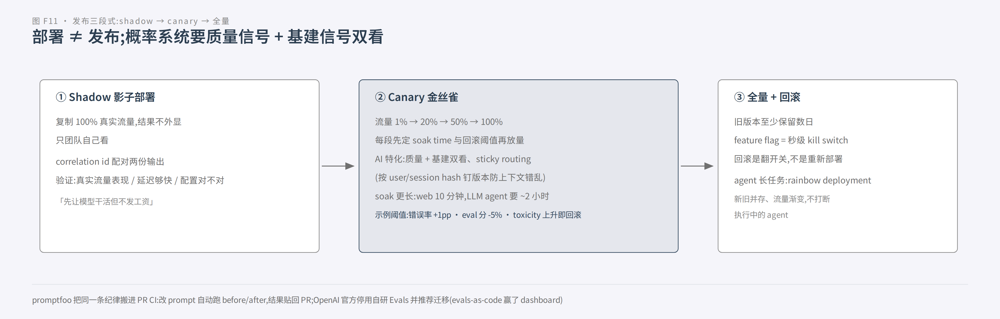

---

## 第 6 章 三层咬合:一个完整的工程回路

分开讲了三层,现在退后一步看全景。先回到引言的瑞士奶酪模型。每一层都有洞,靠层与层互相补:

| 层 | 它的洞(短板) | 谁补 |
|---|---|---|
| **离线 eval** | 只测你想到的题,可能给**虚假信心**(没见过线上真实分布) | 线上监控纠正 |
| **生产监控** | 给 ground truth 但**无打分基准**(只知道坏了,不知道多坏/坏在哪) | eval 与人工校准补齐 |
| **A/B testing** | 慢(数天到数周)、要流量、只测已部署改动、难解释 why | 只在重大改动时用 |
| **用户反馈** | 稀疏、自选择、偏严重问题、**从不解释 why** | 人工读 transcript 建立直觉 |
| **人工读 transcript** | 耗时、不可扩展、覆盖不一致 | 每周抽样读,校准一切 |

Anthropic 的原话:"最有效的团队把这些方法组合起来用:**automated evals 负责快速迭代,production monitoring 提供 ground truth,周期性的人工审阅负责校准。**"而 eval 的价值是**复利**的:一旦存在,baseline、回归测试、成本/延迟/错误率跟踪全部免费获得。

### 6.1 行业实证:闭环做成了产品的 Intercom

Intercom 把客服 agent Fin 的这套流程产品化,让**没有工程师的客服运营团队**也能对 Fin 做"改前测试 → 受控放量 → 线上持续评估"。它的四段飞轮,是三层职责的完整答案:

**Eval(模拟对话)→ Release(隔离舱打包)→ A/B(放量对比业务指标)→ Monitors(盯每条线上对话,标红的转成明天的 test case)→ 回到 Eval。**

细节都值得抄:Simulation 是多轮模拟对话(三个 actor),可从**真实历史会话**生成。把生产案例变成测试资产;跑一个 Eval = 每条 Simulation 出 pass/fail,确定性检查 + LLM judge 混合,**任一标准不过即失败**(all-pass 才算过,和传统测试一致);发布用隔离区、不碰线上,改→跑→看失败→再改;放量一半发现不对就 pause,修完重跑 Eval 确认再继续,要完全撤销就一步 roll back。

为什么需要这么重?两个原因:Fin 是概率系统 + 用户表达无限多样 + 团队持续改内容(发新品/改政策/重写 help article)→ **drift**。"改一件事可能悄悄影响另一件事"。规模感很扎心:

> "At the scale some of our customers run Fin, a 1% regression could affect thousands of conversations a day."(在我们客户的规模上,1% 的回归 = 每天几千条对话受影响。)

以及 AutoDS 用户 Hila 的证词:"Before Evals, a guidance or content change was the one thing we couldn't auto-test… we'd ship it and watch production. Now we prove it before it goes live."(以前内容改动没法自动测,我们只能**发了再看生产**;现在我们上线前就证明它。)

### 6.2 生产实证:Anthropic 多 agent 系统的三层咬合

Anthropic 的 Claude Research(多 agent 研究系统)是三层在同一系统里咬合的最好样本。它的 eval 从 ~20 条真实 query 起步(prompt 一改,成功率 30%→80%,效应量巨大),LLM-as-judge 单次调用输出 0.0–1.0 分最稳;人工测试发现早期 agent 总选 SEO 内容农场而非权威但低排名的学术 PDF,于是加 source quality 启发式:**即便有自动化,手工测试仍必要**。上线后做 full production tracing 定位"用户报找不到信息但看不到原因",并刻意**监控决策模式与交互结构、不监控对话内容**以保隐私;发布用 rainbow deployment 避免打断执行中的 agent。

几个数字足够震撼:多 agent vs 单 agent 内部 eval **高 90.2%**;agent 用量约 chat 的 **4× tokens**,多 agent 约 **15×**(所以只在任务价值够高的场景经济可行);token 用量一项解释 BrowseComp 表现方差的 **80%**。这些数字都是靠 eval + tracing 测出来的,没有它们,"多 agent 更好"永远只是感觉。

### 6.3 开放问题:自进化系统的 eval 悖论

最后留一个问题给思考,它是这个领域真正的边界。

Anthropic 的工程实践里有个有趣的细节:他们造了一个"tool-testing agent"。给定一个有缺陷的 MCP 工具,反复试用并**重写它的 description**,让后续 agent 不再踩坑,结果后续任务完成时间下降 40%。Claude 4 系还能诊断自己 prompt 的失败原因。也就是说:**改进对象从 prompt 延伸到了工具元数据,agent 开始参与改进自己**。

那么问题来了:当系统学会自我改写 prompt、工具描述,甚至改写 eval 自身时。

- **基线在漂移**:你今天测出来的分数,明天被测对象自己变了,分数还有意义吗?
- **eval 套件必须跟着进化**(第 1 章 roadmap 的 Step 8 就是持续维护 + 防 eval 漂移);
- 以及那个递归的、现在还没有答案的问题:**谁来 eval 那个改 eval 的 agent?**

这正是这个领域"最后一英里"的样子。工具会换代(OpenAI Evals 关停、promptfoo 接棒)、框架会换代,但"分层设防 + 闭环回灌"的方法论不换。Anthropic 对原型到生产的鸿沟有一句总结,放在全书结尾正合适:

> "The last mile often becomes most of the journey… the gap between prototype and production is often wider than anticipated."(最后一英里往往占了旅程的大半……原型与生产之间的鸿沟,常常比预想的更宽。)

*本章来源:*
- Intercom《Announcing Evals and Releases for Fin》https://www.intercom.com/blog/announcing-evals-and-releases
- Anthropic《How we built our multi-agent research system》https://www.anthropic.com/engineering/multi-agent-research-system
- Anthropic《Demystifying evals for AI agents》https://www.anthropic.com/engineering/demystifying-evals-for-ai-agents

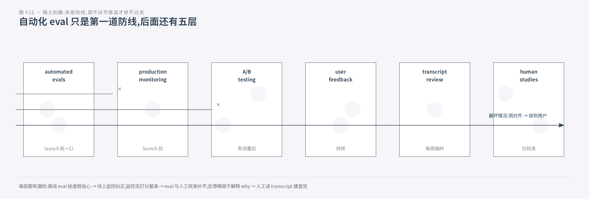

*图 F12:瑞士奶酪多层防线。六层防线各自有洞(漏检),自动化 eval 挡得住大多数问题,但最坏情况下错误穿过全部洞到达用户,所以需要逐层补位。*

---

## 第 7 章 落地路线图:按成本逻辑排序

道理都讲完了,如果你明天要给自己团队的 agent 搭这套体系,从哪开始?答案是**按成本排序:先秒级免费的,再分钟级有价的,最后全量/抽样持续的**。每一层只负责它最擅长的信号,不越级。

**第一周:确定性底座跑在 PR CI 上。** mock LLM 的单元测试 + 工具调用序列断言(retry、max turn、tool schema、解析/路由)。这是 100% 确定性的地基。flaky 即 bug,是最干净、回报最快的投入。

**接着:建 ~20 条黄金用例的离线 eval。** 从 bug tracker / support queue / 你手动测过的东西里挖真实失败,配 reference solution,均衡正负例。发布/升级 prompt 时手动或定时跑。别等凑齐几百条。

**然后:接观测,并建立回灌机制。** 至少让 trace id 贯穿每个请求。任何用户投诉都能一键还原完整轨迹。等第一条坏 trace 出现,它就是你的第一个 dataset item + 第一个回归测试。从"线上失败 → eval case"的回灌开始,让 eval case 自己长大。

**在你第一次动线上 prompt/模型的那一天之前:配好灰度开关和 canary 阈值。** 先定回滚阈值再上线,质量信号 + 基建信号双看,sticky routing 钉版本。

一句话收束全书:

> 单元/集成测试回答"我们写对了软件吗"(秒级,CI);evals 回答"模型在这个变更下还可靠吗"(分钟级,有成本,离线先验);观测 + 灰度回答"线上真实分布里它还好吗、坏了怎么快速缩回来"(持续,在线真值):**三层各守各的时延与成本,缺一层,概率系统就会在你最不注意的地方悄悄坏掉。**

---

## 附录

### A. 术语表

- **task / trial / grader / transcript / outcome / harness / suite**:第 1 章已详述(考试比喻全家桶)。
- **capability eval vs regression eval**:要爬的山 vs 不许忘的事;capability 高分毕业转正进 regression suite。
- **pass@k vs pass^k**:k 次至少一次成功 vs k 次全部成功;由产品需求决定。
- **outcome ≠ transcript**:说得对 ≠ 做成了;状态变更类 agent 判终态(end-state)或离散检查点。
- **harness + model**:评估对象是"脚手架 + 模型"的组合,换 scaffold = 换被测对象。
- **eval 饱和**:套件全过 = 只剩防守价值,会掩盖大进步,要持续注入新题。
- **judge / LLM-as-a-judge**:阅卷人;要校准的仪器,不是可信的钟。
- **trace / span / generation / session**:一次请求的一生 / 内部一步 / 一次模型调用 / 整段对话(第 4 章)。
- **shadow / canary / rainbow deployment**:镜像流量 / 小比例放量 / 新旧并存渐变。
- **Swiss cheese 模型**:多层防线各有个洞,洞不对齐,错误穿不过去。
- **evals-as-code**:eval 配置文件跟代码走,本地/CI 随处跑(promptfoo 范式)。

### B. 工具生态对照(2026-09 时点,工具会换代,方法不换)

| 工具 | 定位 | 关键特征 |
|---|---|---|
| **promptfoo** | CI eval(主流) | evals-as-code、PR before/after、red teaming;OpenAI 官方推荐迁移方向 |
| **Langfuse** | 可观测 + eval 闭环(开源自托管) | trace→dataset→experiment→judge,online/offline 双轨 |
| **LangSmith** | tracing + 离线/在线 eval | run/trace/thread 三原语(LangChain 系) |
| **Braintrust** | 离线 eval + 生产可观测 + 实验跟踪 | enterprise 向 |
| **Arize Phoenix / AX** | 开源 tracing + eval | OTel 原生 |
| **Harbor** | 容器化 eval 大规模跑分 | trial 级隔离 |
| **OpenAI Evals** | 已停用(2026) | 官方建议迁移 promptfoo。"工具会换代"的活教材 |

各家词汇桥接:Langfuse observation/span ≈ LangSmith run ≈ OTel span;Langfuse trace ≈ LangSmith trace;Langfuse session ≈ LangSmith thread。

### C. 全部来源(29+ URL,调研笔记 sources-{a,b,c,d}.md 有逐条精读)

*Anthropic 系:*demystifying-evals-for-ai-agents;multi-agent-research-system;platform.claude.com develop-tests;platform.claude.com cookbook building-evals;code.claude.com agent-sdk/observability
*OpenAI 系:*cookbook topic/evals;getting_started_with_openai_evals;eval_driven_system_design/receipt_inspection;agents_sdk/evaluate_agents;macro_evals_for_agentic_systems;agent_improvement_loop;moving-from-openai-evals-to-promptfoo
*可观测系:*langfuse observability/overview、data-model、evaluation/overview、ai-agent-evaluation;langchain llm-monitoring-observability
*测试/灰度/案例系:*qwak shadow-vs-canary;flagsmith deployment-strategies;mlflow canary-deployment-ai;promptfoo repo/ci-cd/github-action;intercom evals-and-releases;engineering.block.xyz testing-pyramid-for-ai-agents
*(完整 URL 列表见各 sources 文件头部与文末)*