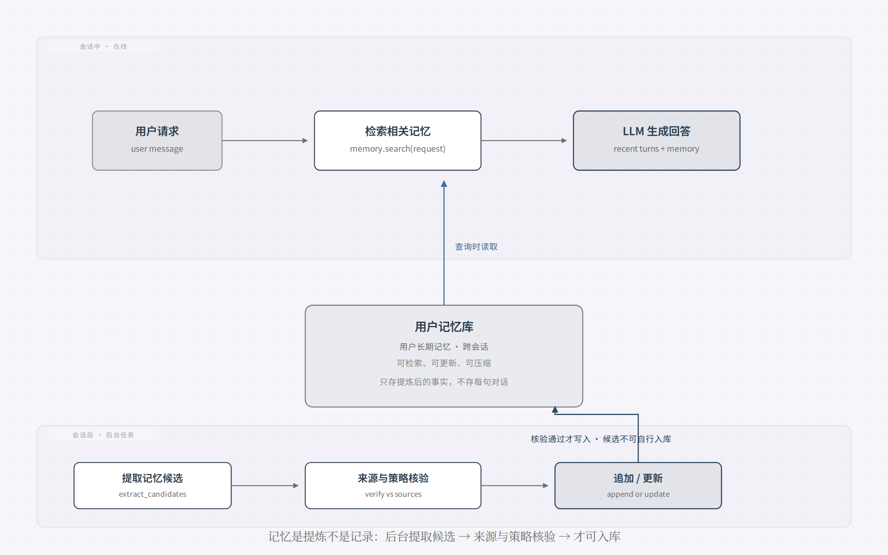
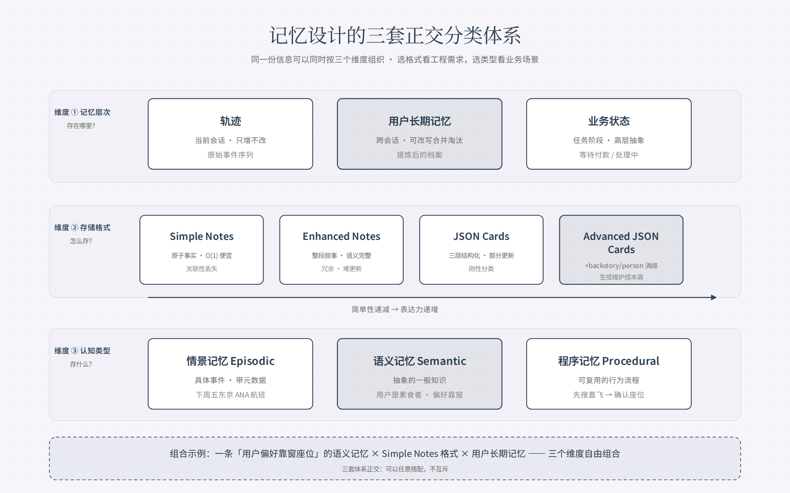
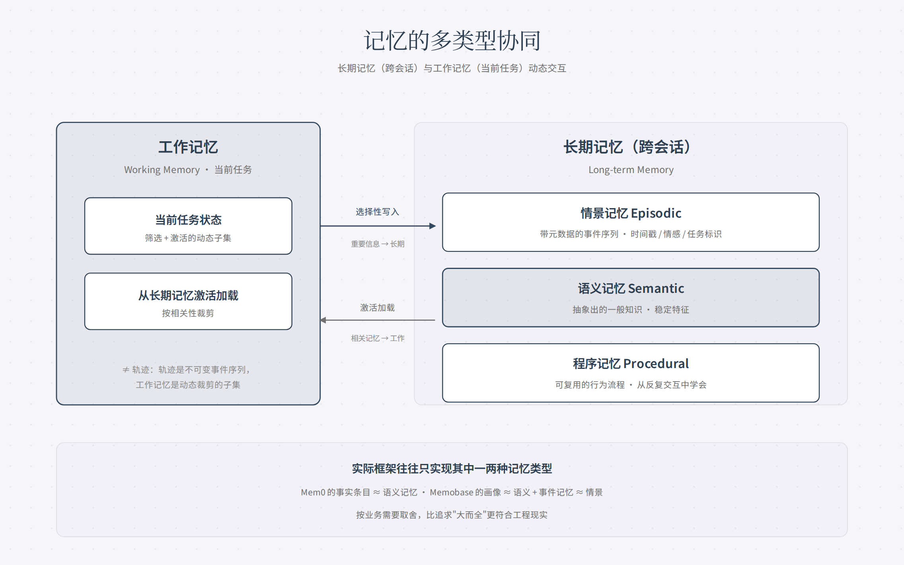
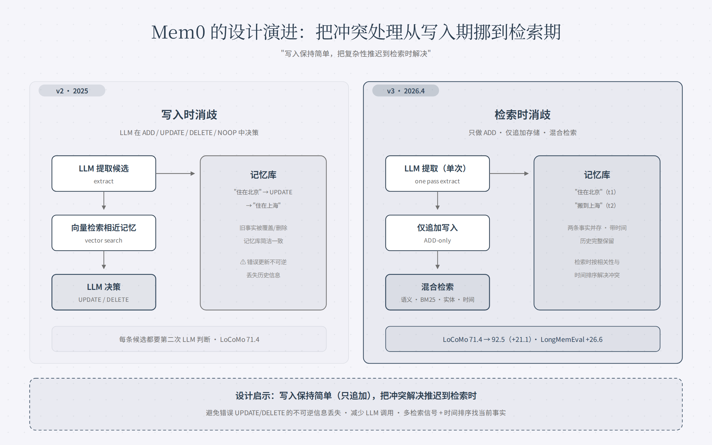
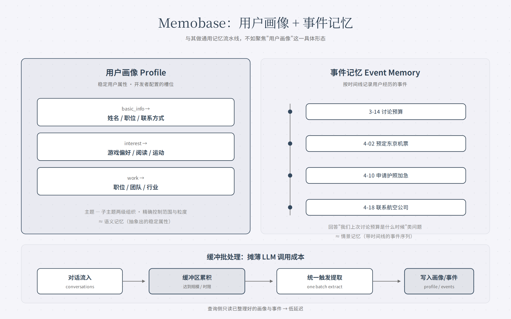
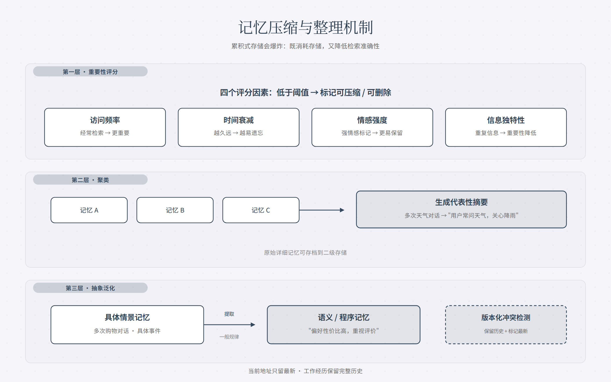

# 深入理解 AI Agent（五）：用户记忆系统

> 资料源：李博杰《深入理解 AI Agent：设计原理与工程实践》第3章（3.1 节）
> 开源仓库：https://github.com/bojieli/ai-agent-book （v1.4，2026-08-13）

## 一句话主线

第2章解决"单次任务内的上下文管理"，第3章处理更难的问题：**如何让 Agent 在对话结束后仍然记住用户、记住知识**。

这一篇（五）聚焦**用户记忆**——面向个人的持久化知识。核心问题：怎么评估记忆好不好、存在哪里、用什么格式、怎么更新。书给出了三套正交的分类体系 + 一个完整生命周期。

## 记忆生命周期：提取 → 验证 → 更新

用户记忆不保存每句对话，而是用额外的 LLM 调用**提取、压缩并审查**对未来有用的事实。

以订机票对话为例：用户说"帮我订下周五去东京的航班，我喜欢靠窗座位，我是素食者，需要特殊餐食"，Agent 回答后，框架调用专门的 LLM 分析对话，提取出值得长期记住的信息（偏好靠窗座位、素食、常旅客号、东京行程）。

生命周期伪代码（注意：提取器可以提出候选，但**不能自行把未核验的字符串当成事实**）：

```python
when answering(user_request):
    recent_turns = conversation.tail()
    relevant_memory = memory.search(user_request)
    answer = LLM(recent_turns + relevant_memory)

after conversation (background job):
    candidates = extract_memory_candidates(conversation)
    verified = verify_against_sources_and_policy(candidates, conversation)
    memory.append_or_update(verified)
```



提取结果要满足三条规则：**选择性**（丢弃"搜索返回 3 个选项"这类短期细节）、**抽象化**（把本次"靠窗座位"归纳为长期偏好）、**结构化**（用可检索的字段保存事实）。

## 三层次评估框架：什么样的记忆系统算"好"

动手设计前先立评估标准。书综合 LoCoMo 等公开基准与商业实践，提出递进的三层次：

1. **第一层·基础回忆**：准确存储和检索用户直接提供的、结构化无歧义信息（"我的会员号是 12345"）。记忆系统最基本的可靠性
2. **第二层·多会话检索**：面对来自多个对象、不同时期的会话，能检索出所有相关信息并推理判断。用户有两辆车时问"为我的车预约保养"，系统要找出全部两辆车的信息并主动询问是哪辆，而不是猜
3. **第三层·主动服务**（"助理"级别的试金石）：综合跨越很久的会话信息，提供预见性的主动帮助——订国际航班时主动关联数月前存的护照信息、发现即将过期并预警。要求系统在没有明确指令的情况下主动规避问题、整合复杂信息

## 记忆层次：放哪里

记忆分三个层次：

- **轨迹（Trajectory）**：单次会话的完整原始记录，按时间追加、只增不改——"流水账"。为决策提供即时上下文
- **用户长期记忆**：跨会话提炼的稳定信息，会被反复改写、合并、淘汰——"档案"。通过特定工具显式读取和更新
- **业务状态**：开发者定义的高层状态抽象（"需要澄清"/"处理请求中"/"等待付款"），事件驱动架构中尤为重要

## 三套分类体系：不要混为一谈

书特意用一张表厘清三套容易混淆的分类：

| 分类体系 | 回答的问题 | 具体类别 |
|---|---|---|
| 记忆层次 | 存在哪里？ | 轨迹（当前会话）、用户长期记忆（跨会话）、业务状态（任务阶段） |
| 存储格式 | 怎么存？ | Simple Notes、Enhanced Notes、JSON Cards、Advanced JSON Cards |
| 认知类型 | 存什么？ | 情景记忆（具体事件）、语义记忆（一般知识）、程序记忆（行为流程） |

三套体系是**正交**的，可以自由组合：一条"用户偏好靠窗座位"的语义记忆，可以用 Simple Notes 格式存在用户长期记忆里。选格式取决于工程需求（简单性 vs 表达力），选类型取决于业务场景（事实/事件/流程）。



## 四种存储格式：简单性递减，表达力递增

**Simple Notes（极简）**：每条记忆是最小不可再分的事实（"用户邮箱：john@example.com"）。O(1) 开销极低，但信息关联性完全丢失——"在 TechCorp 担任高级工程师负责推荐系统"被拆成三个独立事实，同一份工作的内在联系被割裂。

**Enhanced Notes（整体论）**：每条记忆保存包含完整上下文的段落（"用户在 TechCorp 担任高级软件工程师，专注于机器学习已有三年…"）。语义完整、保留叙事结构；代价是存储冗余（相同信息多处重复）、更新复杂（属性变化需重写多个段落）。

**JSON Cards（三层结构化）**：类别 → 子类别 → 键值对（personal.contact.email）。支持部分更新（改 work.position.title 不影响 work.company.name），可预测可扩展。但刚性结构假设信息可清晰分类——"周末用 Python 开发个人项目"同时涉及时间/技术/活动类型，强制归单一类别丢失多维性。

**Advanced JSON Cards（知识管理范式）**：每个卡片不仅记录事实，还加入**backstory**（信息来源的叙事背景）、**person**（主体身份）、**relationship**（与用户的关系）和时间戳。解决现实中的**消歧**问题：用户有多位"张医生"（牙医 vs 心脏科医生），脱离情境无法区分。代价是生成和维护成本高。

实践选择标准：关键且少量的数据（用户偏好、关键人物关系）用 Advanced JSON Cards；大量非关键的对话事实用 Simple Notes 降成本；**多数生产系统采用混合模式**。

### 进阶形态：可执行代码（User as Code）

四种格式本质都是文本——擅长召回单条事实，却把聚合、冲突发现、约束执行交给 LLM"心算"。User as Code 把用户状态改成**带类型的可执行对象**，规则写成普通函数，让"表示"和"推理"用同一种可验证介质。借鉴"预写日志 + 检查点"：会话后事实追加到只增日志，周期性从完整日志重建带类型状态。

带类型状态把原本需要 LLM"读一遍再心算"的操作交给确定性函数：

```python
count(trip for trip in state.trips
      if trip.is_international and year(trip.departure_date) == 2025)
# => 2

def check_drug_allergy(profile):          # 冲突发现：用药 vs 过敏史交叉比对
    for medication in profile.current_medications:
        for allergy in profile.allergies:
            if medication.drug_class == allergy.drug_class:
                emit_conflict(medication, allergy)
```

## 认知科学基础：情景、语义、程序记忆

人类记忆分工作记忆和长期记忆。工作记忆对应 Agent 的上下文窗口（轨迹是核心内容）；长期记忆分三种：

- **情景记忆（Episodic）**：具体事件和经历。"上周三和同事在那家意大利餐厅吃了顿很棒的晚餐" ↔ Agent 记录"用户订了下周五去东京的 ANA 航班"
- **语义记忆（Semantic）**：从具体事件抽象出的一般知识。"意大利的首都是罗马" ↔ "用户是素食者"——从多次交互提炼的稳定特征
- **程序记忆（Procedural）**：行为模式和流程。"骑自行车的能力" ↔ "先搜直飞航班 → 确认座位偏好 → 用常旅客号 → 订餐"



多类型记忆协同的参考架构：长期记忆（情景/语义/程序）+ 工作记忆，动态交互——重要信息选择性写入长期记忆，相关记忆按需激活加载。注意**工作记忆 ≠ 轨迹**：轨迹是不可变的完整事件序列（按时间追加），工作记忆是经过筛选和激活的动态子集（按相关性裁剪）。

## 记忆框架案例：两种设计哲学

**Mem0：从"写入时消歧"到"检索时推理"**——一个很有启发性的演进：

- **v2（2025 论文）**：对话结束后 LLM 抽取候选事实 → 向量检索相近已有记忆 → LLM 在 ADD/UPDATE/DELETE/NOOP 中决策。用户先说"住北京"后说"搬到上海"，系统把前一条 UPDATE 掉，**写入时消除冲突**。优势：记忆库始终简洁一致；风险：一次错误更新/删除**不可逆丢失历史**，且每条候选都要第二次 LLM 判断
- **v3（2026.4）**：只做 ADD（仅追加写入），"住北京"和"搬到上海"作为带时间信息的两条事实**并存**。查询时融合语义相似度 + BM25 关键词 + 实体匹配 + 时间排序。**让相关性在检索时解决冲突**。LoCoMo 从 71.4 → 92.5（+21.1），LongMemEval 67.8 → 94.4（+26.6）



这个演进呼应第2章的哲学：**写入保持简单（只追加），把复杂性推迟到检索时解决**——避免不可逆的信息丢失。

**Memobase：用户画像 + 事件记忆**——聚焦"用户画像"这一具体形态：Profile（开发者配置的槽位，主题-子主题两级组织，精确控制范围和粒度）+ Event Memory（按时间线记录事件，回答"我们上次讨论预算是什么时候"）。缓冲批处理：对话先在缓冲区累积，达到规模/时限再统一触发提取，摊薄 LLM 调用成本。



## 记忆压缩与整理

累积式存储会导致记忆爆炸。三层压缩：

1. **重要性评分筛选**：综合四因素——访问频率（越常检索越重要）、时间衰减（越久远越易忘）、情感强度、信息独特性（重复信息重要性降低）
2. **聚类**：相似记忆分组，每组生成代表性摘要（多次天气对话 → "用户经常询问天气，特别关心降雨"），原始细节存档二级存储
3. **抽象泛化**：从具体情景记忆提取一般性规律，转化为语义/程序记忆（多次购物对话 → "偏好性价比高的产品"）

冲突检测用**版本化方法**：保留历史版本同时标记最新版本。某些信息（当前地址）只留最新，其他（工作经历）保留完整历史。



边界澄清：本节是记忆存储层的整理算法；第2章的上下文压缩是单次会话内窗口问题；第8章把"在线追加证据、离线集中整理"推广到 Agent 行为进化。

## 隐私保护：日志脱敏

核心挑战：让 Agent 利用用户信息提供个性化服务，又不让敏感数据暴露在 LLM 上下文和系统日志中。实验 3-3 用**本地** Qwen3 0.6B 小模型做 PII 检测脱敏——选择本地部署而非云端 API 的原因很明确：日志本身可能包含敏感信息，发送到云端脱敏就违背了隐私保护初衷。相比正则，LLM 脱敏召回率 95%+、假阳性更低；超高吞吐用混合策略（正则快速过滤明显模式，LLM 深度分析剩余）。

## 思考与延伸：三套体系、两种哲学、四因素

学习这节时记下的几个点：

> 记忆涉及的三套分类体系（正交）挺有意思的。Mem0 和 Memobase 的设计哲学也很有意思。情景记忆（episodic）带元数据的时间序列；语义记忆（semantic）抽象出的一般知识；程序记忆（procedural）可复用的行为流程。这三个是长期记忆，跨会话，可以加载到工作记忆里面。

三套体系正交的实操意义：同一份信息可以同时按三种维度组织——"用户偏好靠窗座位"这条语义记忆，可以用 Simple Notes 格式存在用户长期记忆里。选格式看工程需求（简单性 vs 表达力），选类型看业务场景（事实/事件/流程）。设计记忆系统时三套都过一遍，不容易漏。

Mem0 v2→v3 的哲学值得单独记住：**写入保持简单（只追加），把复杂性推迟到检索时**——避免错误 UPDATE/DELETE 的不可逆信息丢失。这和"记忆系统不要轻易物理删除、靠版本化保留可追溯性"是同一条设计主线。

> 记忆压缩与整理：重要性评分思路——访问频率、时间衰减、情感强度、信息独特性，四个标准可以参考。第二层是聚类实现，相似的记忆聚合到组，生成代表性摘要。第三层是抽象和泛化，从情景记忆提取出一般规律，转化为语义/程序记忆。同时，保留历史版本并标记最新版本。

四标准其实是**两个正向 + 两个防御**：访问频率 + 情感强度决定"多重要"（该留），时间衰减 + 信息独特性决定"多冗余"（该删）——组合起来就是一条记忆的存活分数，低过阈值就压缩或删。"保留历史版本 + 标记最新版本"与 Advanced JSON Cards（backstory/person/relationship）、Mem0 v3 的"仅追加"是同一条设计主线：**记忆系统不要轻易物理删除，靠版本化保留可追溯性**。

## 小结

1. **记忆是提炼不是记录**：后台提取候选 → 来源与策略核验 → 更新；选择性、抽象化、结构化
2. **三层次评估先行**：基础回忆 → 多会话检索 → 主动服务（主动服务最难，需要"全局概览 + 精确细节"双视角）
3. **三套分类体系正交**：层次（在哪）、格式（怎么存）、认知类型（存什么）
4. **格式选择是工程权衡**：Simple Notes 便宜但割裂，Advanced JSON Cards 表达力强但贵——生产用混合模式
5. **写入保持简单**：Mem0 v3 的"仅追加 + 检索时消歧"优于 v2 的"写入时更新删除"——避免不可逆丢失

下一篇（六）讲知识库的检索技术基础：RAG——分块、稠密嵌入、稀疏嵌入、混合检索。
