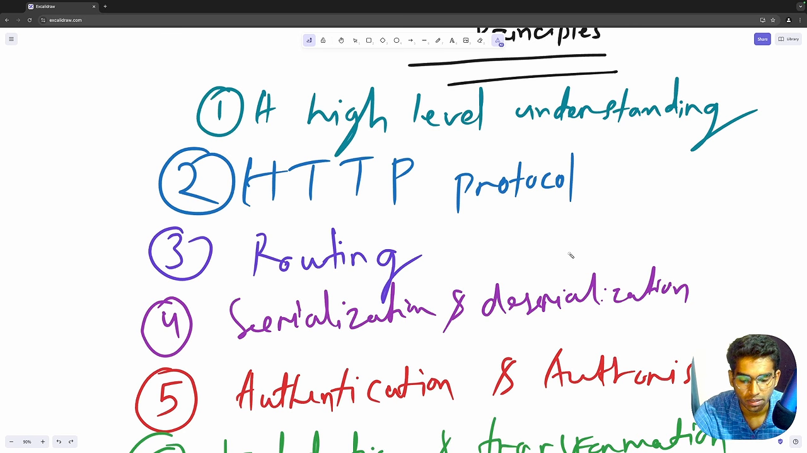
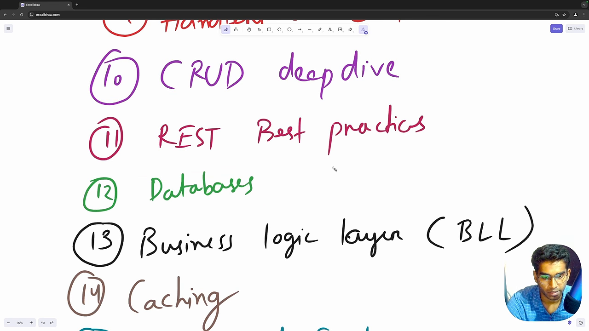
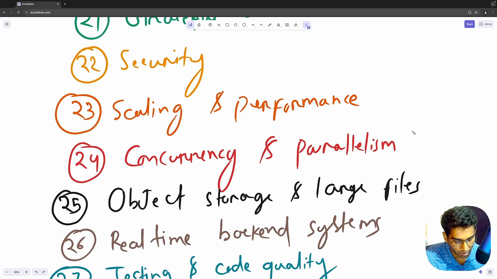
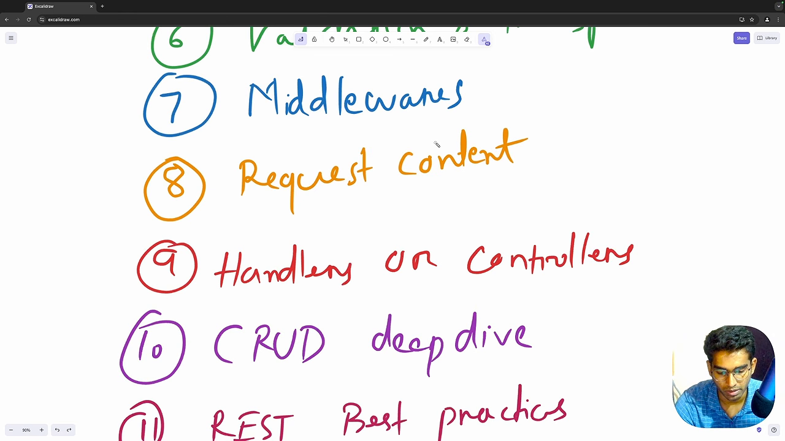
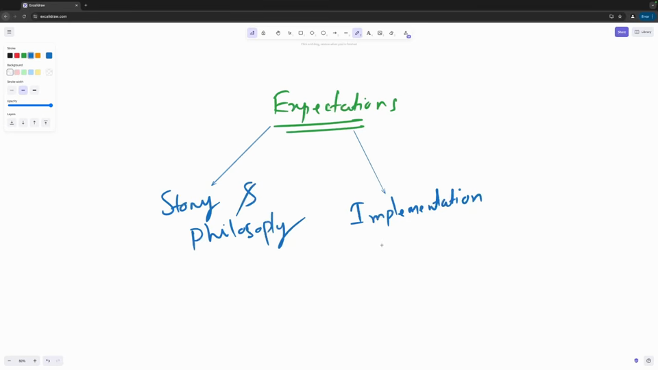
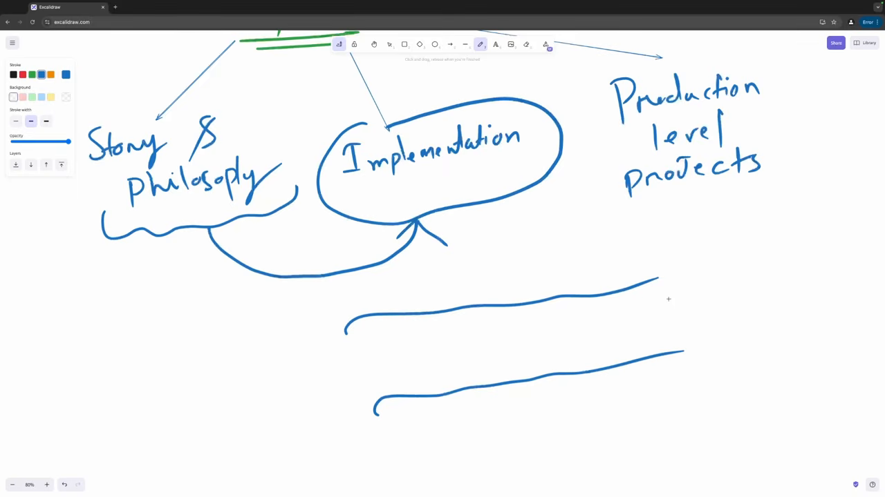
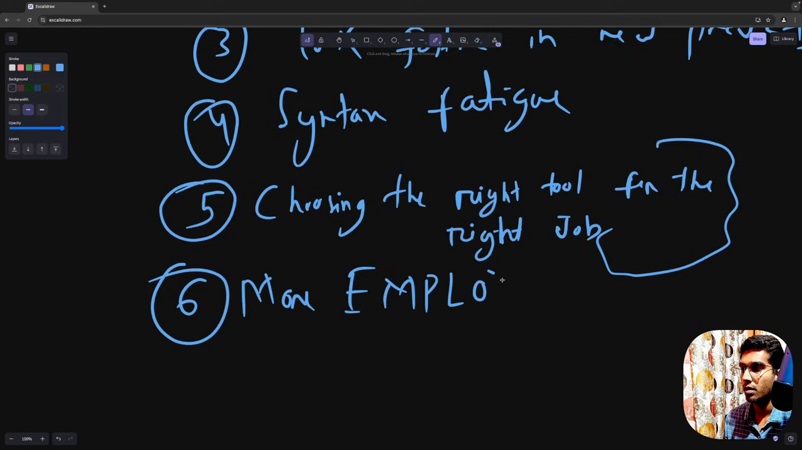

# 后端第一性原理：31 章的白板地图

第 1 集不是口头念目录。讲者开着 Excalidraw，从第 1 章一直写到第 31 章，边写边讲每一项为什么要学。这篇把那张白板完整搬过来，加上第 2 集的学习路径规划（三阶段）和第 4 集的收益论证（六条）。三集都是铺垫，但铺垫里有他给的坐标系。

## 他先定义后端工程

开篇他说的话值得原样记下来：

> backend engineering is much more than building a set of crud apis ... I think backend engineering is about building **reliable scalable fault tolerant and maintainable code bases and efficient systems**（00:00）

也就是说，他给这门学科的定语是四个形容词加一个"efficient"：**reliable、scalable、fault tolerant、maintainable**。CRUD API 只是最外层可见的形态，不是学科本身。

紧接着他给出一句关于学习难点的诊断：现在有至少 1000 种以上的资源可学，但没人告诉你**学什么、按什么顺序、什么时候这些概念会合到一起**。他的答案是"人们通常从被限定的训练范围起步"（大学、bootcamp、速成课），然后靠试错和同事帮助慢慢往上堆，所以"it takes people years to get their head around a lot of these concepts and principles"。

### 他批评的第二个问题：语言视角的盲点

他的原话是：人们从某个语言或框架的视角开始学后端，可能是 Express、Spring Boot 或 Ruby on Rails，问题在于**你用什么语言，就用那套生态的透镜看问题，而透镜有盲点**。

他给的场景很具体：你在 Ruby on Rails 上干了几年，公司有一天因为性能原因决定迁到 Golang，这时**你能带走多少知识**？如果你不理解底层系统，带走的东西很有限。

这一段是他整个系列立项的理由，也是后面所有章节的组织原则：先讲与语言无关的机制，再让语言去填空。

### 他自己踩过的坑

他还交代了自己的路径：起步时不断搜资源、跟着别的开发者学，读了很多后端方面的书，研究了上百个开源代码库，看行业里的人到底怎么搭东西，而"it was a very time consuming procedure"。

## 白板：31 项课程清单

下面是白板的完整内容，按他的编号和英文原词照抄，中文是我的对译（不是他的原话）。他的白板是滚动着写的，我按段落截了几张原图附在后面。

| # | 白板原文 | 中文 |
|---|---|---|
| 1 | A high level understanding | 高层次的全局理解 |
| 2 | HTTP Protocol | HTTP 协议 |
| 3 | Routing | 路由 |
| 4 | Serialization & deserialization | 序列化与反序列化 |
| 5 | Authentication & Authorisation | 认证与授权 |
| 6 | Validation & transformation | 校验与转换 |
| 7 | Middlewares | 中间件 |
| 8 | Request context | 请求上下文 |
| 9 | Handlers or Controllers | Handler / Controller |
| 10 | CRUD deep dive | CRUD 深入 |
| 11 | REST best practices | REST 最佳实践 |
| 12 | Databases | 数据库 |
| 13 | Business logic layer (BLL) | 业务逻辑层 |
| 14 | Caching | 缓存 |
| 15 | Transactional Emails | 事务性邮件 |
| 16 | Task queueing & scheduling | 任务队列与调度 |
| 17 | Elasticsearch | Elasticsearch |
| 18 | Error handling | 错误处理 |
| 19 | Config management | 配置管理 |
| 20 | Logging, monitoring & observability | 日志、监控与可观测性 |
| 21 | Graceful shutdown | 优雅关闭 |
| 22 | Security | 安全 |
| 23 | Scaling & performance | 扩展与性能 |
| 24 | Concurrency & parallelism | 并发与并行 |
| 25 | Object storage & large files | 对象存储与大文件 |
| 26 | Real time backend systems | 实时后端系统 |
| 27 | Testing & code quality | 测试与代码质量 |
| 28 | 12 factor app principles | 12-Factor App 原则 |
| 29 | OpenAPI standard | OpenAPI 标准 |
| 30 | Webhooks | Webhook |
| 31 | DevOps for backend engineers | 后端工程师的 DevOps |

**编号和播放列表不是一一对应。** 播放列表有 4 集开场（路线图、心态、什么是后端、为什么学），白板把"什么是后端"这一讲编为第 1 项，而 HTTP 在第 5 集，所以白板编号比播放列表序号靠前 3 位左右；另外白板里的 Transactional Emails 没有单独成集，Scaling 则拆成了 21.1 和 21.2 两集。对照时按标题找，别按编号找。

## 白板每一项他讲了什么

他在写每一项时会顺带讲这条线上要覆盖的内容。这里按白板顺序摘录，保留他的说法：

**② HTTP**：先讲 HTTP 在通信里扮演什么角色、原始报文长什么样；**头部**的类型区分（request headers、representation headers、general headers、security headers）；**方法** GET/POST/PUT/DELETE 的语义和"什么时候用哪个"；CORS 的流程，以及 simple request 与 **pre-flight request** 的区别；响应结构与**状态码**（哪些最常用、什么情况返回哪个）；HTTP 层的**缓存**（ETag、max-age 头）；HTTP/1.1、2.0、3.0 的差异；**content negotiation**；**持久连接**；**压缩**（gzip、deflate、br，以及哪个最常用）；以及 SSL/TLS 与 HTTPS。

**③ 路由**：URL 怎么映射到服务端逻辑，路由与 HTTP 方法的关系；路径参数与查询参数；**静态路由、动态路由、嵌套路由、层级路由、catch-all 通配路由、正则路由**；用 HTTP 做 **API 版本管理**的几种方式，怎么废弃旧版本；**route grouping** 对版本、权限、共享中间件的好处；路由的安全与匹配性能优化。

**④ 序列化**：为什么要把数据转成某种格式再上路，以及为什么这是互操作性的基础；**文本格式**（JSON、XML）与**二进制格式**（protobuf）的性能差别和选用时机；JSON 的数据类型与嵌套结构；反序列化到各语言原生结构（Python dict、Go struct、JS object）；常见坑（缺字段、多字段、null、日期与时区）；自定义序列化；错误处理（非法数据、类型转换失败、未知字段）；**注入类安全问题**与"反序列化之前先校验"；用 JSON Schema 先验证；性能手段（压缩、去掉不必要字段）与"可读性 vs 性能"这个 trade-off。

**⑤ 认证与授权**：为什么需要；**有状态与无状态**两种认证、basic auth、token 认证；session、JWT、cookie；OAuth 与 **OpenID Connect** 深入；API key；多因子；**salting 与 hashing** 及相关密码学手段；**RBAC / ABAC / ReBAC**。安全实践那一串他也列了：保护 cookie、防 CSRF/XSS/MITM、**审计日志**（记录认证授权事件，监控失败登录、权限提升、敏感资源访问）、模糊化认证错误（不泄露信息）、各失败模式下响应保持一致、限流与账号锁定，以及**防计时攻击**（错误密码的校验要多做一次哈希运算，耗时不同，可以被用来猜用户名密码，虽然很难但"我们不想留任何安全漏洞"）。

**⑥ 校验与转换**：**语法校验**（是不是 email 格式、电话格式）、**语义校验**（出生日期不能在未来、年龄 1–120）、**类型校验**（string/int/array/object）；客户端校验与服务端校验的分工（前者是体验，后者才是安全边界，因为它是进业务逻辑的闸门）；**fail fast**（提前返回，减少无用处理）；前后端校验规则保持一致。然后是**转换**：类型转换（查询参数和路径参数拿到的都是字符串，要转成数字 ID）、日期格式与时区、**规范化**（email 转小写、去空格、电话补国家码）、**清洗**（sanitize，防 SQL 注入）、**关系校验**（password 与 confirm password 必须相同）、**条件校验**（married 为 true 时 partner name 才必填）、**链式校验**（转小写 → 去特殊字符 → 校验长度）；错误信息要能指导前端修复、多条错误聚合返回、同样要模糊化；转换失败要优雅处理（非法 JSON、日期转换失败）。

**⑦ 中间件**：是什么、什么时候用、常见用例；在请求周期里的位置（pre-request 与 post-response）；**链式执行**：一个中间件处理完把控制权交给下一个，直到最终 handler；**顺序很重要**（先记日志、再判认证、再校验、再路由）；`next()` 的行为与提前退出（比如 404 直接短路）；常见中间件种类：安全响应头（X-Content-Type-Options、HSTS、CSP）、CORS 头、防 CSRF、限流、认证、日志与监控、错误处理（把应用级错误格式化成一致的 API 响应）、压缩、请求体解析（JSON、urlencoded、文件上传）；性能与可维护性上的要求：保持轻量、顺序影响性能与安全。

**⑧ 请求上下文**：它是"request-scoped state"，只在这次请求期间有效；生命周期、跨层共享数据而不产生耦合；组成部分：请求元数据（方法、URL、头、查询参数、body）、会话与用户信息（认证中间件取到用户后注入上下文）、追踪与日志信息（**request ID / trace ID**）、请求期内的自定义数据（缓存、权限检查结果）；用例：认证、限流、追踪、日志；与中间件的关系；超时类型（请求超时、自定义超时、取消信号）；最佳实践：保持轻量、请求结束要清理（防内存泄漏）、不要用上下文把组件耦合死。

**⑨ Handler / Controller**：MVC 模式；handler、controller、service 各自的职责；用中间件减少重复代码；集中式错误处理；统一的成功/错误响应格式。

**⑩ CRUD 深入**：CUD 怎么映射到 HTTP 方法；POST 用于创建与提交，成功通常返回 201 Created，参数错误返回 400；GET 用于取列表或单个资源；PUT 与 PATCH 用于更新；DELETE 用于删除。还有分页、搜索 API、排序、过滤；最佳实践：严格校验、响应格式一致、限制 payload 大小、脱敏敏感字段、错误处理、认证授权。

**⑪ REST 最佳实践**：RESTful 架构是什么；围绕**资源**设计 API；遵守 HTTP 语义；过滤与分页的做法；版本管理方式（URI、header、query string、media type）；设计时以 OpenAPI spec 为准；content negotiation；捕获异常并返回有意义的错误；支持客户端缓存（ETag）；优化大请求与大响应。

**⑫ 数据库**：关系型与非关系型的差别、什么时候用哪个；理论部分 **ACID 与 CAP**；基础查询与 join；设计实践（schema 设计、索引）；优化手段（查询优化、缓存、**连接池**）；数据完整性（约束与校验、事务与并发）；**ORM** 的工作原理、该不该用 ORM、代价是什么；**数据库迁移**。

**⑬ 业务逻辑层（BLL）**：请求周期的分层：校验层、路由、中间件、handler/controller 都属于**表现层**（都在处理"用户的数据"），再往下一层是**业务逻辑层**，再往下是**数据访问层**（做查询、插入、删除），业务逻辑层在背后调用数据访问层。设计原则：关注点分离、单一职责、开闭原则、依赖倒置；组件：service、领域模型（user、order 这类核心实体）、业务规则、业务校验逻辑；还有 service 层设计实践，以及错误怎么从 service 层向上传到表现层。

**⑭ 缓存**：为什么需要、它和数据库持久化的区别；类型：内存缓存、浏览器缓存、数据库缓存；客户端缓存与服务端缓存各自的意义；**策略**：cache-aside、write-through、write-behind、read-through；**淘汰策略**：LRU、LFU、TTL、FIFO；**失效方式**：手动失效、TTL 失效、事件驱动失效；**层级**：L1 内存、L2 分布式网络，以及两者组合的分层缓存（热数据放快的 L1，冷数据放慢而大的 L2）；Web 侧的缓存（静态资源、用响应头缓存 API 结果）；数据库侧（把重 join 的结果缓存到 Redis 这类做法）；命中率与未命中率以及怎么优化。

**⑮ 事务性邮件**：用途与常见场景；一封邮件的结构：subject、preheader、body header、主内容、CTA、footer；用动态参数做个性化。

**⑯ 任务队列与调度**：队列的典型用途：发邮件、处理图片、第三方 API 集成（支付、webhook）、把重计算挪走。他举的例子是"清除我的全部数据"这类按钮：要清多张表，耗时长，所以**不要阻塞请求**，先立刻返回响应，再把后台任务推进队列。调度（定时任务）的用途：数据库备份、周期性通知与提醒、数据同步、维护（清日志、清缓存）。组件：producer、queue、consumer、broker；**依赖关系**（链式依赖、父子任务）；**任务组**（并发跑多个任务并等全部完成）；错误处理与重试；**优先级与限流**（支付处理要排在发通知之前）。

**⑰ Elasticsearch**：为什么用、背后怎么工作：**倒排索引、TF-IDF、segment 与 shard**；用例：type-ahead 联想、日志分析、社交内容全文搜索；索引的创建与管理；查询：基础查询、全文搜索、相关性打分；性能优化：text 与 keyword 字段的区别、analyzer、boosting、分页；进阶：过滤、聚合、模糊搜索；Kibana；实践：显式定义字段 mapping、控制 shard 数量、批量索引、避免通配查询。

**⑱ 错误处理**：错误类型：语法错误、运行时错误、逻辑错误；策略：fail safe、fail fast、优雅降级、预防；做法：尽早捕获、**不要吞掉错误**、自定义错误类型、优雅失败、记录日志与堆栈；**全局错误处理器**；面向用户的错误（可读的信息 + 可执行的建议）；监控与日志（Sentry、ELK）；告警（邮件、Slack）。

**⑲ 配置管理**：把环境相关配置从应用逻辑里解耦；用例：多环境、敏感数据（API key、数据库密码、私钥证书）、不改代码动态开关功能；配置分类：静态配置（DB 凭据、API 端点）、动态配置（feature flag、限流阈值）、敏感配置（凭据、token、secret）；来源：env 文件、JSON、YAML；以及环境变量、命令行参数、静态文件三者的差别。

**⑳ 日志、监控、可观测性**：logging、tracing、monitoring、observability 的区别；日志类型：系统日志、应用日志、访问日志、安全日志；级别：debug、info、warn、error、fatal；**结构化日志与非结构化日志**；实践：集中收集、轮转与保留、上下文信息、不打敏感数据（密码、API key）。监控类型：基础设施监控、APM、可用性监控；工具：Prometheus、Grafana；告警：阈值、告警配置、**避免告警疲劳**（只留可行动的告警）。可观测性三支柱：**logs、metrics、traces**；日志管理的安全与合规。

**㉑ 优雅关闭**：为什么需要；场景：服务重启、云环境缩容、微服务、长任务；机制：信号处理（**SIGTERM / SIGINT**）；步骤：捕获信号 → 停止接受新请求 → 处理完 in-flight 请求 → 关闭外部资源（数据库连接、打开的文件）→ 退出进程。

**㉒ 安全**：要防的攻击：SQL 注入、NoSQL 注入、XSS、CSRF、认证被破坏、不安全的反序列化；安全设计原则：**最小权限、纵深防御、默认安全（fail secure）、职责分离、security by design**；输入校验与清洗的重要性；限流、CSP、CORS、SameSite cookie；监控事件。

**㉓ 扩展与性能**：性能指标：响应时间、资源利用率、瓶颈定位；缓存与数据库优化（避免 **N+1 查询**、正确使用 join、恰当使用 lazy loading）；用索引加速高频读取字段（外键、搜索字段）；**批量处理**降低数据库压力；避免内存泄漏（关闭文件句柄与数据库连接、长流程后清理）；减少网络开销（减小 payload、压缩）；性能测试与 profiling；写高性能代码的实践：先写清晰可维护的代码、不要过早优化；模块化以便单独优化某一块；某个资源被打挂时系统要**优雅降级而不是整体崩溃**；把非关键任务（发邮件、写日志）offload 到后台或队列，把资源留给关键操作。

**㉔ 并发与并行**：两者的区别；并发解决 **IO bound**，并行解决 **CPU bound**。

**㉕ 对象存储与大文件**：对象存储（如 AWS S3）的常见用法；大文件用 **chunking 与 streaming** 处理；**multipart 上传**。

**㉖ 实时后端**：**WebSocket**、server-sent events、**pub/sub 架构**。

**㉗ 测试与代码质量**：测试类型：单元、集成、端到端、功能、回归、性能、负载与压力、验收、安全；**TDD**；在 CI/CD 里自动化测试；用外部 lint/format 工具管代码质量；质量指标：**圈复杂度**（按函数里可能的执行路径计数）和**可维护性指数**（按复杂度、代码行数等量化维护难度）。

**㉘ 12-Factor App**：他只用一句"一组很有意思的原则"带过，说放到后面单独讲。

**㉙ OpenAPI**：为什么需要标准、为什么要遵守、收益与生态（Swagger、Postman）；历史（Swagger 到 OpenAPI 的过渡）与当前活跃版本；核心概念：API path、请求与响应定义、parameters、schemas；文档结构：metadata、paths、components、security definitions、responses；OpenAPI 3.0 与 3.1 的新特性；工具（Swagger UI、Postman）；实践：避免重复、遵守标准；以及 **API First 开发**（先写 spec，再实现）。

**㉚ Webhook**：用例：发通知、第三方集成；与 API 的差别：API 常靠**轮询**（客户端发起），webhook 是**服务端推送**（服务端发起）；关键组件：webhook URL、事件触发、payload、HTTP 方法、响应处理；实践：**签名验证**（如 HMAC）、快速响应、重试逻辑、日志；怎么测试 webhook；现实用例：Stripe 支付、GitHub、Slack、Discord、Twilio。

**㉛ DevOps**：核心概念：CI、CD（delivery 与 deployment）；实践：**infrastructure as code**、配置管理、版本控制；工具：用 Docker 做容器、用 Kubernetes 编排、CI/CD 流水线；扩展：水平扩展与垂直扩展；部署策略：**blue-green**、rolling 等。

## 第 2 集：三阶段学习路径

第 2 集只有 3 分 53 秒，讲的是"该期待什么"。他在 Excalidraw 上写了两栏：

他的原话是，这个播放列表讲的是 backend engineering 的 **story、philosophy、大问题、内部机理，以及不同组件和机器之间的协作**；目的是让你看到 production-grade 后端的**big picture**，并"appreciate the concepts that are abstracted by the languages, runtimes, frameworks and libraries that we use every day"。

然后是三段式路径：

**第一阶段：story 与 philosophy。** 这是成为后端工程师的第一步，目标是**language agnostic skills**，超越框架与库。

**第二阶段：implementation。** 前提是"基础清楚了、能看出每个后端应用背后的共同模式、理解这些哲学怎么连起来"，这时候才谈实现。他计划出两个版本，**Node.js 和 Go**，理由是他自己有第一手经验、每天都在用。

这个阶段是另一个播放列表，**每个原理对应一集实现**。他给的例子：原理里讲数据库、驱动、迁移，实现里就落到 Postgres 配 JavaScript 驱动 `pg`（他说成 postgres.js）或 Go 的 `pgx`，把周边每个概念都覆盖一遍。

**第三阶段：production level projects。** 概念、语言细节、哲学全部汇合，按行业标准与最佳实践做端到端项目，"which you can follow along if you want"。

他对结果的承诺写得很直白：如果你决定走完、把内容内化并跟着做项目，"you should be safely able to call yourself a backend engineer"，能做出**从 0 用户扩到百万用户**、并且**能被长期维护**的系统。

## 第 4 集：六条收益

第 4 集用三个场景开场，然后把这些场景的解法画成六条。

场景一：你是刚入职的工程师（也许本职是前端），被派去修后端代码里的一个 bug。后端可能是你不熟的语言，就算是熟的语言，**你从哪开始找**？
场景二：让你从零做一个 API，你怎么建立代码库的心智地图、怎么贴住标准、怎么保证不破坏别的东西？
场景三：你是 TypeScript 或 Go 的后端，突然要跳到 Rust 或 Python。怎么快速上手，而不是把时间花在读 FastAPI、Pydantic、Axum、SQLAlchemy、Diesel 这些库的文档上？

他的回答是"break down complex systems into their most basic and Universal components"，然后落到白板上的六项：

**① Seeing the big picture。** 进一个陌生代码库时，不是被结构和复杂度压住，而是**在脑子里把系统拆成几块、隔离着看**：核心逻辑、路由层、数据库连接，还有那些过度设计的部分。把噪音过滤掉，才敢动代码。

他说这正是 senior engineer / CTO 能扫一眼就大致知道"哪里可能有问题"的原因：人脑擅长抓模式，他们是**潜意识**里抓的，不用刻意。他的追问是：为什么要等几年经验自然长出来？可以**从第一天开始刻意练**，他给的时间是 6 个月到 1 年。

**② Faster onboarding。** 你懂了后端的第一性原理（HTTP 怎么工作、数据库怎么和 API 交互、请求怎么穿过中间件），就能钻进任何语言或框架找到路；一旦核心概念清楚，**语法是次要的**，可以"cut through the noise"，专注逻辑而不是语法。

**③ 10X faster in new projects。** 从零起项目时，因为知道系统的需求而不是照抄 boilerplate 教程，能更快做出 production quality 的 MVP：路由怎么组织、数据库连接怎么建、缓存/错误处理/日志这些关键功能怎么落，不用一直翻文档。

**④ Syntax fatigue。** 学新语言本身就够累；如果你不知道语法之后该学什么概念、不知道怎么把语法用来解决实际的后端问题，就会走向挫败甚至倦怠。第一性原理把"换语言"从"艰巨任务"变成"把已知问题套上新语法"。

这一条他给了完整方法，也是全篇最具体的一段：假设你是 Node.js 开发者，想转 Rust 后端。你当然会去找一个 4-5 小时的端到端 Rust 后端项目，还得满足生产质量标准；问题是 Rust 太新，Node 那种项目级别的资源，Rust 没有。你语法练得还行（数据结构、写小程序），但**怎么跨过那个门槛**去做端到端生产级项目？

他的路径是：你先清楚后端的分层（路由 → 中间件 → 数据库交互 → 日志 → 错误处理 → 异步代码），这些是脑子里的概念与笔记；你也懂 Rust 基础语法。

那就按社区推荐的项目布局起一个 Rust 项目，**一块一块单独击破**。你知道路由的生产级代码长什么样、校验长什么样、数据访问与 repository 模式长什么样、handler 长什么样、认证授权长什么样；现在只要把 Rust 的语法"converted 到那个 pattern"。比如做校验，就去查 Rust 里怎么做校验（大概率会找到一个库或标准做法），语法加最佳实践一拼，你就有了一块生产级的校验模块。重复这个动作，**in 2-3 days** 你就有了一整套生产质量的 Rust 代码库。

**⑤ Choosing the right tool for the right job。** 他说这是他每天看到工程师出问题的地方：大家被标签困住（"我是 Node.js 后端"、"我是 Ruby 后端"），遇到一个要求高并发或低延迟的模块，还是用手上那门语言，**没有底气去伸手拿更合适的工具**。理解了后端要解决的核心问题（数据持久化、请求处理、安全、扩展），你就不被框架和语言限制：知道什么时候该用 Redis 做缓存、Postgres 做关系数据、MongoDB 做非结构化数据、Kafka 做实时事件流，这些判断与你当前用的技术栈无关（他的原话："independent of the stack you're currently working with"）。

**⑥ More employable。** 他承认"this is what most of us want"。在快速变化的技术环境里，能跨语言跨框架应用知识的人才"incredibly versatile"，雇主想要能独立思考、加入任何团队就能快速贡献价值的人。

## 他最后对"principles"的定义

第 4 集结尾他专门澄清了一次术语，这段在中文语境里容易被误读：

> when I say principles I don't mean a list of Rules ... by first principles I mean some **foundational blocks or foundational components around which the rest of the code base revolves at all times**, no matter how small or how big it is. a **generic map of the backend engineering territory** which helps you find the way

不是规则清单，是代码库绕着转的那几个基础块，以及一张能在陌生地形里定位自己的地图。下一集开始就进入地图的第 1 项：HTTP。

## 备注

- 字幕是 YouTube 自动生成的，术语需要按上下文校正：他把 nginx 念成 "enginex"、certbot 念成 "sbot"、EC2 被识别成 "E2 instance"、CORS 被识别成 "cor"。另外两处识别错词按语义还原并在此标注：`time consuming`（原字幕 `timec consuming`）、`tech stack`（原字幕 `text tag`）。
- 白板是滚动书写的，任何单帧都看不到 31 项全貌；表里的编号与措辞是我逐帧核对后合并的，原图按段落附上。
- 第 3 集（什么是后端、一个请求怎么走）单独成篇，因为那集是逐屏演示，信息密度与这三集不同。
- 第 1、2、4 集的原视频：见文末资料源；原始帧提取自本地 720p 副本，时间戳标在图注里，可回原片对位置。

> 资料源：[Sriniously — Backend from first principles](https://www.youtube.com/playlist?list=PLui3EUkuMTPgZcV0QhQrOcwMPcBCcd_Q1)，第 1 集（31m24s）、第 2 集（3m53s）、第 4 集（10m11s）。字幕与帧见 `.journal/backend-first-principles/`。
