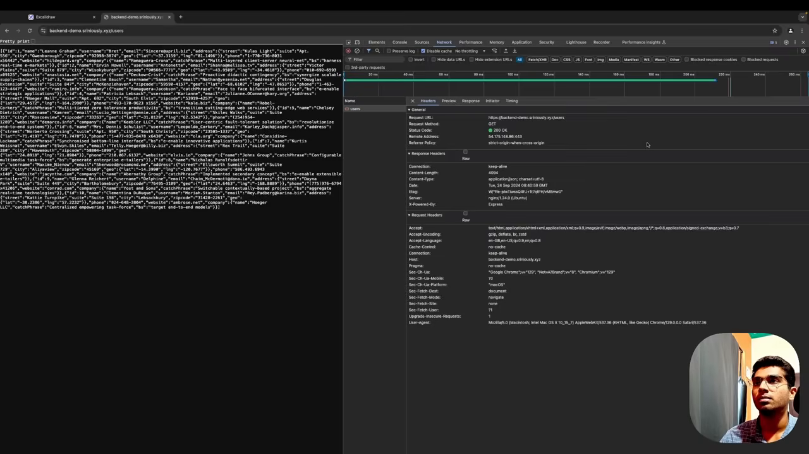
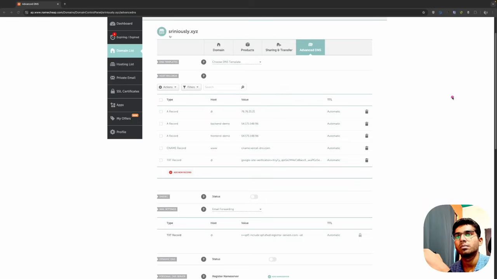
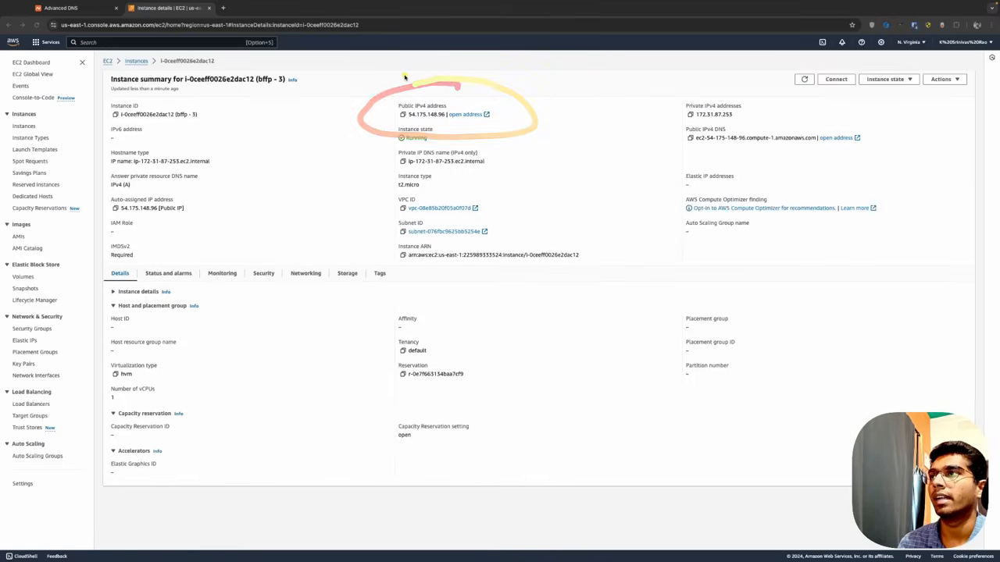
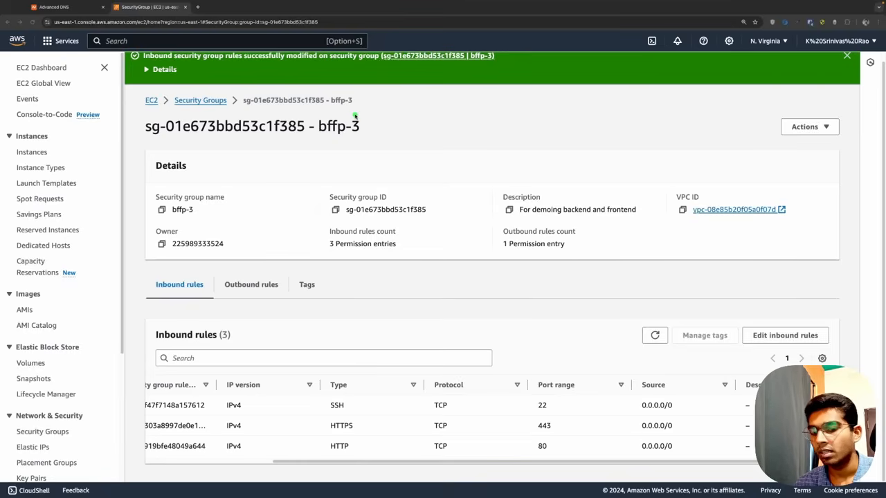
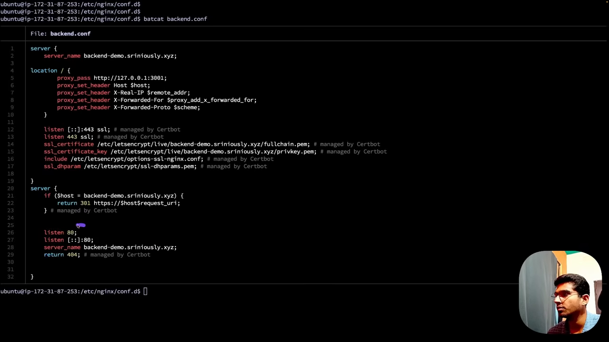
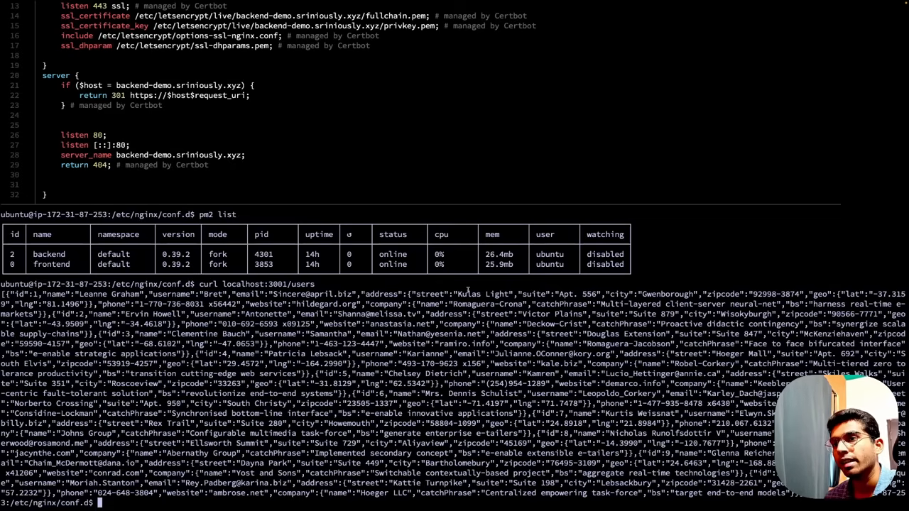
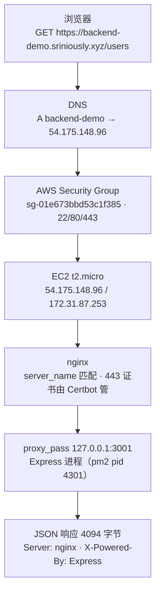
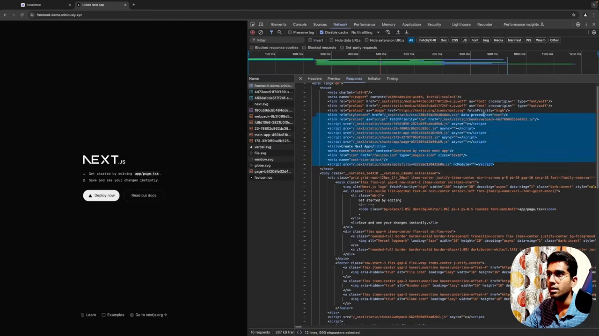
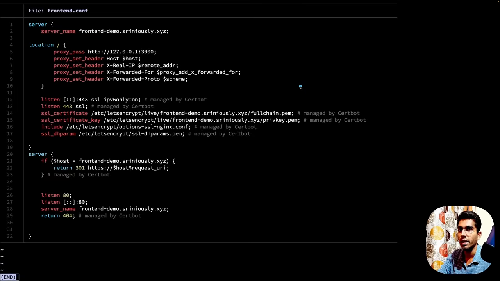

# 一个请求从浏览器到 Node 进程：第 3 集逐屏

这集 19 分钟，讲者没有画示意图，而是**边操作边讲**：打开浏览器 devtools、他的 DNS 面板、AWS 的实例页、安全组页、nginx 配置文件、pm2 进程表，然后把浏览器里的一次请求一路追到 Node 进程，再对比一次前端请求的链路。这篇按他的操作顺序逐屏记录，截图全部来自原片，时间戳标在图注里。

## 他先给的定义

第 3 集开头 40 秒就把后端定义完了，句子值得原样抄下来：

> back end in its traditional definition is **a computer which is listening for HTTP or websocket or grpc or any other kind of request through an open port** whether it is 0 or 443 which is **accessible over the Internet**, so that clients or other front ends can connect to it, send data to it or receive data depending on the kind of request. And we call it **server** because it provides or it serves some kind of content, whether it is static files like images or JavaScript files or HTML files, or it could be Json, and it also accepts data if this client sends something.（00:00）

拆开看，这个定义有四个要件：**一个计算机**、**在某个开放端口上监听**、**这个端口对公网可达**、**能收也能发**。以及一个命名理由：叫 server 不是因为它"服务"，是因为它 **serves content**。

说完他立刻声明这个定义不够："that is a fair definition of what a back end is and how it works, but I want you to get a holistic view to actually see the components physically how they work behind the scenes"。后面 18 分钟都在补这个"physically"。

## 第一屏：浏览器里的请求长什么样

他先在浏览器打开 `https://backend-demo.sriniously.xyz/users`，开 devtools 的 Network，**关掉缓存**，理由是"so that we get the appropriate status code"。



这一屏能读出五组事实，后面每一组都在下面某一跳里被解释：

**请求本身**：`GET`，`https://backend-demo.sriniously.xyz/users`，Status Code 403 Forbidden，Remote Address `54.175.148.96:443`，Referrer Policy `strict-origin-when-cross-origin`。

**响应头**：`Content-Type: application/json; charset=utf-8`、`Content-Length: 4094`、`Etag: W/"ff7-..."`、`Connection: keep-alive`、`Date: Tue, 24 Sep 2024 08:40:03 GMT`。

**两个 server 标识并存**：`Server: nginx/1.24.0 (Ubuntu)` 和 `X-Powered-By: Express`。这是全片最关键的一处线索——**响应是 Express 生成的，但报文最外层是 nginx 发的**，说明中间隔着一次代理转发。

**请求头**：`Accept-Encoding: gzip, deflate, br, zstd`、`Cache-Control: no-cache`（他刚勾了 disable cache）、`Host: backend-demo.sriniously.xyz`、`User-Agent` 是 macOS 上的 Chrome 128。

**状态码**：屏幕上是 403，而响应体仍是一段 JSON 用户列表。他当时没有停下来解释 403 的来源，继续去追链路了；这里按屏幕如实记录，不做归因。

## 第二屏：DNS 记录

他要追的第一跳是域名怎么变成 IP。打开的是 Namecheap 的 Advanced DNS 面板，域名 `sriniously.xyz`，五条记录：



| Type | Host | Value |
|---|---|---|
| A Record | `@` | `76.76.21.21` |
| A Record | `backend-demo` | `54.175.148.96` |
| A Record | `frontend-demo` | `54.175.148.96` |
| CNAME Record | `www` | `cname.vercel-dns.com` |
| TXT Record | `@` | `google-site-verification=irfEly_...` |

他的解释只讲两点，但够用：DNS 记录有多种类型，**A 记录指向一个 IP**，**CNAME 记录指向另一个域名或子域**。他特别点出这五条里有"two A records"，其中 `backend-demo` 指向的那个 IP 来自一台 EC2 实例。

这一步在整条链路里的位置：浏览器解析 `backend-demo.sriniously.xyz` 得到 `54.175.148.96`，请求从这里出发。

## 第三屏：那台实例

接着打开 EC2 控制台。实例页的关键字段（他圈出了 Public IPv4）：



| 字段 | 值 |
|---|---|
| Instance ID | `i-0ceeff0026e2dac12`（名字 `bffp - 3`） |
| Instance state | Running |
| Instance type | `t2.micro` |
| Public IPv4 | `54.175.148.96` |
| Private IPv4 | `172.31.87.253` |
| Hostname | `ip-172-31-87-253.ec2.internal` |
| Private IPv4 DNS | `ec2-54-175-148-96.compute-1.amazonaws.com` |
| Region | `us-east-1`（N. Virginia） |

他指出的对应关系很直白：DNS 里那条 A 记录的 `54.175.148.96`，就是这台实例的公网 IP。请求先到这个 IP，**才谈得上进机器**。

## 第四屏：安全组（防火墙）

IP 到机器之间还有一层。他打开这台实例绑定的安全组 `bffp-3`（`sg-01e673bbd53c1f385`，描述是 "For demoing backend and frontend"），入站规则只有三条：



| Type | Protocol | Port | Source |
|---|---|---|---|
| SSH | TCP | 22 | `0.0.0.0/0` |
| HTTPS | TCP | 443 | `0.0.0.0/0` |
| HTTP | TCP | 80 | `0.0.0.0/0` |

他讲这层的顺序是：安全组决定**哪些端口可以被公网访问**；22 是他登进机器敲命令用的；80 和 443 是给 HTTP/HTTPS 用的；**如果这两条没放行，AWS 会在这一层就把请求挡掉，请求根本到不了你的服务**。这句他在片子里说了两遍，因为这是新手最容易踩的坑——服务在机器里跑得好好的，外面就是连不上。

## 第五屏：nginx 配置

请求进了机器，先落到 nginx。他打开 `/etc/nginx/conf.d/backend.conf`（提示符是 `ubuntu@ip-172-31-87-253:/etc/nginx/conf.d`，与上面那台实例的私网 IP 一致）：



```nginx
server {
    server_name backend-demo.sriniously.xyz;

    location / {
        proxy_pass http://127.0.0.1:3001;
        proxy_set_header Host $host;
        proxy_set_header X-Real-IP $remote_addr;
        proxy_set_header X-Forwarded-For $proxy_add_x_forwarded_for;
        proxy_set_header X-Forwarded-Proto $scheme;
    }

    listen [::]:443 ssl; # managed by Certbot
    listen 443 ssl; # managed by Certbot
    ssl_certificate /etc/letsencrypt/live/backend-demo.sriniously.xyz/fullchain.pem; # managed by Certbot
    ssl_certificate_key /etc/letsencrypt/live/backend-demo.sriniously.xyz/privkey.pem; # managed by Certbot
    include /etc/letsencrypt/options-ssl-nginx.conf; # managed by Certbot
    ssl_dhparam /etc/letsencrypt/ssl-dhparams.pem; # managed by Certbot
}

server {
    if ($host = backend-demo.sriniously.xyz) {
        return 301 https://$host$request_uri;
    } # managed by Certbot

    listen 80;
    listen [::]:80;
    server_name backend-demo.sriniously.xyz;
    return 404; # managed by Certbot
}
```

他对这份配置的解释分三层：

**这是反向代理（reverse proxy）**："a server which sits in front of other servers so that we can manage different types of redirects or configs from a centralized space instead of changing the configs in every single server"。集中管理的意思是：改端口、加证书、加跳转，只改这里，不碰业务进程。

**匹配与转发**：`server_name` 声明这个 server 块服务哪个域名；`location /` 里的 `proxy_pass http://127.0.0.1:3001` 把请求交给本机 3001 端口的进程。上面那四条 `proxy_set_header` 是把原始 Host、客户端 IP、转发链、协议告诉下游，否则 Node 侧看到的 `req.ip` 全是 `127.0.0.1`。

**证书与 80 口**：443 的证书由 Certbot 自动签发续期（他明确说"not something to worry about in this demo"）；第二个 server 块把 80 的请求 301 到 https。

## 第六屏：进程表与本机验证

最后一跳是 Node 进程本身。他在同一台机器上跑 `pm2 list`：



两个进程：`backend`（pid 4301，26.4mb）和 `frontend`（pid 3853，25.9mb），都是 fork 模式、在线 14 小时。他是用 pm2 管这两个 Node 进程的，所以"机器重启后服务还在"这件事不由代码负责。

然后他敲了 `curl localhost:3001/users`，拿到的 JSON 和外网那条请求一致（他截断显示，第一条记录是）：

```json
{"_id":"1","name":"Leanne Graham","username":"bret","email":"Sincere@april.biz",
 "address":{"street":"Kulas Light","suite":"Apt. 556","city":"Gwenborough","zipcode":"92998-3874",
            "geo":{"lat":"-37.3159","lng":"81.1496"}},
 "phone":"1-770-736-8031 x56442","website":"hildegard.org",
 "company":{"name":"Romaguera-Crona","catchPhrase":"Multi-layered client-server neural-net","bs":"harness real-time e-markets"}}
```

这一步的意义他讲得很清楚：**从这台机器的视角看，Node 服务跑在 localhost 上；是 nginx 加上域名把公网请求转到了这个 localhost**。所以本地 `localhost:3000/users` 能看到的东西，和你在外网看到的是同一个响应。他也顺带说了另一面：本地开发时你在浏览器敲 `localhost:3000/users` 就行，不需要那四跳。

## 他把整条链路总结了一遍（06:38）

按他的复述：请求从浏览器出发 → DNS 服务器 → AWS（经过防火墙）→ AWS 实例 → nginx → 本机 `localhost:3001` 的最终服务。他还提了一句"and if you want, we can also check this"，用 curl 验证了最后一段确实就是那个端口。



图：第 3 集 06:38 复述的链路，节点上的标识都是该集演示里实际出现的值。

## 为什么我们需要后端：点赞那条线

追完链路，他反问：为什么需要这套东西？例子是在 Instagram 上刷到朋友的帖子、你点了赞、朋友收到通知。

从"你点下去"到"他收到通知"之间，服务端要做三件事：**判断是谁在操作**（找到你的用户身份）、**把这个动作持久化**（通常是写数据库）、**查出被点赞那条帖子的作者，再触发通知投递**。

他据此给出一个压缩结论：前端应用是"为你定制"的（你的资料、你关注的人、你能做的操作），而你朋友只会收到发给他的通知；**必须有一个中心化的地方装着所有人的信息**。于是：

> if you try to condense down ... the responsibility and the use of backend to a single word, it will be this: **data**. The need to fetch data, the need to receive data, and the need to persist data somewhere, and every kind of action that deals with data.（09:21）

## 换到前端视角：他把同一条链路又走了一遍

为了回答"为什么不能在前端直接连数据库"，他做了第二次演示：一个部署在**同一台** EC2 上的 Next.js 应用，域名 `frontend-demo.sriniously.xyz`。



这一屏的信息量在现场就摊开了：

**第一份文档是 HTML**。Response 面板里能看到它，`<head>` 里是 `<link rel="preload" href="/_next/static/media/...woff2" as="font">`、`<link rel="stylesheet" href="/_next/static/css/...css">`、若干 `<script src="/_next/static/chunks/....js" async>`；`<body>` 里是 `<h1>To get started, edit the <code>page.tsx</code> file</h1>` 这类真实标记。状态栏显示这次加载 **16 个请求、267 kB**。

**其余资源各自成请求**：字体 woff2、`next.svg`、`vercel.svg`、`main-app-*.js`、`173-*.js`、`page-*.js`、`favicon.ico` 逐个出现在列表里。这就是他说的"all these JavaScript and all the images, the fonts and the CSS files are fetched in different requests"。

**转发只是端口不同**：DNS 里 `frontend-demo` 那条 A 记录指向同一个 IP，安全组同样放行 443/80，nginx 换了一份配置——



`server_name frontend-demo.sriniously.xyz`，`proxy_pass http://127.0.0.1:3000`：**同一台机器、同一套 TLS、同一个安全组，只有最后一段端口从 3001 变成 3000**。

**然后是 paint 与 hydrate**，他把这两个词拆开讲：CSS 全部到齐后浏览器"paints our window"，页面才有背景色、字体、按钮样式；JS 全部到齐后浏览器才"hydrates all the event listeners"，按钮点下去才有反应，点它才跳转到另一个页面。所以按钮在 JS 加载完之前是死的。

### 他给的推论：谁在跑代码

| | 后端 | 前端 |
|---|---|---|
| 服务器发给你什么 | 处理结果 | **代码** |
| 谁执行 | 服务器 | **你的浏览器** |
| 你能看到逻辑吗 | 不能 | 能 |

他的原话是 "**the browser is our runtime**"，相对地，传统后端的处理发生在服务器的机器上；到前端这里"it is exactly the opposite"。这个区别不只是一个描述，它决定了下面所有限制。

## 为什么后端逻辑不能塞进前端

他先说了这个问题的合理性：手机、电脑也是计算机，既然一切都在分布式环境里，把逻辑放前端、让前端直连数据库，性能岂不是更好？然后一条一条否掉，每条都给了具体约束。

### 沙箱：能碰的东西只有三样（13:35）

浏览器运行时是**沙箱环境**（sandbox environment），与操作系统、进程、文件系统隔离，"which means the code can only access limited amount of resources"。他列的清单是：**DOM**（document 对象）、**浏览器 API**（localStorage、cookies）、以及**外部 API——前提是这个外部 API 带上了所需的头**（CORS，他说后面单独讲）。

反过来说，后端需要的东西沙箱里都没有：**写日志文件**、**读环境变量**、访问证书。这一条对后端是致命的。

### 沙箱为什么必须存在（14:17）

他主动解释了这层限制的合理性：浏览器做的事是**从远端服务器下载代码、在用户机器上执行**。如果环境不够隔离，远端代码就能访问用户电脑上的数据和文件。

他给的场景很直白：你打开一个网站，对它的前端代码一无所知，如果浏览器不做隔离，"that code can easily get access to your file system, copy all your files, your sensitive details and send it to their servers"。所以这些安全策略不是障碍，是前提。

### 跨域：外部 API 不是想调就能调（16:02）

第二条：浏览器的 CORS 策略限制 JS 只能请求同源资源；跨域要被浏览器拦下，除非对方返回了合适的头。他对 CORS 的定义是"a security policy of browsers which restricts JavaScript code to call external apis which is not the same as the current domain"。

这条对后端的杀伤力在于：**我们不控制所有外部 API**，而后端经常要连别的服务取数据。所以这条限制在后端侧不存在，在前端侧无法绕过。

### 驱动与连接池：数据库不是 HTTP（16:32）

第三条最硬，也最容易被跳过。他说后端有**原生数据库驱动**（他举了 `pg`、`postgis`、`mongodb`），这些驱动"are written to work in environments that can handle socket connections, handle binary data and maintain persistent connections"，也就是**能处理 socket 连接、能处理二进制数据、能维持持久连接**，而这些"things that browsers cannot do"。

然后他解释了为什么持久连接是刚需：后端进程维护一组到数据库的连接（**connection pool**），不必为每个请求重新建连、销毁。因为后端一秒要接成千上万个请求，"if they do the connecting and destroying logic with each request, the database server is going to get overwhelmed"。驱动就是按"维护一批连接"的方式写的。

他甚至回答了"那让浏览器各连一条行不行"：浏览器不是为持久连接设计的；就算硬做，**每个用户各开一条数据库连接**，数据库会先被连接数打垮；而且浏览器里没有连接池管理和高效查询执行的位置。

### 算力：用户的设备不由你决定（18:05）

第四条：前端跑在什么设备上你说了不算，可能是手机、台式机、笔记本，也可能是"a computer which has a 256 MB of RAM and with a single core processor"，这样的设备跑重业务逻辑会卡、会崩。而后端是集中式的，"we can easily increase its memory and CPU whenever we want"，负载上来了加配置就行。

他最后说这个清单可以继续列下去，但已经足以说明问题：把后端逻辑放在前端不是个好主意——**前提还得是你真能在前端做**。

## 备注

- 字幕由 YouTube 自动生成，术语按上下文校正过：`enginex` → **nginx**，`sbot` → **Certbot**，`cor` → **CORS**，`E2 instance` → **EC2**，`0 or 443` 按上下文应为 **80 或 443**，`a records` / `C Name Records` → **A / CNAME**。
- 截图取自本地 720p 副本，时间戳标在图注，可回原片核对；屏幕上的实例 ID、IP、进程号、文件路径均按截图原样抄录，未做改写。
- 403 那一处：他当时只说了"关掉缓存以便拿到正确的状态码"，没有解释为什么响应体是 JSON 而状态码是 403。本文不替他归因。
- 本篇只覆盖第 3 集。第 1、2、4 集（路线图、三阶段路径、六条收益）见同系列第一篇。

> 资料源：[Sriniously — Backend from first principles](https://www.youtube.com/playlist?list=PLui3EUkuMTPgZcV0QhQrOcwMPcBCcd_Q1)，第 3 集（19m01s）。字幕与截图见 `.journal/backend-first-principles/`。
