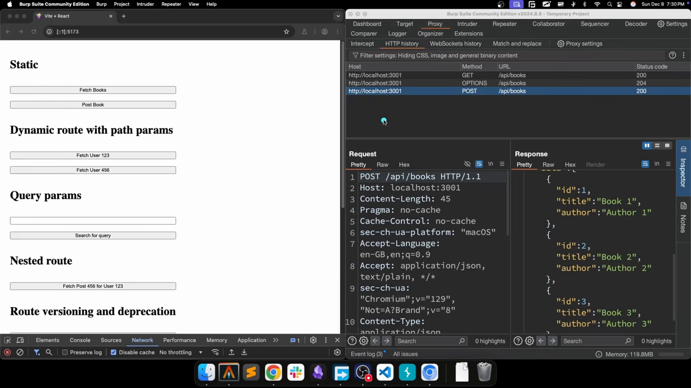
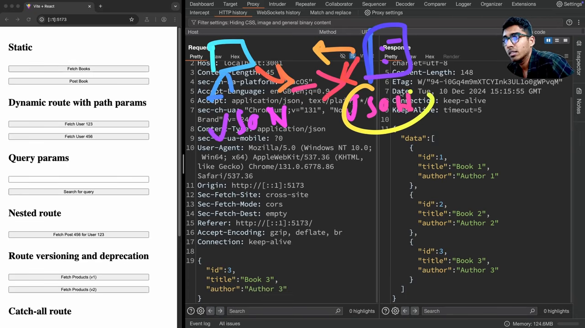
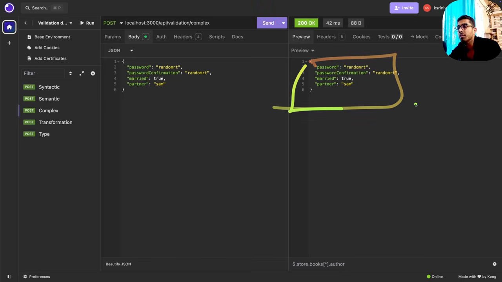

# 请求进入后端之后：路由、序列化、校验与三层结构

这一篇合并第 6、7、9、10 四集（合计 2.5 小时）。它们讲的是同一件事的不同层：请求到了服务器之后，先被路由分派，再被反序列化成原生结构，再被校验与转换，再进入 controller → service → repository 三层，中间被中间件截断或补充，全程共享一份 request context。

他在这几集的开场就把这条链路点明了：前面的视频讲的是请求在**服务器外面**怎么走（DNS、nginx、端口），从这一集开始讲**服务器内部**的请求生命周期。

## 一、路由：方法是 what，路由是 where

他的分工很清楚：HTTP 方法表达的是"你想干什么"，路由表达的是"你要对哪个资源干"。

> these HTTP methods they express the what of a request, your intent, your action. The role of routing is it expresses the where of a request.

`GET /users` 的组合含义是"我要取数据，取的是 users 这个资源"。服务器把这个组合当成一个键，映射到某个 handler，handler 再执行它需要的业务逻辑与数据库操作。

所以路由的定义可以压成一句：**把 URL 参数映射到服务端逻辑**。



这段演示的价值在于：`GET /api/books` 与 `POST /api/books` 是**两条独立的路径**，因为方法与路由拼起来才是唯一的键。它们永远不会冲突，方法天然把它们区分开。

### 静态路由

`/api/books` 这种没有可变部分的，他叫**静态路由**：这段字符串永远不变，请求永远返回同类数据。

### 动态路由

`/api/users/123` 里的 `123` 是变量。它的用途是"用 ID 取某个用户"：服务器从路径里把 ID 抠出来，去数据库查，再返回。

他给了路由匹配的心智模型（不写代码，只说形状）：handler 注册时声明"`GET` + `/api/users/:id`"，服务端收到请求后先比方法、再比前缀、最后把 `123` 塞进动态参数槽。他还点出一个容易忽略的细节：**路径参数永远是字符串**，哪怕看起来是数字。

行业里都用 `:` 标记动态段，Java、Python、Node、Go、Rust 都一样。

### 路径参数 vs 查询参数

这是两个最容易混的东西，他专门区分：

**路径参数**是**语义的一部分**：`/api/users/123` 说的是"ID 为 123 的用户"，把它换成查询参数就丢掉了这层语义。

**查询参数**是**附加信息**：`/api/search?query=...`。为什么需要它？因为 REST 的 GET 请求没有 body，客户端想传值就没地方放；塞进路径又破坏语义（`/api/search/某个值` 维护不了也读不懂）。

分页就是这个东西的标准用法：`/api/books?page=2&limit=20`。服务端默认给第 1 页，响应里带 `total`、`currentPage`、`totalPages` 这类元数据，客户端据此决定下一页请求。过滤、排序、升降序同理，全部走查询参数的键值对。

### 嵌套路由

`/api/users/123/posts/456`。他说这严格来说不是一种"路由类型"，而是 REST 里为了表达语义自然长出来的实践：每深一层就多一层含义，而且每一层本身都是合法路由。

- `/api/users`：所有用户
- `/api/users/123`：ID 123 的用户
- `/api/users/123/posts`：这个用户的所有帖子
- `/api/users/123/posts/456`：这个用户的 456 号帖子

他补了一句现实观察：只要 API 有一点复杂度，嵌套路由就一定会出现。

### 版本化与废弃

`/api/v1/products` 与 `/api/v2/products`。演示里两个版本的响应字段不同：v1 是 `id / name / price`，v2 是 `id / title / price`。

他解释动机：你要给 Web 端返回一种结构，后来又要给 React Native 或 Flutter 端返回另一种结构。方案一是直接换路由（`/api/new-products`），方案二是加版本号。版本号的好处是把"意图"写进 URL，而且**给了客户端一个迁移窗口**：发通知说 V1 已废弃，让前端在下一版迁到 V2，之后再把 V2 变成新的 V1。这是加破坏性变更时最稳的工作流。

### catch-all 路由

请求打到一个服务器根本没有的路由时，默认行为是返回 null。他说更好的做法是在所有路由匹配之后放一个 `/ *` 兜底 handler，返回一条人能读懂的信息："你请求的这个路由不存在"。

## 二、序列化：为什么必须约定一种共同格式

第 7 集换了视角：客户端是 JavaScript 应用，服务器可能是 Rust 写的。

> how one data type that is transmitted over a network is able to reach another machine and make sense of that data?

前端发一个 JS 对象，Rust 收到的是完全不同的类型系统：JS 是动态的、不编译，Rust 严格、要编译。要让两端都懂，唯一的办法是**约定一种共同格式**：发送方把本地类型转成这个格式，接收方再从格式转回本地类型。

一句话定义：**序列化与反序列化就是按共同格式在数据与本地表示之间来回转换**，目的是跨语言、跨环境可读。传输可以用，存储也可以用。

### 心智模型：只关心应用层

他又提了 OSI 模型，但态度很明确：OSI 值得有个高层理解，但深挖是 rabbit hole。

作为后端工程师，需要的心智模型只有一段：**应用层里数据被转成 JSON，之后它变成 data frame、IP packet、物理层的 0/1，再到对端还原成 JSON**。中间的转换不归你管。他原话是"that is all your responsibility is"，你的责任到 JSON 为止。

### 文本格式与二进制格式

- **文本格式**：JSON、YAML、XML。可读性是强项，JSON 最早就是按人类可读设计的。
- **二进制格式**：protobuf 等。传输效率高，但人读不了。

他说社区里 JSON 大概占了 80% 的客户端-服务器通信，所以整条系列都用 JSON。

JSON 的规则他只强调四条：**以花括号开始和结束**；**键必须在双引号里且是字符串**（不能是数字或别的类型）；**值可以是字符串、数字、布尔、数组、另一个对象**；**嵌套对象遵循同样规则**。

```json
{
  "id": 1,
  "title": "some book",
  "author": "someone",
  "price": 29.99,
  "tags": ["backend", "http"],
  "address": { "country": "India", "phone": 3456 }
}
```



他在演示里把这段 JSON 的每一部分都指了一遍，然后强调：服务端拿到的就是这段文本，反序列化成自己的结构，处理完再序列化回 JSON 发回去。

## 三、校验与转换：为什么必须在入口做

第 9 集的开场就定位了这件事：这是设计 API 时的一组**数据完整性与安全**规则。

### 位置

典型分层的执行顺序是：客户端 → 路由匹配 → controller → service → repository。校验与转换发生在**路由匹配之后、controller 执行任何实质逻辑之前**。

这个位置不是随便挑的。他的论证是一条具体的事故链：

假设 API 期望 `name` 是字符串，客户端发了 `0`。如果没有校验，这个值会一路穿到 repository，拼进 `INSERT INTO books (name) ...`。而建表时 `name` 是 `TEXT NOT NULL`，PostgreSQL 会拒绝插入，数据库调用失败，客户端拿到 **500 Internal Server Error**。

> that is a very poor user experience

有了校验，同样的输入会在入口被拦下，返回 **400 Bad Request**，并告诉你哪个字段不符合什么约束。这就是校验的全部目的：**别让错误数据走到会崩的地方**。

### 三种校验

**语法校验（syntactic）**：值是否符合结构。email 必须有 `@` 和域名与顶级域的结构；电话号码有国家码加位数的结构；日期有 `YYYY-MM-DD` 这类结构。

**语义校验（semantic）**：值本身是否说得通。出生日期不能在未来；年龄不能是 365（他的原话是"至少目前还不合理"）。

**类型校验（type）**：值是不是期望的类型。期望 string 收到 array、期望 array 收到 string、期望 boolean 收到数字，都会被拒。



这里他讲了个实用观察：**即使没有文档，校验错误信息本身就是文档**，它告诉你这个接口要哪些字段、每个字段要什么格式。

### 复杂校验规则

- **关系校验**：`password` 与 `passwordConfirmation` 必须相等（他顺带提到密码最少 8 位这类约束）
- **条件校验**：`married === true` 时 `partnerName` 才必填；`married === false` 时它可选
- **链式校验**：转小写 → 去特殊字符 → 检查长度，一条链上依次执行

### 转换（transformation）

校验确认数据合规，转换负责把数据改成**下游好用的形状**。他的例子是分页参数：`page=2`、`limit=20` 到了服务器都是**字符串**，而校验规则要求是数字、`page` 在 0 到 500 之间、`limit` 小于 10000。

于是第一次请求必然失败，报"page 应该是 number 却收到 string"。这不是客户端的错，因为查询参数按定义就是字符串；**把字符串转成数字是服务端的责任**，这一步就叫类型转换（type casting）。

演示里的三个结果很直观：邮箱被转成小写，电话前面补上 `+`，日期被重排成服务端想要的格式。他还提到可以在这层设**默认值**：查询参数全部设计成可选（他说这是推荐做法），客户端没传 `sort` 时，转换层直接填 `date` 或 `name`，这样 service 层就不用写条件分支。

### 前端校验不能替代后端校验

这是他反复强调的一点，理由是两者的目的不同：

| | 前端校验 | 后端校验 |
|---|---|---|
| 目的 | 用户体验 | 安全与数据完整性 |
| 效果 | 即时反馈，不提交就知道错 | 拦截一切非法输入 |
| 覆盖 | 只有浏览器界面 | 所有客户端，包括 Postman、Insomnia、脚本 |

因为服务端可能面对的是直接调 API 的客户端，"there is no front-end validation at all"。所以后端校验的严格程度不能取决于前端做了什么。

## 四、三层结构：controller / service / repository

第 10 集把请求生命周期拆开讲。他先说了一句很关键的话：**三层不是硬性要求**，把所有逻辑塞进一个 handler 也能跑；分三层只是为了可扩展、好维护、好排查。

### handler / controller

它从运行时拿到两个对象：**request** 与 **response**（Go 的 `http.ResponseWriter`、Express 的 `req`/`res` 都是这个思路），不需要自己造。

它的职责按顺序：

**第一步，取数据 + 反序列化。** 按方法不同，GET 取查询参数，POST/PUT/PATCH 取 body。然后把 JSON 反序列化成本地结构（Go 的 struct、Python 的 dict），这一步叫 **binding**。

他特别指出 Node/Express 里这一步常被 `express.json()` 这类中间件提前做掉了，所以 handler 里看不见；Go、Python 里通常要显式做。反序列化失败直接返回 **400**，请求到此为止。

**第二步，校验与转换。** 就是上一节那套。

**第三步，调用 service。** 把校验过的数据连同认证信息（user ID、权限）一起传下去。

**第四步，决定响应。** service 成功就按语义选状态码（200/201/204…），失败就选 400/500，组织响应体再发回去。

他的总结是：**controller 控制数据流动的方向**，输入格式与输出格式归它管。

### service

他给了一个很好用的判断标准：**看一个 service 方法的第一眼，不应该看出它是在给 API 用的**。

service 不该关心 HTTP：不决定状态码、不碰 req/res、不做序列化。它的形态是"接收数据 → 处理 → 返回结果"。它的工作包括编排（调多个 repository 方法、合并数据）、调用外部 API、发邮件、发通知。真正处理业务逻辑的地方就是这里。

### repository

职责单一到可以一句话说完：**拿数据、做数据库操作、返回结果**。

他给了一条明确的规则：**一个 repository 方法只返回一种类型**。不要写"传了 id 就返一条、没传就返全部"这种带可选参数的方法，那是两个方法。因为可选参数会让调用方无法从签名判断行为，也让测试变复杂。

### 三层的边界

> The handlers are responsible for the data formats. The actual processing occurs in the service layer. All database calls occur in the repository layer.

还有一个容易忽略的收益：**错误码归属清晰**。数据库约束违例、外部服务超时这类问题在 service 与 repository 暴露，统一由 controller 翻译成 4xx/5xx。

### 一条完整的请求轨迹

他最后把整条链重放了一次：请求到入口 → 路由匹配 → controller 绑定数据 → 校验转换 → 调 service → service 调 repository 拿数据 → 数据回到 controller → controller 选状态码发响应。

## 五、中间件：为什么、放在哪、顺序多重要

### 它是什么

中间件也是"controller 的一种"：同样拿到 request 与 response，但多一个 **`next`** 函数。`next` 的作用是把执行权交给**下一个处理上下文**，注意不是"下一个中间件"，因为链条末端可能直接是路由或 controller。

它是**可选**的：一个都不写，请求照样能从入口走到 controller。

因为手里有 response 对象，中间件可以在请求还没到路由之前就**直接返回响应**，比如认证失败时立刻回 401，省掉后面所有处理。这就是中间件能省服务器资源的原因。

### 为什么要它

他的回答是复用，而且说得很具体：一个后端一天可能收到几千到几十亿个请求，有几百上千个 API endpoint，**每个 endpoint 都要做安全、日志、认证、压缩这些事**。没有中间件，就得在每个 handler 里重复；写成普通函数再逐个调用，仍然是重复。中间件把这类"每个请求都要做"的事情收进一个组件。

### 顺序

**顺序极其重要**，因为链条是**单向流动**的。他举的反例很典型：全局错误处理中间件如果放在链条中段，后面 handler 里抛的错它根本收不到，因为执行早就过去了。所以它必须放在**最后**。

他给了一个典型顺序，并解释了为什么：

1. **CORS** 最先：如果来源根本不允许访问，就该在最早的地方掐断
2. **日志**
3. **认证**
4. **全局错误处理** 最后

中间还可以插安全响应头、限流、压缩、请求体解析。

### 各类中间件在做什么

**CORS**：从请求里取 origin，比对允许列表；匹配就往响应对象上加 `Access-Control-Allow-*` 头，然后 `next()`；不匹配就不加头，浏览器收到响应后会自己拦。

**安全响应头**：给每个响应加 CSP、HSTS 这类头（HTTP 篇讲过具体头名）。

**认证**：从 header 或 body 里取 token（JWT、session id），验证；失败直接返回 **401** 并终止；成功则把 user ID、角色等塞进**请求上下文**，再 `next()`。

**限流**：按 IP 统计窗口内的请求数（他举例"2 秒内超过 30 次"），超了返回 **429**，没超就放行。阈值和窗口自己定。

**日志与监控**：每个请求记录访问的路由、body 摘要等，方便调试与审计。

**全局错误处理**：捕获任意环节抛出的结构化或非结构化错误，判断是客户端错还是服务端错，返回 400 或 500，并带上 `message`、错误码、状态，方便前端按码展示提示。

**压缩**：大响应（几千个字段的 JSON）用 gzip 压一遍；现代浏览器会自动解压。

**反序列化/绑定**：把 JSON 解析成本地对象，也可以做成中间件，这样 handler 不用重复做。

## 六、请求上下文：一份请求级的共享状态

最后一节讲 context，也就是认证中间件刚塞过东西的那个容器。

定义：**请求上下文是一份只属于当前请求的状态**（key-value 存储），同一次请求里所有中间件与 handler 都能读写。每个请求都有自己的 context，请求结束它就消失。

为什么需要它？因为从入口到响应的路上有很多函数边界（CORS → 路由 → 认证 → 权限 → controller → 错误处理），上一层的产出需要被后面几层拿到。用参数一路显式传递会把组件耦死；context 提供了一个"大家都能访问、但只活这一次请求"的位置。

### 两个标准用法

**认证信息**。认证中间件验证成功后写入 `userId`、`role`（user/admin/sales…）、权限（读/写）。controller 需要知道"这书是谁创建的"时，**从 context 取 userId，而不是从请求体取**。理由很硬：请求体是客户端可控的，恶意客户端可以填别人的 userId 去操作别人的数据。

**请求 ID**。上游中间件生成一个 UUID 存进 context，后续日志、下游服务调用（放在 `X-Request-ID` 头里）都用它。这样微服务之间一次调用链能被串起来，排查时能回答"这个请求从哪开始、经过了哪些服务"。

他还提到 context 用来传**超时、取消信号、deadline**，避免下游服务卡住导致整条链挂死。

## 备注

- 集数与时间点：第 6 集（路由）03:40、07:20；第 7 集（序列化）12:30；第 9 集（校验与转换）06:10、18:40、29:50；第 10 集（三层与中间件、上下文）开场即讲，无屏幕演示。
- 第 10 集全程是 Excalidraw 画结构，没有真实操作界面，所以本篇没有它的截图；按新规则，纯板书不截图。
- 自动字幕错词按语义还原：`BB Suite / BP Su`→Burp Suite、`SL`→`/`、`realization / de realization`→serialization / deserialization、`der serialization`→deserialization、`bullion`→boolean、`calias / crais`→花括号、`protuff`→protobuf、`ARB layers`→RBAC、`agent`（在限流处）→按上下文为客户端、`insomnia` 保留（那是工具名）。
- 他没展开的部分（本文不代他补）：路由匹配的复杂度与 trie 实现、`PATCH` 的幂等性、context 的具体 API（Go 的 `context.Context`、Express 的 `res.locals`）。

> 资料源：[Sriniously — Backend from first principles](https://www.youtube.com/playlist?list=PLui3EUkuMTPgZcV0QhQrOcwMPcBCcd_Q1)，第 6 集（24m04s）、第 7 集（21m48s）、第 9 集（42m48s）、第 10 集（59m57s）。
