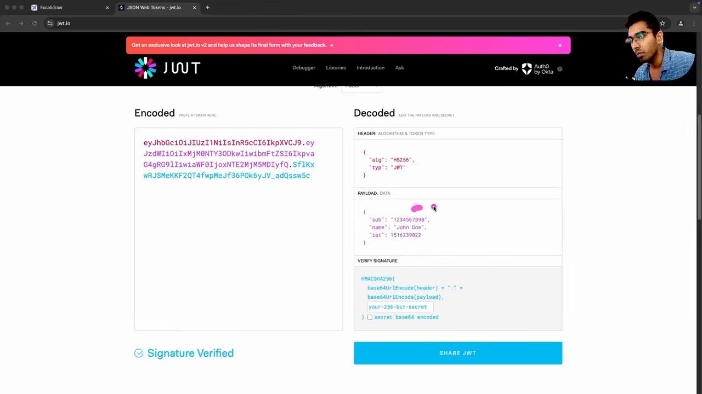

# 认证与授权：从蜡封到 OAuth 2.0 与 JWT

第 8 集 96 分钟，是系列里第一次讲安全，也是他自称最喜欢的一集。开场用两句话把整集的范围框死：

> authentication can be explained as a mechanism to **assign an identity to a subject**, to answer the question of **who are you** ... in the same way, the answer to the question **what can you do** in that context, all your capabilities, all your permissions ... that process is called **authorization**.（00:24）

他补了一句前提："in a given context"，这个 context 可以是平台、操作系统，也可以是你的手机。所以认证不是某个系统独有的动作，而是"在某个语境里确认身份"这件事本身。

## 一、认证的五段演进

他在白板上画了一条时间线，每一段都是上一段被攻破之后的产物。

### 隐性信任：握手

前工业社会里认证是**内嵌在关系里的**（implicit）。一个在社区里有声望的人作证，交易靠握手完成，握手这个动作本身象征"互相认可以及达成一致"。

他的评价是"elementary"，并且点出它为什么只能在熟人社会成立：村长没法为全社会、全大陆的人作证。人口一多，这套机制就**不再 scale**。

### 显式证明：蜡封

社会需要一种"不依赖私人交情也能验证"的凭据，于是出现了**蜡封（wax seal）**。

这是他给的第一句硬结论：蜡封是**"the first widely adopted authentication tokens"**，本质是"你把某个物件拿在手上，所以你是你"（possession）。它和今天的签名是一回事，只是载体不同。

蜡封的弱点他也直接说了：**可伪造**。而伪造印章被归类为最早记录的**认证绕过攻击（authentication bypass）**：不正面破解，直接跳过认证环节。后来的水印、加密代码都是在堵这个洞。

### 共享秘密：来自口令

工业革命带来了电报，电报成了关键基础设施，于是需要"安全地验证消息"。操作员之间用**事先约定好的 passphrase**，这是最早的共享秘密。

这一段的转折是认证的依据变了：从"你**有**什么"变成"你**知道**什么"。他特意指出当时的 passphrase 就是今天的静态密码，是固定的字符串，不是动态的。

### 1961：明文密码与一次打印事故

计算机时代的第一站是 MIT Project MAC 的 **CTSS（Compatible Time-Sharing System）**。为了让多用户共用一台机器且互相看不到数据，他们引入了密码。

问题在于密码**以明文存在文件里**。后来有人把这个密码文件打印了出来，漏洞彻底暴露。他把这次事故称为"secure password storage 的起点"：正是它让"密码不能明文存储"变成一条原则，并推动了**哈希**。

哈希的性质他讲得清楚：单向、把任意长度输入变成**固定长度**输出、同一输入永远同一输出。从这之后，认证才开始对齐信息安全的 CIA 三要素（机密性、完整性、可用性）。

### 1970s：非对称密码与票据

Diffie 与 Hellman 的**密钥交换**让双方可以在不可信信道上协商共享秘密，**非对称密码**由此成为现代认证协议的地基，也就是今天说的 **PKI**。

同一时期还有 **Kerberos**：靠可信第三方签发**票据**来同时验证用户与服务的身份。他给了一句定位，这句话解释了后面所有 token 体系：Kerberos 是"token-based authentication 的前身"。

### 1990s 至今：MFA、OAuth、零信任

1990 年代互联网扩张，用户名加密码扛不住暴力破解与字典攻击，于是 **MFA** 出现。他把它拆成三个因素：**你知道的**（密码、PIN）、**你拥有的**（智能卡、OTP 生成器）、**你是谁**（指纹、视网膜）。

生物识别他也点出了问题：误识率（false positive / negative）与模板存储本身，都是新的安全负担，所以它同样不是终点。

21 世纪的云计算、移动端、API 架构又推了一轮，产出是 **OAuth / OAuth 2.0**、**JWT**、**零信任架构**，以及 **WebAuthn** 这类把公钥私钥放在硬件里、彻底去掉密码的方案。

他列的未来候选有三项：**去中心化身份**（基于区块链，用户自己持有身份）、**行为生物识别**、**后量子密码**（量子计算机一旦普及，RSA 这类基于计算难度的算法会被攻破）。

## 二、三个核心组件之一：Session

进入技术部分之前，他先把整集要反复出现的三个东西介绍掉：**session、JWT、cookie**。

### 为什么需要 session

HTTP 是无状态的，每个请求是独立事件，服务器不记得上一个。这在早期 Web 完全够用：静态页面、静态图片，读完就走，不需要连续性。

Web 变成动态内容后就撞墙了。他的两个例子：电商要记住购物车，用户要能在页面之间跳转而不掉登录。这两个需求催生了 **stateful interaction**，而 HTTP 本身给不了。

> a session basically provided a way to establish **temporary server-side context for each user**.（21:29）

### 三个阶段

**创建**：用户登录成功后，服务器生成唯一的 session ID，把用户角色、名字、购物车、是否已认证等"服务器要反复用到的数据"一起写进持久化存储。

**下发**：session ID 以 cookie 形式发给浏览器。他顺带对比了两种存储：数据库是"file based persistent store"，Redis 是"in-memory persistent store"，后者快得多。

**过期**：session 有有效期。他给的例子是 15 分钟：超时后再拿旧 ID 来，服务器认为无效，重新签发一个新的。

一句话总结这一段的用处：session ID 让 Web 有了记忆，让服务器能"为用户记住一些事情"。

### 存储的三代

第 1 代 **文件**：最早期的实现把 session 写在服务器文件里。简单，但用户一多就不 scale。

第 2 代 **数据库**：session 数据搬进数据库，支持更大的用户量，而且**服务器重启后 session 仍然可用**（持久化）。

第 3 代 **分布式内存**：进入分布式架构后，session 存储搬到 Redis、Memcached 这类内存存储，因为内存查找比数据库快。

## 三、JWT：把状态搬进 token

2000 年代中期，Web 应用变成全球分布式系统，stateful 方案暴露出两个瓶颈：

**存储开销**：为成千上万乃至上亿用户保留 session 数据，是很大的服务器负担。

**复制与延迟**：分布式部署下，session 数据要在不同地域的服务器之间同步，同步带来延迟，也就是**认证流程本身的延迟**，还带来一致性难题。

JWT 的定位是一句话：**stateless mechanism for transferring claims**，2015 年正式化。核心创新是 **self-contained**：用户 ID、角色、签名**全在 token 里**，服务端不需要再存任何东西。

### 三段结构

**Header**：元数据，说明签名算法，让服务端知道"这个 token 是用什么算法签的"。屏幕上就是 `{"alg":"HS256","typ":"JWT"}`。

**Payload**：声明（claims）。他点了三个字段：

| 字段 | 含义 |
|---|---|
| `sub` | 用户 ID。可以是数据库里的 ID，也可以是某个 OAuth provider 给的 ID，"just a storage mechanism" |
| `iat` | issued at，签发时间 |
| 自定义字段 | 用户名、角色（admin / member / editor / viewer…） |

**Signature**：用服务端的**密钥**签发。验证时用同一把密钥重算，只要 payload 被人改过一个字节，验签就失败。

他把这套东西的意义讲得很直白：**会话校验从此不需要存储，每次请求就地完成**。服务的成本从"存"变成"算"，而算一次签名很便宜。

### 三个收益

**无状态**：服务端零存储成本。

**可扩展**：微服务/分布式架构里，一个服务器签发的 cookie 到另一个域的服务器上用不了；而 JWT 可以被客户端带到任意一台服务器，**只要它们共享同一个密钥**，都能独立验签。

**可移植**：轻、URL 友好、base64 编码，能放 header、能放 cookie、能塞进 URL。他甚至提了一句"可以放 localStorage，但你不该那么做"。

### 两个代价

**token 被盗即身份被盗**。因为服务端不存状态，谁拿到 token 谁就能以你的身份行动，直到它过期。

**撤销做不到**。他连着说了两层：想立刻让某个用户的 token 失效，唯一的办法是**换密钥**；而换密钥意味着**全平台所有用户一起被登出**。这对"账号被黑、用户要求强制下线"这种场景来说是不能接受的。

### 混合方案，以及他对这套方案的质疑

实践里的补丁是 **JWT + 黑名单**：正常请求只验签，同时在持久化存储（数据库或 Redis/Memcached）里维护一份被撤销 token 的黑名单，每次请求顺手查一下。

他自己立刻反问了这个设计的逻辑：如果为了校验有效性还要查存储，**那当初为什么要选无状态？** 直接上 stateful 不是更简单也更安全吗？

他给的答案是行业里的通行建议：**别自己纠结这些策略，直接用 OAuth provider**（他提到 Auth0、Clerk 这类）。哈希、加盐、密钥轮换这些细节交给它们；"那是他们的头疼事"。他只留了一个例外：学后端工程时自己实现一遍，目的是理解 trade-off。

## 四、三个核心组件之三：Cookie

定义很朴素：cookie 是**服务器让浏览器存一段信息**的机制，值可以是任意字符串。

他强调的两个性质：

**按服务器隔离**：一个服务器设的 cookie，别的服务器看不到。这是浏览器提供的安全特性。

**自动附带**：服务器设过的 cookie，会在之后**发往该服务器的每个请求**里被自动带上。

认证流程里它就干这一件事：登录成功后 `Set-Cookie` 下发 session ID 或 token，之后浏览器自动带回来，服务端从中取出凭证完成识别与授权。他把这称为"自动化"：服务器不必每次都提醒客户端"记得带上凭证"。

## 五、四种认证类型与选型

白板上列了四项：**① Stateful ② Stateless ③ API Key ④ OAuth 2.0**。

### Stateful 的完整流程

登录（账号 + 密码）→ 服务器校验 → 生成 session ID → 连同用户数据写进 Redis（他说明了为什么多用 Redis 而不是数据库：读写快）→ session ID 放进 **HttpOnly cookie** 回给客户端（HttpOnly 意味着 JavaScript 读不到这个值）→ 之后每个请求自动带 cookie → 服务端拿 session ID 去 Redis 查存在性、有效期、用户数据 → 识别并放行。

他还补了一句实现自由度：session ID 本身可以是密码学随机串，也可以是 JWT，"depending on the implementation"。

### Stateless 的完整流程

登录 → 校验 → 服务器用**自己的密钥**签发 JWT（内含 user ID、角色）→ 客户端把 JWT 放进 `Authorization` 头（他说这是标准做法，也允许别的载体）→ 服务端取出 token、用密钥验签 → 成功就拿到 user ID；失败返回 unauthorized / forbidden。

为什么叫 stateless？他给了因果："because in a stateful authentication we need to look up a persistent store ... in a stateless authentication whatever information that we need about the user is stored in the token itself"。

### 两者的取舍

| | Stateful | Stateless |
|---|---|---|
| 优势 | 集中控制；能实时看到所有活跃 session；随时踢人、登出 | 可扩展；不依赖 session store；对移动端友好 |
| 劣势 | 扩展性有限；多地域部署运维复杂、有延迟 | 撤销困难；密钥轮换会全员登出 |

他的个人建议（原话是 "in my opinion"）：**大多数应用应该用 stateful**，因为安全和撤销的便利性更重要。

### 混合：按客户端分开

他的落地方案是混合：浏览器里的主 Web 应用用 stateful；移动端、第三方集成、服务器对服务器用 stateless。理由是移动端本来就没有 cookie 这个概念。

### API Key：面向机器

生成流程：在平台的 UI 上点"生成 API Key"，拿到一个**密码学安全的随机串**。

他用 ChatGPT 讲清了它的定位：普通用户在网页 UI 里对话，是**人机交互**（client-to-server）；而你的后端想程序化调用模型，就是**机器对机器**（machine-to-machine），中间没有人、没有登录表单。API Key 就是为后者设计的：把密钥放在服务端的环境变量里，每次请求带上，服务端据此认出"这是哪个账号、什么套餐、还剩多少额度"。

它的特点是可限定权限与有效期，适合"单一用途的客户端"。

### 选型口诀

他自己给的 thumb rules：

| 类型 | 用在哪 |
|---|---|
| Stateful | 所有 Web 应用的登录流程，包括大部分 SaaS |
| Stateless | API、全球分布式系统 |
| OAuth 2.0 | 第三方集成、用 Google/Facebook/Discord 登录 |
| API Key | 服务器到服务器、机器对机器、单用途客户端 |

他最后补了一句经验：日常写 API 时，你用得最多的还是 stateful 与 stateless 这两种。

## 六、OAuth：从"分享密码"到"分享受限 token"

### 问题：委托访问

先讲动机。用户名密码体系的老问题是"平台越多、凭据越多"：要是没有密码管理器，人就记不住，于是**到处复用同一个密码**，一次泄露就连坐一批账号。

第二个问题是**疲劳**：账户太多，管不过来，这催生了 **delegation**（委托）这个概念。

场景很具体：旅行 App 要读你的 Gmail 去扫机票；社交 App 要导入你的 Google 联系人。本质都是"一个平台需要以程序化方式访问另一个平台的资源"。

### 早期解法：分享密码，以及它为什么是灾难

人们最初就是让用户把密码交给第三方。他用了 "disastrous" 这个词，理由两条：

**权限过大**：密码给的是账号全部权限。他举的例子很直白：你把 Google 密码给我，我就能看你的照片、地图历史、联系人、日历，还能增删改。

**无法撤销**：因为大家都在复用密码，想收回权限就得在所有地方改密码。

### 2007：token 代替密码

思路是把"全权凭证"换成"**限定范围的凭证**"：token 只对账号的某个部分、某个操作有权限。他给的对比例子：密码能删你的联系人，而只读 token 只能读。

四个角色（他的原话顺序）：

- **Resource Owner**：数据的拥有者，也就是用户
- **Client**：请求访问的应用，例子里是 Facebook
- **Resource Server**：存资源的服务器，例子里是 Google
- **Authorization Server**：认证用户并签发 token 的服务器

### OAuth 1.0 的流程

1. Client 把用户重定向到 Authorization Server
2. 用户在那边登录并授权（"点同意，勾选要给哪些权限"）
3. Authorization Server 把 token 发给 Client
4. Client 拿 token 访问 Resource Server 上的资源

结果是：密码从未离开 Authorization Server，权限被限定在授权范围内。他的评价是"以非常漂亮的方式解决了一个问题"。

但 1.0 有两个技术局限：**实现复杂**（整个流程对开发者不友好），以及**依赖密码学签名**（极易写错）。

### 2010：OAuth 2.0 的两处简化

**Bearer token** 取代签名：请求里带上 token 即可。他承认这"更脆弱"，但实现简单得多。

**按客户端类型拆流程**：

| 流程 | 场景 |
|---|---|
| Authorization Code | 服务端应用（最常用） |
| Implicit | 浏览器端应用；因安全风险现在**不推荐** |
| Client Credentials | 机器对机器，无用户参与 |
| Device Code | 输入能力受限的设备，例如智能电视 |

### 关键一句：OAuth 只解决授权

他专门停下来强调：**OAuth 解决的是授权（委托），不是认证**。拿到 access token 只说明"这个客户端被允许访问某些资源"，不能说明"现在这个人是谁"。

补上这块的是 **OIDC（OpenID Connect，2014）**：它在 OAuth 2.0 之上加了一个 **ID token**，形态就是 JWT，里面装 `sub`、`iat`、签发方（issuer），以及名字、邮箱这类身份信息。

### OIDC 的实际流程（"Sign in with Google"）

1. 客户端（比如笔记应用）把用户重定向到 Google 的 Authorization Server
2. 用户在 Google 侧登录并授权（比如"允许读取邮箱和头像"）
3. Authorization Server 返回 **authorization code**（有时同时给 ID token）
4. 客户端拿 code 去换 **access token**（以及 ID token）
5. 客户端用 access token 以用户身份访问资源（比如读 Google Keep 的笔记）

有了这一步，平台不必自建账号体系就能"认出你"，同时只能拿到你授权范围内的东西。他的收束比喻是：OAuth 2.0 与 OIDC 像"数字时代的门锁与钥匙匠"，保证任何一方都不会拿到超出授权的东西。

## 七、授权：从"万能字符串"到 RBAC

他把授权单独开了一节，用一个笔记应用的例子讲动机。

场景：用户登录后能增删改笔记。但产品有个"回收站"设计：删除只是移进回收站，30 天后进入一个叫 **dead zone** 的区间，对用户不可见但仍在数据库里。现在**平台创建者**需要一个管理界面来批量处理这些数据，也就是"某些能力不对所有用户开放"。

他先讲了一个反面方案：**发一个特殊字符串**，请求里带上它就当作管理员。两个致命问题：

**它是一条"god mode"字符串**：一旦被截获，对方可以清库、篡改所有用户数据。

**它不可扩展**：要给同事也开权限，只能复制字符串或再加几条字符串，服务端逻辑越来越乱，权限越来越难管。

于是引出定义：**给不同用户不同的权限，就是 authorization**。多租户场景更明显：组织管理员要能决定谁能读、谁能写。

### RBAC

最常用的模型是 **RBAC（Role-Based Access Control）**：用户不直接持有权限，而是被分配**角色**，权限挂在角色上。

他的例子：`user` 角色只给读，`admin` 给读写，`moderator` 给读写；再按资源细分：笔记这种资源上普通用户可读写删，而访问 **dead zone** 的权限只给 admin。

流程上，角色在请求周期的早期就被确定：用户注册时分配角色，之后每次请求带 token 或 session ID，服务端据此（或查库）得到角色，把角色信息传给后续逻辑；后续 handler 判断角色够不够，不够就返回 **403 Forbidden**。

## 八、两个必须知道的安全细节

### 错误信息要通用

他列了三种"友好"的报错，然后逐个说明它们如何变成攻击者的线索：

| 报错 | 泄露了什么 |
|---|---|
| `user not found` | 该邮箱/用户名**不存在**，攻击者直接换下一个 |
| `incorrect password` | 用户名**存在**，只需集中爆破密码 |
| `account locked due to too many failed attempts` | 该账号存在，且锁定策略已知 |

结论很明确：**认证流程里的错误信息一律通用**，比如统一返回 `authentication failed`。他把范围划得很清楚：校验类、业务类的接口可以给友好的错误提示，认证不行。

### 时序攻击

他先把正常登录的三个步骤拆开：

1. 查用户是否存在
2. 检查账号是否被锁定
3. 把提交的密码**哈希**后与数据库里的哈希比对

问题出在"提前返回"：如果用户名不存在，第 1 步就结束，响应很快；如果用户名存在但密码错，要走到第 3 步才算完，而**哈希是耗时操作**，于是响应慢一点（他举了 200ms 这个量级）。

攻击者不需要看到报错，**只靠响应时间的差异**就能判断用户名是否正确，甚至判断卡在哪一步。

他给两种防御：

**恒定时间比较**：用密码学安全的 constant-time 比较函数，执行时间不随输入相似度变化。

**模拟延迟**：失败路径人为补一段延迟（Node 的 `setTimeout`、Go 的 `time.Sleep`），让"用户名不存在"和"密码错误"的耗时看起来一样。

## 备注

- 本篇字幕来源：**YouTube 的 en-orig（原声英文 ASR）**，不再是机翻版本。前一版用的是 `en` 轨道，译自印地语自动翻译，句子是碎的、无法引用；换成 en-orig 后所有英文引文都是逐字的。
- 时间戳：两个定义 00:24、认证演进 02:16–18:19、session 19:01–25:38、JWT 25:41–38:16、cookie 38:24–41:03、四种类型 41:10–58:00、OAuth 58:01–77:20、选型口诀 77:20–78:60、授权与 RBAC 79:05–87:38、错误信息 87:54–90:24、时序攻击 90:25–95:55。
- 唯一截图是 jwt.io Debugger（29:20），其余全是 Excalidraw 板书；按规则纯板书不截。
- 他讲到但没展开的（本文不代他补）：refresh token 与轮换策略、PKCE、token 该存 localStorage 还是 HttpOnly cookie 的取舍、ABAC/ReBAC 的具体建模。

> 资料源：[Sriniously — Backend from first principles](https://www.youtube.com/playlist?list=PLui3EUkuMTPgZcV0QhQrOcwMPcBCcd_Q1)，第 8 集（1h35m57s）。
