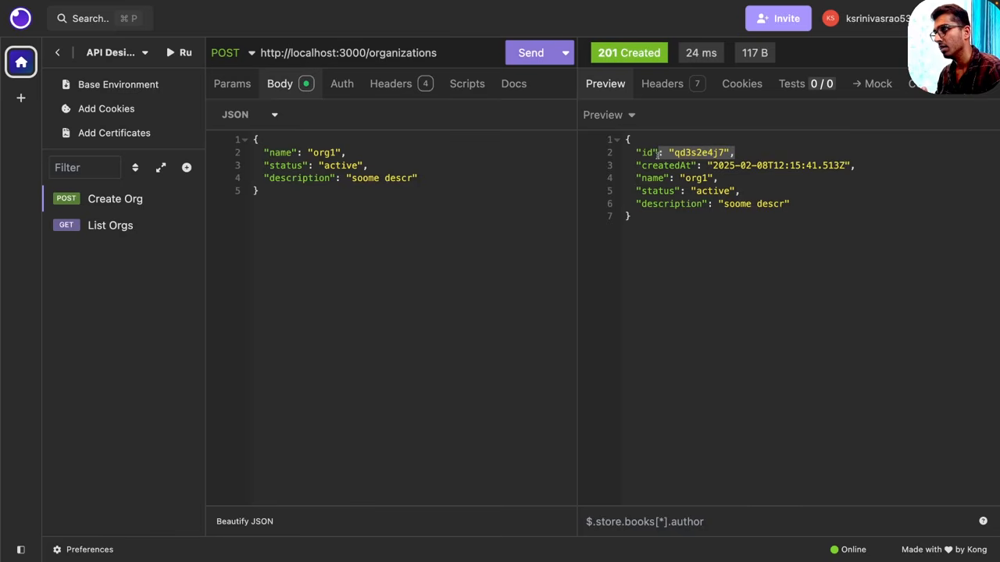
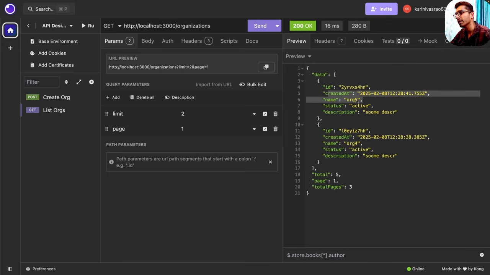

# REST API 设计：从 Roy Fielding 的六个约束到一次完整的设计演示

第 11 集 2 小时 4 分，是整个系列最长、也是他自己说"最重要"的一集。开场他先把问题摆出来：REST 已经存在二十多年，有成百上千的后端工程师踩过坑，但新手仍然会被同一批问题卡住。

> should the URI path segment be plural or singular, or when updating a resource should you call `PATCH` or should you call `PUT` ... if it's a non-CRUD operation ... which method should you use.（00:20）

他给的原因是**时代错位**：这些标准成型时，主流还是 MPA（多页应用），服务器的职责与今天 SPA（单页应用）时代的差别很大。

这一集的目标也说得清楚：**不发明新标准，而是从已有标准里抽出规则**，让所有人按同一套约定走，把注意力留给业务逻辑。

## 一、REST 的来历

他先讲了历史，因为"为什么叫 REST"直接决定了后面所有规则。

1990 年，Tim Berners-Lee 为了"和全世界共享知识"启动了万维网项目，一年内造出一整套东西：**URI、HTTP、HTML、第一个 Web 服务器、第一个浏览器、第一个所见即所得 HTML 编辑器**。这些今天还在用，只是版本变了。

问题随之而来：用户量指数增长，项目**撑不住了**。1993 年，Apache HTTP Server 的联合创始人 **Roy Fielding** 关注到这个扩展性问题，提出一组约束来解决它。后来他与 Berners-Lee 一起写了 **HTTP/1.1** 规范；2000 年，扩展性危机解除后，他在**博士论文**里给这套"Web 的架构风格"命名：**REST（Representational State Transfer）**。

他把这篇论文称为"后端工程师必读"，因为里面能看到今天这些模式为什么长成这样。

### 六个约束

**Client-Server**：关注点分离。客户端管 UI 与体验，服务器管数据与业务逻辑，两边能独立演进。

**Uniform Interface**：统一接口，简化整体架构。它下面还有四个子约束：资源标识、通过表示操作资源、自描述消息、**HATEOAS**（超媒体作为应用状态引擎）。

**Layered System**：架构由层次组成，每层只能看到并交互它的下一层。这让负载均衡、代理这类中间件可以随时插入，而不影响核心功能。

**Cacheable**：响应必须显式标注可缓存或不可缓存，客户端据此复用，降低服务端压力、改善体验。

**Stateless**：每个请求自带处理所需的全部信息，服务端不保留客户端上下文。他用负载均衡举例：加了机器、前面有轮询，正因为无状态，任何一台都能处理同一个客户端的请求。

**Code on Demand**（可选）：服务器可以临时把可执行代码（如 JavaScript）发给客户端来扩展功能。他说这条在实际里用得很少，所以是唯一可选的约束。

### REST 三个词各是什么意思

**Representational**：资源（数据或对象）按客户端需要以某种**表示**呈现。同一个 user 资源，给 API 客户端返回 JSON，给浏览器返回 HTML。

**State**：资源当前的状态与属性。他的例子是电商购物车：里面有哪些商品、各自数量、总价，这就是这个资源的 state。

**Transfer**：表示的**传输**。客户端和服务器之间通过 HTTP 交换同一资源的不同表示，用 GET/POST/PUT/DELETE 这些方法完成。

把三个词合起来就是一句话：**同一份资源可以有多种表示，资源的状态在客户端与服务器之间传输，整个系统遵循一组让它可扩展的约束**。

## 二、URL 怎么拼

他先拆了普通网页 URL 的组成：**scheme**（http/https）、**authority**（域名，可带子域）、**path**（资源路径）、**query**（键值参数）、**fragment**（页内锚点）。

API 的 URL 在此基础上加了两条行业惯例：

**子域用 `api.`**：`https://api.example.com`。

**版本号放进路径**：`/v1/...`。他说这是最常见的做法，虽然也见过放 header 或 query 的（第 5 集提过）。

### 资源名永远用复数

这是他的第一条硬规则。取全部书是 `/books`，取单本也是 `/books/:id`，**不是** `/book/:id`。理由不是语法，而是**一致性**：路径段代表的是"资源集合"这个概念，具体某个资源是集合里的一个元素，所以集合名保持复数，个体靠 ID 区分。

### slug 规则

要用人可读的名称做路径参数时（比如用书名而不是 ID），他一共给了三条：

1. **全小写**：URL 会跨服务器、跨客户端、跨操作系统，不该赌大小写敏感的一致性
2. **空格换成连字符**：`Harry Potter` → `harry-potter`
3. **不用空格、不用下划线**

### 斜杠表示层级

`/` 在路径里表示**层级关系**：`/books` 是第一层（集合），`/books/:id` 是第二层（集合中的一个元素）。这条在嵌套路由里会反复用到。

## 三、幂等性：逐方法论证

他的定义：**同一个操作执行多次，产生的效果与执行一次相同**。注意这里的"效果"指**对服务器状态造成的影响**，不是响应内容本身。

他用同一套推理过了一遍五个方法：

**GET**：只取数据，不改变服务器状态，调用多少次效果都是零变化。有人会问"如果别人同时新建了书，我第二次拿到的列表不就变了吗"——他专门澄清：幂等看的是**你这个请求造成的副作用**，别人造成的改变不算。

**PATCH 与 PUT**：都是更新。他用 `name: A → B` 的例子说明：第一次把 A 改成 B，第二、第三次还是 B，状态不再变化。

他把 `PATCH` 与 `PUT` 的区别也放在这里讲：`PATCH` 传**部分字段**（只传 name），`PUT` 传**完整表示**（id、name、createdAt 全要传，服务器整条替换）。他还说了两个现实观察：

- 内部 API 里两者混用很常见，"as long as you're using your API internally" 影响不大
- **公共 API 必须守语义**，因为集成方会按标准假设你的行为，你偏了就是在制造错误假设

他的实践偏好很明确：**更新部分字段就用 `PATCH`**，他自己很少写 `PUT`。

**DELETE**：第一次删除成功；第二次同一个 ID 会得到 **404**，但服务器状态没有再次改变。所以它**仍然是幂等的**，幂等不等于"每次返回相同响应"。

**POST**：唯一的非幂等方法。创建资源时每次都会插入一条新记录，ID 由数据库生成，所以两次相同请求产生两个实体。他顺带解释了为什么可以把同名书创建两次：**区分实体靠 ID，不靠名字**。

### custom action 为什么也用 POST

REST 规范需要给"不属于 CRUD 的动作"留出口，于是 **POST 被设计成开放式的**。

他的例子是 `POST /send-email`：这既不是取数据，也不是创建、更新、删除，而是一个"让服务器做某件事"的动作。

## 四、设计流程：从线框图到接口

他给的工作流是这样的：

**第一步，看 UI 设计稿**（Figma、线框图、用户故事）。理由很实际：从这里能看清"用户怎么和数据交互"，而这是 API 服务的对象。

**第二步，把需求里的名词抠出来当资源**。他举了一个项目管理平台（类似 Jira/Linear）的例子，扫一遍需求能拿到：`projects`、`users`、`organizations`、`tasks`、`tags`。

**第三步，设计数据库 schema**（这一集跳过，下一集讲）。

**第四步，列动作清单**。每个资源先套一遍 CRUD：list、get one、create、update、delete，再加上业务需要的 custom action。

**第五步，用 API 客户端（他选的是 Insomnia，比 Postman 轻）把接口"设计"出来**，不写代码。他强调这一步是**设计**而不是实现：

> the interface point we are designing, not the execution point.（约 1:07:00）

演示用的三张表是 `organizations`、`projects`、`tasks`。

## 五、Organization：五个 CRUD 端点逐条过

### list：`GET /organizations`

返回体里有四个字段，这是他给的分页契约：

| 字段 | 含义 |
|---|---|
| `data` | 当前这一页的数据 |
| `total` | 数据库里符合条件的总条数 |
| `page` | 当前是第几页 |
| `totalPages` | 一共多少页 |

为什么需要分页，他给了两条理由：**序列化本身很贵**（把上千条记录序列化成可传输 JSON 是重活），**用户也看不完**（首屏只显示 10~20 条）。

### create：`POST /organizations`

请求体和 url 完全一样，服务器**靠方法区分**：`POST` 路由到创建 handler，`GET` 路由到列表 handler。

请求体只放**客户端能决定的字段**：

```json
{ "name": "org 1", "status": "active", "description": "some description" }
```

`id`、`createdAt`、`updatedAt` 由服务器生成，**不收**。

Insomnia 里那条真实请求是：

```json
{ "name": "org1", "status": "active", "description": "soome descr" }
```

响应把服务器生成的两个字段一起返回（ID 是 8 位短串，`createdAt` 是 ISO 时间戳）：`id: "2yrvxs4hn"`、`createdAt: "2025-02-08T12:28:41.755Z"`，后面才是 `name` / `status` / `description`。

响应是 **201 Created**，并把新建的实体原样返回（带服务器生成的 ID 与时间戳）。



### 分页实战

建了 5 个组织后，他用 `?limit=2` 演示：

- 第 1 页：org5、org4（**默认按 createdAt 倒序**）
- 第 2 页：org3、org2
- 第 3 页：org1（只剩一条）

`total=5`、`totalPages=3`。算式他当场算了一遍：5 条、每页 2 条，需要 3 页（2 / 2 / 1）。他顺带讲了客户端怎么用这些元数据：显示"10 / 50"，或者无限滚动时判断 `page === totalPages` 就停止请求。



### 排序：`?sortBy=name&sortOrder=asc`

他在这里提出了一个贯穿全篇的概念：**sane defaults（合理默认值）**。

客户端什么都不传时：`page` 默认 1、`limit` 默认 10 或 20、`sortBy` 默认 `createdAt`、`sortOrder` 默认 `desc`。

**为什么必须有默认排序**：数据库不保证顺序，不显式排序的话，同样的请求每次可能返回不同顺序，客户端体验就崩了。按创建时间倒序是"最新在前"，最符合直觉。

### 过滤：`?status=archived`

先建了一个 `status: archived` 的组织，然后 `?status=archived` 只返回归档的，`?status=active` 只返回活跃的，`?name=org4` 按名字过滤。他说明这就是列表 API 的第三个必备能力。

### update：`PATCH /organizations/:id`

请求体只传要改的字段（例子里只改 `status`），返回 **200** 加更新后的实体。

### get one：`GET /organizations/:id`

返回 200 + 单条实体。他强调了这条的**路由形状**：get/update/delete 单条资源的路径完全一样（`/organizations/:id`），区别只在方法。

### delete：`DELETE /organizations/:id`

返回 **204 No Content**、响应体为空。删完再 `GET` 同一个 ID，得到 **404**。

### 列表为空不能返回 404

这是他很强调的一条 thumb rule：列表 API 过滤不到数据时，返回 **200 + `data: []` + `total: 0`**。

理由：客户端请求的不是"某一个资源"，而是"一个资源集合"。集合为空是合法结果，不是"找不到资源"。404 只用于**请求了某个具体资源而它不存在**。

![第 11 集 1:35:10：过滤条件写成一个不存在的值（status=random），响应依然是 200，body 是 data: []、total: 0、totalPages: 0](p03-empty-list.png)

## 六、custom action：归档组织

组织有 `status` 字段，把 `active` 改成 `archived` 看起来像 PATCH，他解释了为什么不能这么做：

> 归档一个组织时，它下面的项目可能要一并删除、成员要收到通知、项目下的任务也要处理。

也就是说**归档是一个业务动作，不是一次字段更新**。所以按 REST 的约定用 POST 走 custom action：

```http
POST /organizations/:id/archive
```

返回 **200** 加更新后的实体。他在这里纠正了一个常见误解：

> 不要以为 POST 一定返回 201。POST 只在"创建了资源"时返回 201；custom action 没有创建资源，所以返回 200。

## 七、Projects：同一套模式再跑一遍

他明确说了这一段是"为了让你把模式内化"。

`POST /projects` 的请求体字段是 `name`、`organizationId`、`status`、`description`，同样排除服务器字段。`organizationId` 是外键，告诉服务器这个项目属于哪个组织；`status` 的示例值是 `planned`。

这里他补了一条 JSON 约定：**所有字段用 camelCase**，因为这是 JSON 世界的通用规范，客户端不用猜。

clone 是第二个 custom action：`POST /projects/:id/clone`。理由和归档对称——克隆可能意味着"把项目下的任务一起克隆、通知项目所有者"，客户端用 `POST /projects` 自己拼一份是模拟不出来的。

这次返回的是 **201**，因为克隆**确实创建了新资源**。他借此再强调一次：**状态码取决于服务端实际发生了什么，不是取决于用了哪个方法**。

## 八、两条铁律

### 一致性

他用一个具体场景说明了为什么：前端工程师集成你的第一个 API 之后，会**用这个 API 的形状去推断后面所有 API**。

- 你在创建组织时用了 `description`，创建项目时改成 `desc`，对方就会撞上校验错误
- 你在 `/organizations` 用了复数，`/project` 用了单数，对方也会错

他的原话是"这是一名优秀后端工程师最重要的特征之一"：**风格一致性**。哪怕你不采用全球标准，也要**自己定一套并坚持**。

### sane defaults

三条落地：

**GET 列表**：page/limit/sortBy/sortOrder 全给默认值。

**POST 创建**：只要求必要字段，其余给默认值。例子是 `status`：客户端不传，服务端默认设为 `active`，因为新建的组织按常识就是活跃的。

**避免缩写**：`description` 不要写成 `desc`。他给了理由——写 API 时你掌握的信息量，远大于后来集成的人；缩写在你这儿清楚，在对方那儿就是猜。

### 交互式文档

他要求从项目初期就把 **Swagger/OpenAPI** 这类交互式文档纳入规划：既能自己测，又能当文档给集成方用。他把"多认真、多频繁地维护 OpenAPI 文档"列为区分后端工程师水平的重要指标。

结尾那张清单只有四条，值得抄下来：

| 要求 | 具体做法 |
|---|---|
| 提供交互式文档 | Swagger / OpenAPI，从项目初期就规划，自己测也用得上 |
| 直觉且一致 | 路由、动态参数、custom action、payload 全部同一套风格 |
| 给 sane defaults | 分页、排序、创建时的默认值都在服务端定好 |
| 避免缩写 | `description` 不写 `desc`；集成方没有你脑子里的上下文 |

## 九、结尾那句

他说 API 的第一步永远是**设计**，不是编码：

> an API, a rest API at least, is designed in the initial form, it is not coded or programmed right away.（约 2:02:00）

所以这一集从头到尾没有出现任何编程语言或框架，只用 Insomnia 把接口摆出来。

## 备注

- 时间戳：困惑清单 00:20、REST 历史 01:20–04:40、六个约束 04:40–09:30、三个词的含义 09:30–15:00、URL 结构 15:00–22:00、幂等性 22:00–40:00、设计流程 40:00–50:00、organization 端点 51:00–1:26:00、projects 端点 1:26:00–1:52:00、两条铁律与文档 1:52:00–2:02:00。
- 截图全部取自 Insomnia 实机演示；他的白板（六个约束那张）属于纯板书，按规则不截。
- 他在这集没讲的部分（本文不代他补）：HTTP 语义里 `HEAD` 与 `OPTIONS` 的细节、基于 header/media type 的版本化具体写法、错误响应的统一结构（下一批章节会碰到）、`HATEOAS` 的落地方式。

> 资料源：[Sriniously — Backend from first principles](https://www.youtube.com/playlist?list=PLui3EUkuMTPgZcV0QhQrOcwMPcBCcd_Q1)，第 11 集（2h03m34s）。
