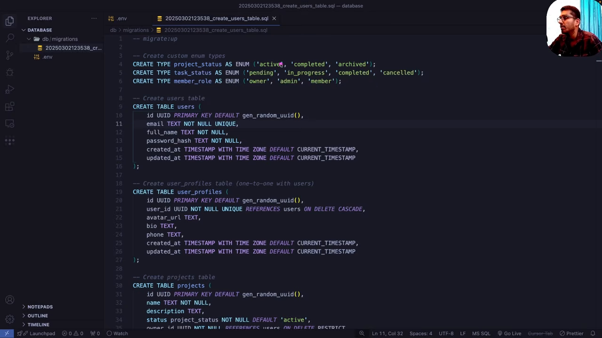
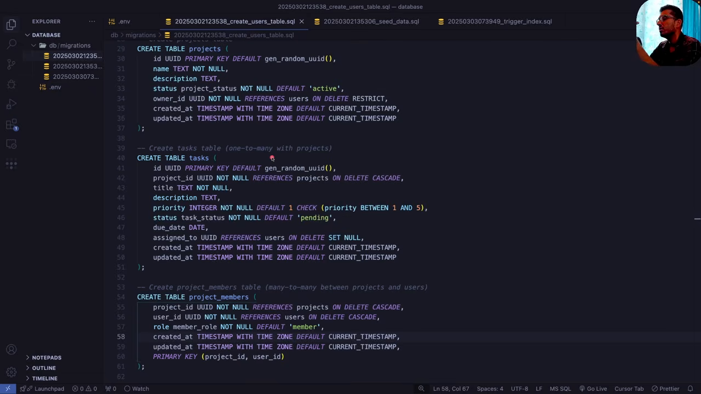
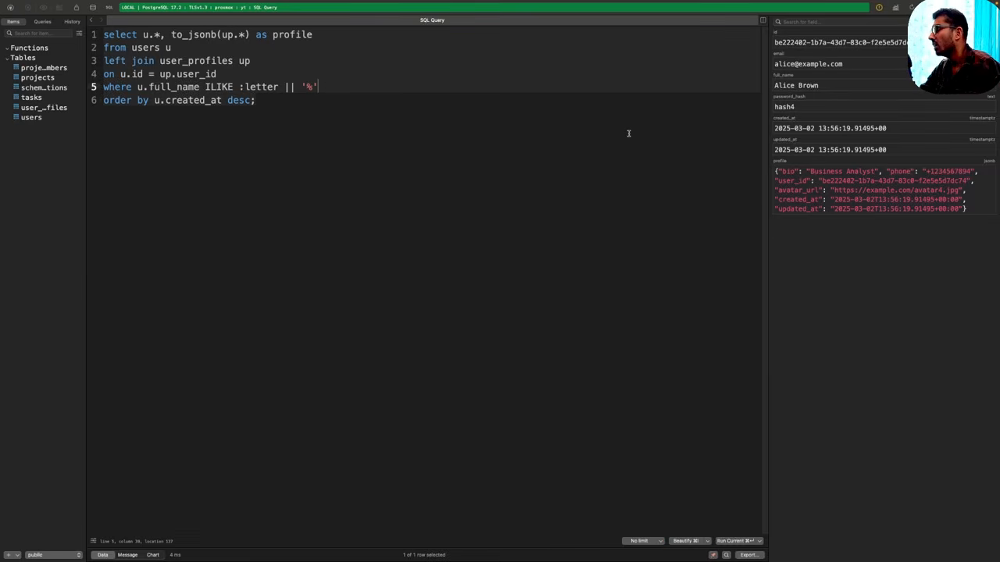

# Postgres 实战：从数据类型的取舍到迁移、索引与触发器

第 12 集 2 小时 45 分，是全系列最长的一集。开场他把范围划得很清楚：**SQL 语法和 Postgres 的基础用法不在这里讲**："if you want you can pause this video right now and just search in YouTube SQL Basics"，有一小时到二十小时的免费课程可选。这一集只讲后端工程师日常真正会遇到的部分。

他给的判据是"80%"：接收前端传来的 payload → 动态拼出查询 → 参数化执行 → 返回数据。

## 一、为什么需要数据库

数据库的本质是一句很短的话：**让数据在不同会话之间活下来**（persist information across different sessions）。

他的例子是待办清单：你加了条目、勾掉了已完成的，关掉应用再打开，列表还是你离开时的样子。如果没有持久化，每次打开都等于重来一遍。

### 一个必须接受的取舍：磁盘便宜、内存快

他先解释为什么后端语境下的"数据库"默认指**磁盘数据库**：

| | 内存（RAM） | 磁盘（SSD/HDD） |
|---|---|---|
| 速度 | 快，主存直连 CPU | 慢一个量级 |
| 容量 | 常见 8/16/32GB，最多 64/128GB | 常见 512GB～2TB |
| 成本 | 贵 | 便宜 |

结论就是分工：**缓存放内存**（Redis 这类），**数据库放磁盘**。数据库要的是容量，速度可以做一定程度的妥协，而缓存要的是速度，容量可以妥协。

### 什么都能叫数据库

他举了三个例子：手机通讯录、浏览器里的 localStorage（Excalidraw 就在里面存了键值对）、一个记笔记的 txt 文件。

所以宽泛定义是：**任何提供持久化 + CRUD 的东西都能叫数据库**。落到后端工程师的日常，指的是"跑在磁盘上的持久层"。

## 二、DBMS 到底负责什么

把数据丢进磁盘还不够，还要能高效地取、改、删：在几百 GB 的数据量上。这就是 DBMS 的活。他列了四项职责：

**数据组织**：让插入、更新、查询都尽可能高效。

**访问**：提供 CRUD 的操作入口。

**完整性（integrity）**：数据必须是准确的、有效的、没被写坏的。他的例子很具体：订单表里 `payment` 字段存金额，如果有人试图往这个字段写字符串，**数据库应该直接拒绝**，这是 DBMS 的责任，不该推给应用层。

**安全**：通过用户、角色等机制防止未授权访问。

## 三、为什么不用文本文件

这是他讲得最透的一段，因为他要说明"为什么必须有 DBMS"。

**解析的代价**：把客户数据存在 txt 里，每次查一个客户，你都要用应用代码读整个文件、按行切分、逐个字段比对。这既慢（JavaScript、Python 这类语言更慢）又容易出错。

**没有结构**：文本文件是"流体"，你想写什么都行。你无法约束"这个字段只能是数字"，也就无法保证一致性。

**并发会直接丢数据**。他给的例子值得抄下来：

> 文件里有一行 `amount = 40`。两个人同时要改：一个想 +20，一个想 −20。两人都先读到 40，然后各自算完写回：一个写 60，一个写 20。最后存下的是哪个，取决于 CPU 周期等一堆你无法预料的因素。

这不是"偶尔出错"，而是**没有任何机制保证正确**。数据库要靠锁、事务这些东西来管住并发，文本文件一个都没有。

## 四、关系型与非关系型

| | 关系型 | 非关系型 |
|---|---|---|
| 结构 | 表 / 行 / 列，写入前必须定义 schema | 集合 / 文档，不强制 schema |
| 典型产品 | MySQL、Postgres、SQL Server | MongoDB |
| 一致性 | 由数据库强制（类型、外键、约束） | 靠应用层自己保证 |
| 适合 | 需要强一致性与关系查询的场景 | 结构不固定、早期快速试错 |

他的两个对照案例：**CRM**（客户关系管理，联系人、销售机会要准且要能关联分析）适合关系型；**CMS**（内容管理，文章里可能夹图片、代码块、YouTube 嵌入，字段不固定）适合文档型。

代价他也说了：NoSQL 把完整性检查推到应用层，应用代码改动频繁，"it's very easy to miss something"。

## 五、为什么选 Postgres

他的五条理由，最后一条是关键：

1. **开源免费**，可以自己部署
2. **遵守 SQL 标准**，将来迁移到 MySQL 之类不用大改
3. **可扩展**，官方文档约 1400 页，扩展体系完善
4. **可靠、可扩展**（他这里的"可扩展"指的是能扛量）
5. **对 JSON 支持极好**：这条直接消掉了"为了动态数据去上 MongoDB"的理由

第 5 点的推理值得记：NoSQL 被选中的常见理由是"任意结构的数据"，而那些数据基本都是 JSON。Postgres 有 `json` / `jsonb` 类型并且能建索引、能查询，所以 CMS 那类需求也能用 Postgres 扛。

## 六、数据类型：每一个选择背后都是取舍

他先给了一段建表语句，然后把每个类型讲了一遍。这里只留真正影响决策的部分。

### 整数与自增

`serial` / `bigserial` 是自增整数。他说生产系统里主键常用 `bigserial`，因为容量更大。整数本身分三档容量：`smallint` < `integer` < `bigint`。

### decimal / numeric 还是 float

`decimal(10, 2)` 的含义他拆得很细：**小数点右边固定两位，整串数字最多 10 位**。

然后是他给的决策规则：

| 场景 | 选型 | 原因 |
|---|---|---|
| 金额、价格这类**精确性关键**的字段 | `decimal` / `numeric` | 浮点在不同系统上可能有不同的表示，算钱会出错 |
| 尺寸、面积这类**允许微小误差**的字段 | `real` / `double precision` | 浮点运算快得多 |

他的追问也很实在：既然 decimal 精确，为什么不全用 decimal？答案是**速度**：浮点在存储和计算上都更快，所以科学计算领域普遍用浮点。

### char / varchar / text

三个都能存文本，区别在长度语义：

- **`char(10)`**：固定长度。写 `ab` 进去，数据库补 8 个空格。**他说永远别选 char**，除非你确定长度恒定（比如星期几的 `Mo`/`Tu`）
- **`varchar(255)`**：变长，255 是上限，存 `ab` 就是两个字符
- **`text`**：不限长度（有极大上限），相当于不带长度的 varchar

他在这里讲了一个流传很广的误解：`varchar(255)` **在 Postgres 里没有任何特殊含义**，255 是 MySQL 时代的习惯，被一路抄过来。而"`varchar` 比 `text` 快"也是 MySQL 的语境，Postgres 官方文档明确说两者性能上没有实质差别，**建议直接用 text**。

他的补充理由更工程化：如果哪天业务要求把 255 放宽，你就要做一次数据库迁移，而迁移是有风险的；用 `text` 把长度约束放在应用层，迁移语句更简单，新同事读 schema 时也不会对着一个"看起来有意义"的 255 猜半天。

### 其余类型

`boolean`、`date`、`time`、`timestamp`、`timestamptz`（带时区）、`interval`（存"10 天""一周"这类时长）、`uuid`（主键的好选择）、`json` 与 `jsonb`（后者是二进制存储，查询更快，**他建议一律用 jsonb**）、数组、以及 `inet` / `macaddr` / `point` / `xml` 这些很少用到的类型。

## 七、迁移：为什么不能在 GUI 里直接改库

生产环境不该打开图形工具直接执行 SQL，他的理由是**无法追溯**：谁在什么时候改了什么、数据库现在处于哪个版本，全都无从查起。

迁移的机制：

1. 一个 `db/migrations` 目录，里面是顺序编号或时间戳命名的 SQL 文件（`1.sql`、`2.sql`…）
2. 每个文件分成**up**（应用变更）与**down**（回滚变更）两段
3. 一个命令行工具（他用了 **dbmate**，也有 flyway、go-migrate）按顺序执行
4. 数据库里有一张**记录当前版本的表**（dbmate 建的是 `schema_migrations`，只有一个 `version` 字段），工具靠它决定"从哪一条开始执行"

down 段的意义就是回滚：变更上线后出问题，你能退回上一个状态。

他用一条命令生成第一份迁移（`dbmate new create_users_table`），生成的目录结构就是 `db/migrations/<时间戳>_create_users_table.sql`。



## 八、把项目管理平台的库建出来

上一集用 Insomnia 设计了 API，这一集给同一套业务建库。他一共建了五张表。

### 三个 enum

```sql
create type project_status as enum ('active', 'completed', 'archived');
create type task_status as enum ('pending', 'in_progress', 'completed', 'cancelled');
create type member_role as enum ('owner', 'admin', 'member');
```

为什么要用 enum 而不是 `text`？他给了两条，第二条他说"比第一条更重要"：

**数据完整性**：把校验交给数据库。往 `status` 里写一个乱码，数据库直接报错，应用层不必兜。

**文档性**：半年后新同事翻迁移文件，看到 `status` 是 `project_status` 类型，一眼就知道只有三个合法值；如果类型是 `text`，他得翻遍整个应用代码才能推出这个约束。

### 五张表

**users**：`id uuid primary key default gen_random_uuid()`、`email text not null unique`、`full_name text not null`、`password_hash text not null`、`created_at` / `updated_at timestamptz default now()`。

他顺带强调了两条通用规则：**默认所有字段都加 `not null`**（除非有明确理由允许空），因为自动化脚本的一个 bug 就会往库里灌一堆 null；表名用**复数**，字段名用 **snake_case**：Postgres 对大小写不敏感，写 camelCase 等于白写，除非你到处加双引号。

**user_profiles**：1:1 关系，`user_id uuid primary key references users(id)`。为什么不把头像、bio、电话塞进 users？因为用户资料会一直加字段，拆开之后主表不用频繁改。

**projects**：`owner_id uuid not null references users(id) on delete restrict`。`restrict` 的含义是：**只要这个用户还有项目，就删不掉他**。

**tasks**：`project_id ... on delete cascade`（删项目连带删任务）、`priority integer not null default 1 check (priority between 1 and 5)`、`status task_status not null default 'pending'`、`assigned_to uuid references users(id) on delete set null`。

**project_members**：多对多，`primary key (project_id, user_id)` 复合主键：同一个人不能重复加入同一个项目。角色字段 `role member_role default 'member'` 放在这张表里，因为角色是"某人在某个项目里"的属性。

三个关系型的实现方式他总结得很清楚：**1:1 把对方主键拿来当自己主键**、**1:N 把对方主键拿来当普通外键**、**N:N 用连接表 + 复合主键**。

对外键的删除行为，他在迁移里用了三种，含义与代价都不一样：

| 写法 | 删父行时 | 用在哪 | 代价 |
|---|---|---|---|
| `on delete restrict` | 拒绝删除 | `projects.owner_id` | 想删用户必须先处理他的项目 |
| `on delete cascade` | 连带删除子行 | `tasks.project_id`、`project_members` 两个外键 | 一次误删可能带走一大批数据 |
| `on delete set null` | 把外键置空 | `tasks.assigned_to` | 字段必须允许 null，任务会变成"没人认领" |

关键三张表的 DDL 原文（屏幕上的迁移文件）：

```sql
CREATE TABLE users (
  id UUID PRIMARY KEY DEFAULT gen_random_uuid(),
  email TEXT NOT NULL UNIQUE,
  full_name TEXT NOT NULL,
  password_hash TEXT NOT NULL,
  created_at TIMESTAMP WITH TIME ZONE DEFAULT CURRENT_TIMESTAMP,
  updated_at TIMESTAMP WITH TIME ZONE DEFAULT CURRENT_TIMESTAMP
);

CREATE TABLE tasks (
  id UUID PRIMARY KEY DEFAULT gen_random_uuid(),
  project_id UUID NOT NULL REFERENCES projects ON DELETE CASCADE,
  title TEXT NOT NULL,
  description TEXT,
  priority INTEGER NOT NULL DEFAULT 1 CHECK (priority BETWEEN 1 AND 5),
  status task_status NOT NULL DEFAULT 'pending',
  due_date DATE,
  assigned_to UUID REFERENCES users ON DELETE SET NULL,
  created_at TIMESTAMP WITH TIME ZONE DEFAULT CURRENT_TIMESTAMP,
  updated_at TIMESTAMP WITH TIME ZONE DEFAULT CURRENT_TIMESTAMP
);

CREATE TABLE project_members (
  project_id UUID NOT NULL REFERENCES projects ON DELETE CASCADE,
  user_id UUID NOT NULL REFERENCES users ON DELETE CASCADE,
  role member_role NOT NULL DEFAULT 'member',
  PRIMARY KEY (project_id, user_id)
);
```



### 灌测试数据（seeding）

他建了第二份迁移专门放种子数据，用 CTE（`with inserted_users as (...)`) 让插入语句可读：先插用户、再拿 `returning id, email` 的结果去插资料、项目、任务、成员。

## 九、按接口写查询

这一段是全集密度最高的部分，他一个一个接口过。

### 列表：一次查询带出关联数据

`GET /v1/users` 要求每个用户带上 profile。做法是 `left join user_profiles`，然后用 `to_jsonb(up.*)` 把整行 profile 塞成一个 JSON 字段：

```sql
select u.*, to_jsonb(up.*) as profile
from users u
left join user_profiles up on u.id = up.user_id
order by u.created_at desc;
```

两个决策点值得记：

**为什么 left join 而不是 inner join**：用户可能从没编辑过资料，`user_profiles` 里没有对应行。inner join 会把这个人整个丢掉，left join 保证用户信息一定在。

**为什么要 `order by`**：关系型数据库**不保证返回顺序**，不排序的话每次顺序都可能不同。



### 参数化查询：防注入的唯一正确姿势

他把原理讲了：查询里留一个**槽位**，执行时再填值；数据库会把填进来的东西一律当作**字符串**处理（转义），哪怕内容是 `delete from users` 也不会被执行。

拼接字符串的写法就会中 SQL 注入。他顺带说明：实际写后端时，这件事由驱动/ORM 处理，你写的是占位符而不是拼 SQL。

### 动态过滤、排序、分页

他用一个"按姓名首字母过滤"的例子演示：

- 过滤：`where full_name ilike $letter || '%'`：`ilike` 是大小写不敏感的 like
- 排序：`order by $sort_by $sort_order`，但**排序字段必须是白名单**（`email`、`full_name`、`created_at`），不能让客户端传任意列名；而且传值时要带表别名（`u.email`），否则拼出来的语句对不上
- 分页：`limit $limit offset $offset`，其中 `offset = (page - 1) * limit`：**接口的 page 从 1 开始，数据库的 offset 从 0 开始**，这个错位是他特意点出来的

默认值他也给齐了：page=1、limit=10、sort_by=created_at、sort_order=desc。客户端什么都不传时，行为是确定的。


### 创建与更新

`POST /v1/users`：`insert into users (...) values (...) returning *`，`returning` 直接把新建的行返回给接口。

`PATCH /v1/users/:id`（更新资料）：**只更新客户端传了的字段**。bio 传了就更新 bio，没传就不动。

这里他发现一个坑：`updated_at` 不会自己变。他给了两条路：应用层每次手动写 `updated_at = now()`，或者用**触发器**。

## 十、索引：本质是一张查找表

他用书的索引做类比：想在 100 页的书里找第 4 章，不必一页页翻，看目录直接跳到第 54 页。

对应到数据库：没有索引时查一条记录是**顺序扫描**：数据库要把磁盘上散落各处的行一条条读出来比对。几百万行就是几百万次比对。

索引就是这张"章节目录"：**字段值 → 该行在磁盘上的位置**。查询时先查索引拿到位置，再直接跳到那一行。

### 三个判断依据

他给的规则可以背下来：

**出现在 `where` 条件、`join` 条件、`order by` 排序里的字段**，才值得考虑建索引。

他逐个解释了自己建的索引：`users.email`（按邮箱查）、`users.created_at desc`（列表默认倒序）、`tasks.project_id`（查某项目的任务）、`tasks.assigned_to`（查某人的任务）、`tasks.status`（按状态过滤）、`project_members.user_id`。

**外键默认没有索引**，这点很多人以为有：主键会被自动索引，外键不会。所以 `tasks.project_id` 这种 join 字段要手动建。

### 另一面：索引不是免费的

每次 `insert` / `update`，索引都要同步维护，这是额外开销。他的建议是：先建，然后监控查询频率；发现某条查询不再频繁调用，就把索引删掉。

## 十一、触发器：让 updated_at 自己动

他用一个迁移同时做两件事：建索引，以及给每张表加 `updated_at` 触发器。

```sql
create function set_updated_at() returns trigger as $$
begin
  new.updated_at = now();
  return new;
end $$ language plpgsql;

create trigger users_set_updated_at before update on users
for each row execute function set_updated_at();
```

`before update` 意味着在写入前改 `new` 行，所以任何 `update` 都会自动带上新时间戳，应用层不用再写。他现场跑了一次 update 验证：`updated_at` 确实变成当前时间。

## 十二、收束与边界

他在结尾把日常工作的形状又描述了一遍：接收 payload → 判断哪些字段要动 → 动态构造查询 → 参数化 → 执行 → 返回。这就是"80% 的数据库工作"。

同时他明确说了没做的部分：剩下那些接口的查询没写（"I don't want to make this video longer than what it already is"），留给你自己按同样的推理补完。

## 备注

- 时间戳：为什么需要数据库 00:00–05:30、磁盘与内存取舍 05:30–08:20、DBMS 职责 08:20–11:00、文本文件三宗罪 11:00–16:00、关系型 vs 非关系型 16:00–21:30、为什么选 Postgres 21:30–26:00、数据类型 26:00–40:00、迁移 40:00–50:00、建表 50:00–1:12:00、seeding 1:12:00–1:20:00、列表与关联查询 1:20:00–1:32:00、参数化查询 1:32:00–1:44:00、过滤排序分页 1:44:00–2:00:00、插入与更新 2:00:00–2:12:00、索引 2:12:00–2:32:00、触发器 2:32:00–2:42:00、收束 2:42:00–2:45:00。
- 本篇引用的 SQL 片段按他演示时的语句整理，字段名与约束名与迁移文件一致；`decimal(10,2)`、`ilike`、`on delete restrict/cascade/set null`、`new.updated_at = now()` 都是原样保留。
- 自动字幕错词按语义还原：`POG / postgress / postra`→Postgres、`care / Vare / Ware`→char / varchar、`D mate / dbate`→dbmate、`rium / radius`→Redis、`uid`（当主键讲时）→uuid、`arrow`→array、`chares`/`ino`→char/enum。
- 他在这集**没讲**的内容（本文不代他补）：N+1 查询的识别与 `EXPLAIN ANALYZE` 读法、连接池的具体配置、事务隔离级别与 MVCC 细节、ORM 的取舍、分区表与分库分表。这些在后续章节（缓存、扩展与性能）里会再碰到。

> 资料源：[Sriniously — Backend from first principles](https://www.youtube.com/playlist?list=PLui3EUkuMTPgZcV0QhQrOcwMPcBCcd_Q1)，第 12 集（2h45m25s）。
