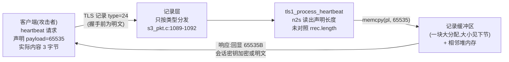
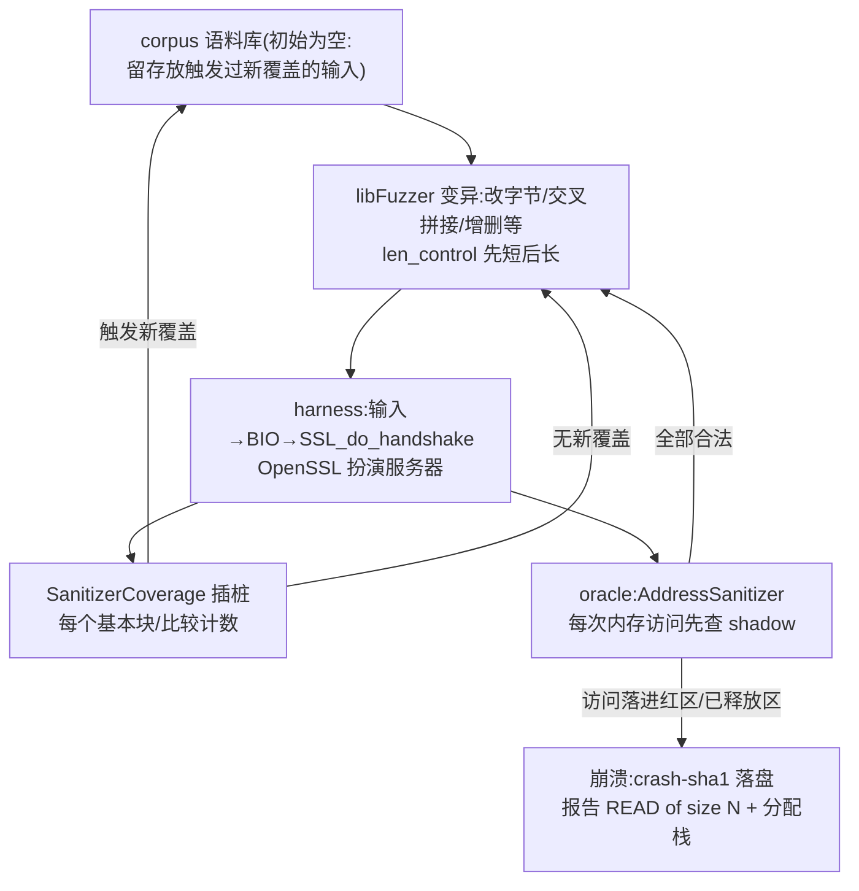
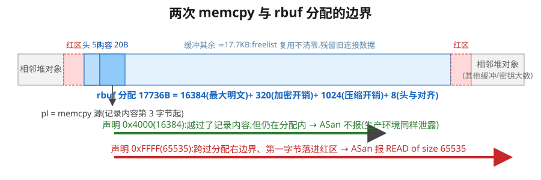
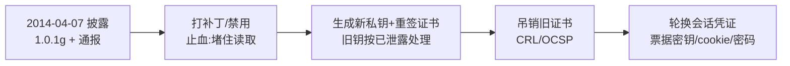
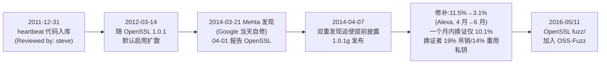

> 系列第一篇。真实对象:OpenSSL 1.0.1f/1.0.1g、RFC 6520、Google ClusterFuzz 官方复现教程、Cloudflare 挑战实验与 IMC 2014 测量论文。文中所有"本地实验"都在固定版本的源码上实际运行,命令、日志与输入都有存档;未运行的结论标明来源。

先看两个数字。第一个是 6:把下面这六个字节喂给 OpenSSL 1.0.1f,内存错误检测器 AddressSanitizer(ASan)立即报告 `tls1_process_heartbeat` 里发生堆越界读(out-of-bounds read)——

```
18 03 00 00 01 01
```

这是一条 TLS 记录:内容类型 `0x18`(24,heartbeat)、版本 3.0、记录长度 1,内容只有一个字节 `0x01`(heartbeat 请求)。它前面没有任何握手字节。这六个字节是模糊测试(fuzzing:自动生成并执行大量随机输入)工具 libFuzzer 找到的输入:它不带任何初始样例从零开始,约 3.5 万次执行(约 1 秒)后触发崩溃,再由"崩溃最小化"自动删光无关字节;对这条最小输入,ASan 报告的读取长度是一个来历奇怪的 48830。这些工具各自的工作方式第四节会逐一解释,这里只需知道一件事:自动化测试自己找到了这个最小触发输入。

第二个数字是 64 KiB:一次恶意 heartbeat 请求能让服务器回吐的内存上限,而它只需要 2 个字节的"声明长度"。这段缺陷让任何能连上服务器的人反复读取服务器进程的内存——可能包括私钥。加密没有阻挡它,日志没有记录它。

后续测量估计,披露时 Alexa 前 100 万(Alexa 排名,当时的网站流行度榜单,已停更,这里当作"重要站点"的抽样)里的 HTTPS 站点有 24%–55%、上界约一半,运行着包含这个缺陷的 OpenSSL;披露两天后的全网扫描里,仍有约 200 万台 HTTPS 主机易受[23]。

这篇文章沿三个问题展开,它们分别对应机制、测试和处置。此外还有一条贯穿的方法论线索——把"机制上可能、实验观察到、生产环境推断"三层证据分开——它首次出现在第三节,结尾会回收:

1. 为什么一个"长度字段没对照检查"的实现错误,能穿过加密连接把内存交给攻击者?
2. 这样一个缺陷,测试需要什么条件才能看到?2012 年代码进入 OpenSSL 时、到 2014 年披露前,为什么没有任何测试看到它?
3. 修复发布之后,"风险已经下降"这个判断需要哪些证据?

我们从协议开始,因为漏洞的全部戏剧性都藏在一个设计上很合理的协议语义里。

## 一、协议:一个会"原样回显"的扩展

TLS 连接建立之后,双方握有会话密钥,但连接本身没有"心跳"。长时间空闲的连接会被中间设备(NAT、防火墙)悄悄丢弃,而重新握手代价不小;DTLS 跑在 UDP 上,还需要探测路径最大传输单元(PMTU)。RFC 6520 在 2012 年 2 月为此定义了 heartbeat 扩展:任一方随时发一条 HeartbeatRequest,对方回一条 HeartbeatResponse,**响应必须携带请求 payload 的逐字节副本**——"carrying an exact copy of the payload"[1]。回显正是 keep-alive 与 PMTU 探测所需要的语义。

消息格式很简单:

```text
heartbeat_request =
  type (1B)          0x01 = request, 0x02 = response
  payload_length (2B)  声明的 payload 长度
  payload           随意内容
  padding           随机内容,接收方必须忽略
```

三条约束与我们直接相关。其一,padding 不是显式字段:`padding_length = 记录长度 − payload_length − 3`,且**至少 16 字节**;整条消息上限 2^14。其二,响应要回显 payload,所以实现必须把请求里的 payload 找出来再拷进响应。其三,RFC 明确写了防线:"If the payload_length of a received HeartbeatMessage is too large, the received HeartbeatMessage MUST be discarded silently"——收到的声明长度对不上实际数据时,**必须静默丢弃**[1]。修复注释里则显式引回了这一节:"silently discard per RFC 6520 sec. 4"。

heartbeat 消息作为新的内容类型(24)承载在 TLS 记录层之上,发送时机几乎没有限制:"can arrive almost at any time during the lifetime of a connection";RFC 只以 SHOULD 级别建议握手期间不要发、接收方在握手期间收到时应当丢弃[1]。记住这个"应当":它不是 MUST,而实现比这更宽。

值得记录的时间差:heartbeat 代码进入 OpenSSL 是 2011 年 12 月 31 日(commit `4817504d`,Robin Seggelmann 提交、Stephen Henson 审核合入,提交信息里写着 "Reviewed by: steve"),而 RFC 6520 到 2012 年 2 月才正式发布——实现先于标准定稿进入主干,并随 2012 年 3 月 14 日发布的 OpenSSL 1.0.1 默认启用[23]。RFC 那条"必须静默丢弃"的防线,在实现里对应不上任何一行代码。

## 二、实现:一次 heartbeat 请求的旅程

现在把六个字节送进 OpenSSL 1.0.1f,看它走到哪里出事。以下代码行号均来自我们从 openssl.org 官方 tarball(sha256 记录在档案)解包核对的源码,与 GitHub 标签 `OpenSSL_1_0_1f` 一致;文中代码摘录保持原文,中文行注为本文所加。

**第一站:记录层不设门槛。** 服务器的握手状态机在等 ClientHello 时,通过 `ssl3_read_bytes` 读记录。该函数处理"收到的记录类型与期待不符"的逻辑里,有这么一个分支(`ssl/s3_pkt.c:1089-1092`):

```c
else if (rr->type == TLS1_RT_HEARTBEAT)
    {
    tls1_process_heartbeat(s);
    /* Exit and notify application to read again */
    rr->length = 0;
    ...
    return(-1);
    }
```

分支条件只有记录类型等于 24 这一个:不查握手进行到哪一步,不查对端有没有协商过 heartbeat 扩展。这就是六个字节能生效的原因——连接甚至还没完成 ClientHello,一条明文 heartbeat 记录就被分发了。此时记录层还没有安装解密上下文,`tls1_enc` 里对应的分支是一次 `memmove` 直通:明文进来,明文存放[4]。

**第二站:函数体里消失的检查。** `tls1_process_heartbeat`(`ssl/t1_lib.c:2554`)拿到刚解密(此刻是直通)的记录:

```c
unsigned char *p = &s->s3->rrec.data[0], *pl;   /* 记录明文起点 */
unsigned int payload;
unsigned int padding = 16; /* Use minimum padding */

/* Read type and payload length first */
hbtype = *p++;
n2s(p, payload);        /* 从记录里读出 2 字节声明长度 */
pl = p;
```

到这一行为止,函数读了 1 字节类型、2 字节声明长度,而记录的真实长度 `s->s3->rrec.length` **一次都没有出现**。RFC 那句"声明过大必须静默丢弃"要落地,应该就在这里——把 `payload` 和 `rrec.length` 对照一下。它不在。

于是请求分支按声明值办事:

```c
buffer = OPENSSL_malloc(1 + 2 + payload + padding);  /* 按声明长度分配响应 */
...
*bp++ = TLS1_HB_RESPONSE;
s2n(payload, bp);
memcpy(bp, pl, payload);        /* ← 从记录里拷"声明长度"个字节 */
...
r = ssl3_write_bytes(s, TLS1_RT_HEARTBEAT, buffer, 3 + payload + padding);
```

`memcpy` 的长度是攻击者在两个字节里声明的 16 位数,上限 65535(上面摘录里的 `s2n` 与 `n2s` 相对,把长度按 2 字节网络序写回)。而源指针 `pl` 指向的是服务器自己的记录缓冲区。攻击者发一条实际内容只有几个字节、声明 payload 却是 65535 的请求,`memcpy` 就从这条小记录的末尾开始,把服务器进程堆内存顺流拷出最多 64 KiB,装进响应,经 `ssl3_write_bytes` 发还给攻击者。函数返回 0,无告警,无日志。

**加密为什么救不了。** heartbeat 响应是一条普通记录,用当前会话密钥加密——但 TLS 的加密防的是链路上的第三方,密钥由握手双方共享,而攻击者正是这次握手的客户端。更极端的情况我们在实验里用的就是:握手还没完成时触发,写路径没有加密上下文,响应根本就是明文。机密性设计没有背叛,是这个协议语义把"读服务器内存并回传"变成了合法操作,加密反而保证了这 64 KiB "安全地"送达攻击者[5]。



*图 1:一次 Heartbleed 请求的路径。攻击者的全部成本是构造一条记录的两个字节;服务器的检查环节是零。*

## 三、越界读到了什么:从机制可能到实证

`memcpy` 的源是记录缓冲区 `rbuf`。它是一块单独的 malloc 分配,大小按"能装下最大 TLS 记录"设计:最大明文 16384 + 加密开销 320 + 压缩开销 1024(本构建未禁用压缩选项)+ 记录头与对齐 8,合计 17736 字节——与 ASan 报告的分配大小一致[6]。所以一次 65535 字节的越界读分两段:前半段还在 rbuf 分配内部,后半段越过分配右边界,读到进程堆里相邻的其他对象。

rbuf 内部有什么?关键在 OpenSSL 的缓冲复用策略:为规避部分平台 malloc 性能问题,连接结束时不释放 rbuf,而是挂进 SSL_CTX 级的 freelist,等下一个连接按大小取走复用,**全程不清零**(`ssl/s3_both.c:695-736`)[6]。也就是说,越界读的前半段读到的是**之前某条连接留在缓冲区里的记录明文**——上一个用户的请求头、cookie、会话票据都可能在这里。越过边界之后是典型的堆邻居:其他连接的缓冲区、握手消息缓冲(`BUF_MEM` 的 realloc 扩张同样把旧副本留在堆上)、以及——与私钥最相关——加载进进程的 RSA 私钥的各 BIGNUM 分量与运算用的 Montgomery 预计算表[7]。

"机制上可能"到"实际发生"之间隔着实验。这段历史值得按证据顺序复述,因为它展示了一次正确的科学反转:

**第一步:阴性结果。** 2014 年 4 月初,Cloudflare 的工程师做了六轮实验——普通泄露、高频请求、重启后立即请求、对自己的客户站点采样——**没有**从 heartbeat 泄露中找到私钥碎片,于是公开写道"我们倾向于认为私钥未泄露"[8]。注意这个推断的方法论地位:样本少、条件特定、未观察不等于不存在。

**第二步:改变条件的挑战。** 4 月 11 日 Cloudflare 设了挑战站(nginx + 漏洞版 OpenSSL,公开日志)。当天 16:22:01 PST,Fedor Indutny 提交成功,他当天发送了至少 250 万次 heartbeat 请求;17:12:19 PST,芬兰 NCSC-FI 的 Ilkka Mattila 以约 10 万次请求同样成功。挑战服务器当天 3:08 PST 曾重启过一次,Cloudflare 自述不确定这是否有帮助[9]——这个疑问要等下面的机理分析才收束。持续的海量请求让堆内存反复"翻动"——大量 heartbeat 响应缓冲被分配又释放,分配器不断重组空闲内存,把含私钥中间量的块挪进越界读的相邻射程。挑战结论在当天被改写:"While it takes effort, it is possible to extract private SSL keys"[8]。

**第三步:解释机理。** 4 月 27 日 Cloudflare 的 John Graham-Cumming 给出机制:给 OpenSSL 的 malloc/free 打桩,每 1024 次心跳 dump 一次全部内存再搜私钥碎片,发现泄露物主要是**Montgomery 预计算表**:RSA 做大数模乘时对模数 n、p、q 各建一张加速表,其中对 p、q 的表由私钥的秘密素因子直接构造,等价于私钥的另一种存放形式——拿到表就能还原出 p、q。而这些表会出现在堆上,是因为大数在 `bn_expand2()` 扩张时被拷贝到新内存,旧副本留在堆上。这证明提取私钥不需要"重启后未初始化内存"的猜想,持续高频心跳就够了[10]。

把三层分开是这篇文章想教的分析习惯:机制上可能(rbuf 缓冲区与堆邻接)、特定条件下的实验观察(Cloudflare 挑战)、以及对生产环境的推断("大量真实服务器的私钥曾被读取"——无法证实也无法证伪,因为利用不留痕迹)。第三层正是处置决策的依据,后面回到它。

## 四、测试:为什么没人看到,以及怎样就能看到

回到 2012 年。这段代码合入主干时,什么样的测试能发现它?答案由三个相互独立的条件决定,而当年三个都不满足。

**条件一:得有会生成畸形输入的测试。** 我们解包检查了 1.0.1f 的 `test/` 目录:106 个文件,全部是固定输入的功能测试(`testssl`、`testenc`、各种 `.pem` 固定样例),没有一个模糊测试文件[11]。功能测试验证"正确的输入得到正确的结果";一条"声明长度 65535、实际内容 3 字节"的 heartbeat 记录不在任何固定输入里,这条路径从未被执行过。

**条件二:得有持续运行的 fuzzing 基础设施。** OpenSSL 仓库出现 `fuzz/` 目录是 2016 年 5 月(commit `c38bb727`,提交信息就一行:"Add fuzzing!");接入 Google OSS-Fuzz 是 2016 年 11 月("Add OpenSSL (#62)")[12][13]。OSS-Fuzz 官网对起源的表述是:"OSS-Fuzz was launched in 2016 in response to the Heartbleed vulnerability"[14]。在漏洞存续的 2012-2014 年,这两样都不存在。(顺带更正一个流传的引用:ClusterFuzz 教程原文并没有"如果有 fuzzing 早就发现了"这句话——我们用三种方式核对了当前版本,它只说实验后"soon after that"会看到崩溃。那句名言的出处是 OSS-Fuzz 首页——值得一提的是,连这句官方动机也省略了"需要带内存检查工具"这个条件:没有 ASan 这类判定器,常规 fuzzing 对不崩溃的越界读依然无能为力[16]。)

**条件三——最容易被忽略的:得有判定器(test oracle,判断"这次执行对不对"的机制)。** 就算有人当年对着 OpenSSL 跑过无插桩的 fuzzer,也几乎不可能发现 Heartbleed,因为**越界读不会让程序崩溃**。Hanno Böck 在披露一周年时写过:"Most of the time read overflows won't crash your application. That's also the case with Heartbleed."[15] 不写内存、不改控制流、不触发段错误——程序的行为在操作系统看来完全正常。以"是否崩溃"为判定器的 fuzzing,面对这个缺陷的失败信号恒为假。David Wheeler 当年的分析同样指出:常规 fuzzing 找不到它,带内存检查工具的才行[16]。

把三个条件补齐,就是 Google ClusterFuzz 教程做的事,也是我们在本地实际复现的流程[17]。

**Harness:三十行让 OpenSSL 陪你玩。** 教程的 `handshake-fuzzer.cc`(Kostya Serebryany 原作,我们锁定在 commit `f0907b32`,连同 server.pem/key 一起构建)核心只有:

```cpp
static SSL_CTX *sctx;
Environment() {                       /* 进程启动时执行一次 */
    SSL_library_init(); ...
    sctx = SSL_CTX_new(TLSv1_method());
    SSL_CTX_use_certificate_file(...); SSL_CTX_use_PrivateKey_file(...);
}
int LLVMFuzzerTestOneInput(const uint8_t *Data, size_t Size) {
    static Environment env;
    SSL *server = SSL_new(sctx);
    BIO *sinbio = BIO_new(BIO_s_mem()), *soutbio = BIO_new(BIO_s_mem());
    SSL_set_bio(server, sinbio, soutbio);
    SSL_set_accept_state(server);      /* 扮演服务器 */
    BIO_write(sinbio, Data, Size);     /* 输入=客户端发来的字节 */
    SSL_do_handshake(server);
    SSL_free(server);
    return 0;
}
```

libFuzzer 把每个输入当作"一个恶意客户端发来的字节流"写进输入 BIO(BIO 是 OpenSSL 的 I/O 抽象,内存 BIO 相当于把一块缓冲区伪装成网络连接),调一次 `SSL_do_handshake`,OpenSSL 以服务器身份消化这些字节——握手能走多远走多远,走不到就返回,不检查结果。**整个 TLS 服务器状态机变成了一个纯函数:`字节串 → 执行痕迹`。**



*图 2:覆盖率引导 fuzzing + ASan 判定。覆盖反馈负责"到达"(把输入逐步推进到 heartbeat 分支),ASan 负责"判定"(把静默的越界读变成确定的失败信号)。二者缺一,Heartbleed 对测试系统不可见。*

**ASan 为什么能看见。** AddressSanitizer 把应用内存按 8:1 映射成影子内存(shadow memory),给每个堆分配四周包上红区(redzone,默认 128 字节),每次 load 先查 shadow——地址落进红区即报错退出[18]。它也有自己的漏报条件:若一次越界访问恰好跳过红区、直接落进另一个合法分配,它同样看不见[18]——对这里连续 memcpy 型的过读不构成问题,但"红区不是全能"应当记住。Heartbleed 的过读是从分配内部出发、连续跨过右边界的 `memcpy`,第一个越界字节必然落在右红区里,所以检测是确定性的,不需要等野读碰巧命中不可映射页。代价是约 2 倍减速,换来的是每一次执行都携带真/假判定。

**本地实测。** 环境:WSL Ubuntu 24.04,clang 18.1.3,按教程的 CFLAGS(`-g -fsanitize=address,fuzzer-no-link`)从官方 tarball 构建 1.0.1f 与 1.0.1g(教程的裸 `make` 在新版链接器上会失败于 apps 链接,我们改用 `make build_libs`;运行时设 `detect_leaks=0` 关闭与本目标无关的泄漏检测——1.0.1 的初始化存在已知泄漏,会在越界读之前中断运行;全部偏差记录在档案)[17]。结果:

- **从零发现**:空语料库、固定种子,libFuzzer 在约 35,192 次执行(约 1 秒)后崩溃。报告:`READ of size 65535`,栈是 `tls1_process_heartbeat (t1_lib.c:2586) ← ssl3_read_bytes (s3_pkt.c:1092) ← ssl3_get_client_hello ← ssl3_accept`,读的分配正是 17736 字节的 rbuf,由 `freelist_extract ← ssl3_setup_read_buffer` 分配——与第二节走读的代码逐行对应[17]。
- **最小化**:崩溃输入 41 字节,`-minimize_crash` 压到 6 字节(即开篇那串),再次确认触发不依赖任何握手字节。
- **修复对照**:同一批输入喂给 1.0.1g 构建的同一 harness,全部干净退出;1.0.1g 以相同种子跑满 300 秒、752 万次执行、新增 1467 个触发新覆盖的语料输入,无崩溃(这是单次观察,不是评测,见下节)。

**一次意外的实验教训。** 我们最初手工构造的触发输入声明 payload=16384(0x4000),预期立即崩溃——结果 ASan **毫无反应**。原因:越界读虽然跨过了记录的逻辑边界,但 16384+3 仍然在 17736 字节的 rbuf 分配**内部**,没有碰到红区。把声明改成 65535 才触发:



*图 3:同一个 `memcpy` 源、两种声明长度,只有跨过分配右边界的那种才被 ASan 看见(依据:本地实验输入与日志存档,以及 s3_both.c 的分配代码)。*

这个"失败"恰好演示了 sanitizer 的判定边界:ASan 检测的是对**分配**边界的越界,不是对**逻辑对象**的越界。在生产环境里,那条 0x4000 的请求同样在泄露(读的是缓冲区里的旧数据),只是任何工具都看不见。另一个补充实验:6 字节输入根本没有长度字段可读,`n2s` 读的是分配里未初始化的字节——ASan 默认用 0xBE 填充新分配,所以报告 `READ of size 48830`(0xBEBE);把填充字节改成 0xFF,报告变成 65535;改成 0x41(16705,读取范围仍在分配之内、不触红区),则完全不崩溃[17]。触发条件精确到堆内容的取值——这正是"信息泄露类缺陷难以用单一机制判定"的微观写照。

最后补一条披露后的注脚:Heartbleed 公开后,Böck 用 afl+ASan 在**没有任何先验知识**的情况下约 6 小时复现了发现过程[15];Codenomicon 当年则是用自己的协议专用 fuzzer 独立发现了它[15]。工具链在 2012 年之后才逐渐成熟到"教程级"。

## 五、一次实验能证明什么

我们的实验复现了发现,但这中间每一步推理的适用范围都值得说清——这一节是给未来要做安全研究(包括模型安全)的读者的方法论部分。

**从 ASan 报告到"信息泄露"隔着一步协议推理。** ASan 证明的是:存在一次跨分配边界的读,读的长度、位置、分配点都已知。它不证明数据泄露。把报告升级为"信息泄露漏洞"需要协议知识:heartbeat 的回显语义会把读到的字节装进响应发回。这个链条在 fuzzing 研究里有正式表述:Klees 等人在 CCS 2018 的评估综述里专门警告 crash ≠ bug ≠ 可利用性,并且恰好举了反例——有评测把 Heartbleed 类崩溃一律标注为"可利用",而它其实是信息泄露[19]。判定"这是什么类型的缺陷"始终需要人(或领域知识)介入。

**演示不是评测。** 我们(和教程)做的实验是"单目标、单次运行、短预算"的**演示**(demonstration):它证明这条工具链在该环境下能找到这个已知缺陷。按 Klees 的建议(fuzzing 是随机过程,单次运行的时间数字没有统计意义,应多次独立运行报告分布)和 SoK 2024 的 P8 原则("Do not generalize based on one run, target, or bug"),不能从中得出"libFuzzer 稳定在 N 秒内发现同类漏洞"或"某工具优于另一工具"[19][20]。同理,1.0.1g 300 秒无崩溃只是观察,不是"修复版无漏洞"的证明——它证明的是修复让这批触发输入失效,仅此而已。

**oracle 的边界。** 测试判定器(test oracle)的经典定义来自 Barr 等人的综述:区分正确与错误行为的程序[21]。崩溃是最原始的隐式 oracle;ASan 把"任意越界内存访问"纳入了程序化判定的范围,是这套体系的关键扩展。但要清楚它划出的边界:sanitizer 只覆盖内存安全这一类性质。一条"接受了本应拒绝的畸形 Finished 消息"的协议逻辑错误,既不崩溃也不越界,对任何 sanitizer 都不可见——protocol 语义需要另外的判定器(状态机检查、差分测试、形式化属性)。Heartbleed 恰好是"协议漏洞表现为内存安全缺陷"的实例,fuzzing+ASan 这把锤子对它适用;换一个缺陷类别,锤子就得换。

对模型安全研究者,这个对应关系值得展开两句,因为机制是同构的:agent 评测里的"任务成功率"对应功能测试(只在给定输入上检查给定行为);"崩溃类"失败(语法错误、工具调用格式非法)对应隐式 oracle;而提示注入、越权这类**语义层面的错误行为**,对应的是上面"协议逻辑错误"的位置——不崩、不越界,判定器本身成了研究问题(由谁判定?政策文档、人工标注还是评判模型?它们的可靠性各自如何?)。Heartbleed 的教训在此可以迁移:判定器的覆盖范围决定了你的测试系统对哪一类缺陷天然失明,而"看不见"会被误读成"不存在"——当年 Cloudflare 的六轮阴性实验差点得出"私钥不会泄露"的结论,就是 oracle 缺失时"未观察≠不存在"的活例。

## 六、修复之后:风险下降的证据链

实验回答了"能不能被发现";接下来的测量与历史证据回答"处置到了什么程度"。

先把发现-披露的小史补全:Google 的 Neel Mehta 在 3 月 21 日发现漏洞,当天修补了 Google 自己的服务器;4 月 1 日报告 OpenSSL 核心团队,修复原定 4 月 9 日发布;芬兰安全公司 Codenomicon 4 月 2 日独立发现并经国家CERT通报;两路撞车推高了泄露风险,OpenSSL 在 4 月 7 日提前发布了修复与通报[23]。

修复本身很小。commit `96db9023`("Add heartbeat extension bounds check.",修复由 Adam Langley 与 Bodo Moeller 准备)把读类型/长度的语句挪到两条检查之后:

```c
/* Read type and payload length first */
if (1 + 2 + 16 > s->s3->rrec.length)
    return 0; /* silently discard */
hbtype = *p++;
n2s(p, payload);
if (1 + 2 + payload + 16 > s->s3->rrec.length)
    return 0; /* silently discard per RFC 6520 sec. 4 */
pl = p;
```

第一条保证记录至少装得下"类型+长度+最小 padding"(≥19 字节);第二条把**声明的** payload 与**实际的**记录长度对照——RFC 6520 第 4 节那句 MUST,两行代码,晚了两年。错误处理是静默丢弃、连接继续。DTLS 版同型修复,另多一条写长度上限检查(TLS 侧没有,两个文件的修复不完全对称)[3]。1.0.1f→1.0.1g 之间与 heartbeat 相关的代码修复仅此一个;回归测试到 1.0.1h 才补上[3]。

官方通报([07 Apr 2014] "TLS heartbeat read overrun")列出受影响版本(1.0.1 系与 1.0.2-beta)与两条出路:升级 1.0.1g,或用 `-DOPENSSL_NO_HEARTBEATS` 重编译整个禁用[22]。没有 CVSS 评分——今天资料页上的 7.5 是后来用 v3.1 规范追评的。

但"补丁发布"离"风险下降"还有整条证据链,每环都有测量:



*图 4:处置链。顺序有讲究:不先打补丁,换上的新钥照样能被读走。*

吊销环节解决的是给依赖方的问题:证书在到期前仍会被浏览器、验证服务继续信任;如果旧私钥可能已被拿走而不吊销旧证书,攻击者就可以拿它冒充你的站点。CRL(证书吊销列表,Certificate Revocation List)与 OCSP(在线证书状态协议,Online Certificate Status Protocol)是客户端获知吊销状态的两条主要渠道——前者是整张列表下载,所以吊销量对流量是线性放大,这解释了下面 GlobalSign 的数字为什么"贵"。

**部署有多快?** Durumeric 等人的 IMC 2014 测量(全网 ZMap 扫描)给出:披露后两天(4 月 9-10 日),Alexa 前 100 万的 HTTPS 站点 11.5% 仍易受,全网约 6%、约 200 万台——注意两个比例分母不同(流行站点子集与全部 IPv4 主机),不可直接相比;到 6 月初,这两个数字降到 3.1% 与 1.9%——大部分修复发生在头两周,但长尾拖了数月[23]。他们还做了一个受控实验:4 月 24 日的全网扫描发现 588,686 台易受主机,过滤掉嵌入式设备后,212,805 台对应 4,648 个 abuse 联系人,剔除不直接管理主机的机构后随机分成两组、间隔 9 天先后发通知——自 4 月 28 日首批通知起 8 天内,先收到通知的一组修补率 39.5%,尚未收到通知的对照组只有 26.8%[23]。**"知道"本身就是部署链路上的一环**;而全部联系人中 77% 从未回应过联系——"回应"与"修补"是两回事,这个数字刻画的是通知渠道的损耗,而非未行动比例。

**换钥换证呢?** 同一研究:披露时易受的站点,其后一个月内只有 **10.1%** 更换了证书;换证者中只有 **19%** 吊销了旧证,**14%** 重用了同一把私钥——"重打补丁但换用旧钥"意味着修补后私钥仍是泄露窗口期内那把[23]。也就是说,大量服务器完成了图 4 的第一步就停下了。

**吊销基础设施的代价。** 短期内数以十万计的吊销冲向 CRL/OCSP:GlobalSign 两天吊销 56,353 张证书,占其扫描中可见证书的 50.2%,CRL 从 KB 级涨到 MB 级持续被下载[23];Cloudflare 作为最保守的处置方,吊销并重签了自己全部 97,728 张客户证书(24 小时内完成),并估计每年新增约 18 万美元的 OCSP 流量成本(企业自述)[24]。

**有没有被利用?** 公开证据的答案是:披露**之前**没有找到利用痕迹——论文检查了四组独立的流量与蜜罐数据集,一无所获;而披露**之后** 21 小时 29 分,就观察到了第一次利用尝试(4 月 8 日 15:18 UTC,目标是受监测的 LBNL 网络中的主机)[23]。当年 Bloomberg 引匿名信源称 NSA 已利用两年,NSA 否认;EFF 的"披露前五个月可能已被利用"也被第三方反证。这些都停留在"声称"层面。要紧的是推理方式:利用不留日志痕迹,所以"未观察到"永远不能升级为"未发生"——这正是处置上必须按"私钥已泄露"对待、必须换钥吊销的原因,而不是技术上证明了泄露。

**生态的响应**收在同一周:4 月 24 日 Linux Foundation 联合 12 家公司成立 Core Infrastructure Initiative,为 OpenSSL 等关键开源项目提供全职开发与审计资金——此前 OpenSSL 核心团队是"一小撮志愿者,只有一个全职",年度捐款据称只有约 2000 美元(此数字多方转引一致,原句核验受限)[25]。两年后 OSS-Fuzz 上线,自述动机"Heartbleed";OpenSSL 自己的 `fuzz/` 也建于 2016[12][13][14]。第四节里缺的三样东西——畸形输入生成、持续基础设施、判定器——在制度层面被逐一补上。



*图 5:时间线。E 节点数字口径见正文与[23]:11.5% 为披露两天后 Alexa 1M HTTPS 仍易受比例(55% 为披露时的估计上界,区间 24%–55%),3.1% 为 6 月初;换证/吊销/重用钥的三个百分比限"披露时易受站点其后一个月内"。*

## 七、回到三个问题

**为什么长度错误能穿过加密泄露内存?** 因为 heartbeat 协议的回显语义把"服务器把内存内容发给客户端"设计成了合法操作,剩下的只是让 `memcpy` 多读一点:声明长度 2 字节、无一处对照、响应原样发回。加密保护的是信道,而攻击者坐在信道的合法端上。缺陷的全部"深奥"之处——分发无握手门槛、缓冲区复用不清零、堆上残留私钥的中间量——都是让那 64 KiB 里"有东西可读"的配角。

**测试需要什么条件?** 到达与判定缺一不可:覆盖率引导的输入生成负责把测试推进到 heartbeat 分支(这条路径浅到 6 个字节);ASan 负责把不崩溃的越界读变成确定失败。2012 年,固定输入的功能测试、不存在的 fuzzing 基础设施、以崩溃为 oracle 的传统,三者各自保证了这个缺陷不可见。补上三样,在我们的单次复现里,1 秒与 3.5 万次执行之内就看到了它(单次数字的意义见上节)。

**修复之后,怎样知道风险下降?** 靠分层测量,而不是"补丁已发布":全网扫描看部署比例与长尾,证书数据看换证/吊销/换钥行为,流量与蜜罐看利用证据(并接受"未观察到≠未发生"),基础设施指标看吊销体系的承压。每层的数字都有自己的口径,Cloudflare 的全量吊销与 10.1% 的换证率是同一条证据链的两个极端。

这轮研究也改变了我们自己的几个认识,记录在此以免将来重犯:我们最初以为"越界读必然触发 ASan",被一条 0x4000 的输入上了一课——判定器看到的是分配边界,不是逻辑边界;"Mehta 3 月 21 日报告 OpenSSL"是二手误传,报告发生在 4 月 1 日,3 月 21 日是发现日;那句广为流传的"如果有 fuzzing 早就发现了"不在教程里,出处是 OSS-Fuzz 首页。

**证据边界**:本篇的结论止于何处,以及哪些部分留待核验——① heartbeat 分发"无协商检查"只断言到 1.0.1f,后续版本何时收紧未查;② Cloudflare 的挑战与机理是当事方自述,其完整原文两篇受页面渲染所限,以研究档案中的精读笔记为准;③ DTLS 侧的完整接收路径未逐行走读;④ 测量论文通知实验的统计方法(分组细节)未复核,只引用了结果句;⑤ [24] 的吊销规模数字取自分路精读,本地存档为部分渲染。这些都不动摇主线,但它们是读者应当知道的边界。

下一篇(Bro/Zeek 与网络监测)将从"端点看到的字节"换到"监测器看到的事件",继续这条"真实系统怎样失效、研究者怎样知道"的线索。

---

## 参考文献

[1] Seggelmann, K., Williams, M., Tuexen, M. RFC 6520: Transport Layer Security (TLS) and Datagram Transport Layer Security (DTLS) Heartbeat Extension. IETF, 2012-02. https://www.rfc-editor.org/rfc/rfc6520.txt(引用节:§3、§4、§6)

[2] OpenSSL commit 4817504d069b4c5082161b02a22116ad75f822b1 "Support for TLS/DTLS heartbeats"(PR 2658,Submitted by Robin Seggelmann,Reviewed by steve,合入 2011-12-31). https://github.com/openssl/openssl/commit/4817504d069b4c5082161b02a22116ad75f822b1

[3] OpenSSL commit 96db9023b881d7cd9f379b0c154650d6c108e9a3 "Add heartbeat extension bounds check."(2014-04);1.0.1 分支对应 731f4314;1.0.1h 回归测试 ab0d9642. https://github.com/openssl/openssl/commit/96db9023b881d7cd9f379b0c154650d6c108e9a3

[4] OpenSSL 1.0.1f 源码:ssl/s3_pkt.c(ssl3_read_bytes,L1089-1097)、ssl/t1_lib.c(tls1_process_heartbeat,L2554-2618)、ssl/t1_enc.c(L746-750)、ssl/s3_both.c(L695-775). 官方 tarball sha256=6cc2a80b17d64de6b7bac985745fdaba971d54ffd7d38d3556f998d7c0c9cb5a;GitHub 标签 OpenSSL_1_0_1f. 本地走读记录:research/heartbleed/notes/own-source-walkthrough.md

[5] RFC 5246: The Transport Layer Security (TLS) Protocol Version 1.2, §6.2.3、§8.1. https://www.rfc-editor.org/rfc/rfc5246

[6] OpenSSL 1.0.1f, ssl/s3_both.c:freelist(L695-736)、ssl3_setup_read_buffer(L758-775);ssl/ssl3.h:缓冲常量。本地实测分配 17736 字节见 runs/logs-f/fuzz-discovery-f.log 的 ASan 报告。

[7] OpenSSL 1.0.1f,crypto/buffer/buffer.c(BUF_MEM_grow realloc 残留)、crypto/rsa/rsa.h(RSA BIGNUM 分量与 Montgomery 上下文)、ssl/ssl_rsa.c(L220,私钥常驻 SSL_CTX)。

[8] Sullivan, N. Answering the Critical Question: Can You Get Private SSL Keys Using Heartbleed? Cloudflare Blog, 2014-04-11(初版结论与当日更正;"While it takes effort…"句出自本帖 Update,经线上原文核验). https://blog.cloudflare.com/answering-the-critical-question-can-you-get-private-ssl-keys-using-heartbleed

[9] Sullivan, N. The Results of the CloudFlare Challenge. Cloudflare Blog, 2014-04-11. https://blog.cloudflare.com/the-results-of-the-cloudflare-challenge/(16:22:01 PST/2.5M、17:12:19 PST/约 10 万、3:08 PST 重启等关键句经本地存档核验)

[10] Graham-Cumming, J. Searching for The Prime Suspect: How Heartbleed Leaked Private Keys. Cloudflare Blog, 2014-04-27. https://blog.cloudflare.com/searching-for-the-prime-suspect-how-heartbleed-leaked-private-keys/(企业事后分析)

[11] OpenSSL 1.0.1f test/ 目录检查(106 文件、0 fuzz 相关;1.0.1g 亦无 heartbeat 测试):本地源码树,2026-10-16。

[12] OpenSSL commit c38bb72797916f2a0ab9906aad29162ca8d53546 "Add fuzzing!"(2016-05-07). https://github.com/openssl/openssl/commit/c38bb72797916f2a0ab9906aad29162ca8d53546

[13] oss-fuzz commit 7dc035f11e6725e18230c3b331782b12f51b8f64 "Add OpenSSL (#62)"(2016-11-01). https://github.com/google/oss-fuzz/commit/7dc035f11e6725e18230c3b331782b12f51b8f64

[14] Google. OSS-Fuzz 官网,Project history:"OSS-Fuzz was launched in 2016 in response to the Heartbleed vulnerability". https://google.github.io/oss-fuzz/(访问 2026-10-16)

[15] Böck, H. How Heartbleed could've been found. 2015-04-07. https://blog.hboeck.de/archives/868-How-Heartbleed-couldve-been-found.html(关键句经本地存档核验)

[16] Wheeler, D. A. How to Prevent the next Heartbleed. 2014(更新至 2024). https://dwheeler.com/essays/heartbleed.html

[17] 本地实验档案:research/heartbleed/runs/(构建与偏差记录 02-build.log;发现与最小化 logs-f/fuzz-discovery-f.log、minimize-crash.log;对照与探针 artifacts/probe-summary.txt、fillbyte-probe.txt;脚本 01-04b)。harness 与证书:clusterfuzz commit f0907b32f94e1bedc4d4aae8bd07964184efadea。教程:https://google.github.io/clusterfuzz/setting-up-fuzzing/heartbleed-example/

[18] Serebryany, S., Bruening, D., Potapenko, A., Vyukov, D. AddressSanitizer: A Fast Address Sanity Checker. USENIX ATC 2012. https://www.usenix.org/system/files/conference/atc12/atc12-final39.pdf;以及 google/sanitizers wiki(算法页)。

[19] Klees, G., Ruef, A., Cooper, B., Wei, S., Hicks, M. Evaluating Fuzz Testing. ACM CCS 2018. DOI 10.1145/3243734.3243804(引用:§4 随机性、§7.1 crash≠bug 与 Heartbleed 标注例、§8 基准)。

[20] Fu, Y. 等. SoK: Prudent Evaluation Practices for Fuzzing. IEEE S&P 2024(引用:P8、§5.2.1). arXiv 2405.10220。

[21] Barr, E. T., Harman, M., McMinn, P., Shahbaz, M., Yoo, S. The Oracle Problem in Software Testing: A Survey. IEEE TSE 41(5), 2015(引用:定义与 implicit oracle)。

[22] OpenSSL Security Advisory [07 Apr 2014]: TLS heartbeat read overrun (CVE-2014-0160). https://openssl-library.org/news/secadv/20140407.txt(本地存档 refs/secadv-20140407.txt)

[23] Durumeric, Z., Kasten, J., Li, F., Adrian, A., Halderman, J. A., Bailey, M. The Matter of Heartbleed. ACM IMC 2014, 475-488. DOI 10.1145/2663716.2663755(引用数字:11.5%/3.1%、2.0M、10.1%、19%、14%、56,353/50.2%、首攻 21h29m、表 1 时间线;关键句经作者镜像 PDF 本地核验)。

[24] Sullivan, N. The Heartbleed Aftermath: all CloudFlare certificates revoked and reissued. Cloudflare Blog, 2014-04-17. https://blog.cloudflare.com/the-heartbleed-aftermath-all-cloudflare-certificates-revoked-and-reissued(企业自述:97,728 张/24h/约 $180k/年;本地存档为部分渲染,数字以分路精读为准)

[25] Marquess, S. Of Money, Responsibility, and Pride. 2014-04-12(团队与捐款背景;"$2,000/年"经二手转引一致,原句未逐字核验);CII:Linux Foundation 新闻稿,2014-04-24。背景另见 Wikipedia "Heartbleed"(CVSS 7.5 为 v3.1 追溯值)。

---

*研究档案:本篇的来源清单、阅读笔记、论断映射、跨来源综合与全部实验日志构成独立研究档案;文中"本地实验"均可按存档的脚本与日志复现。*
