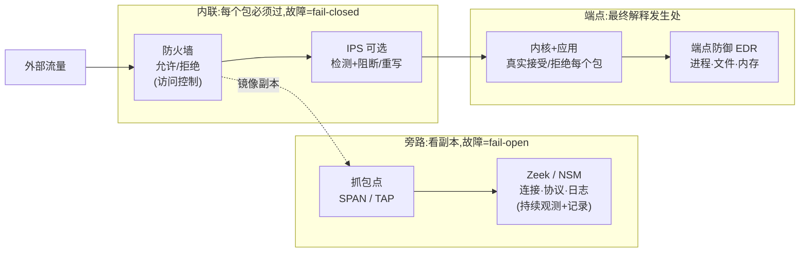
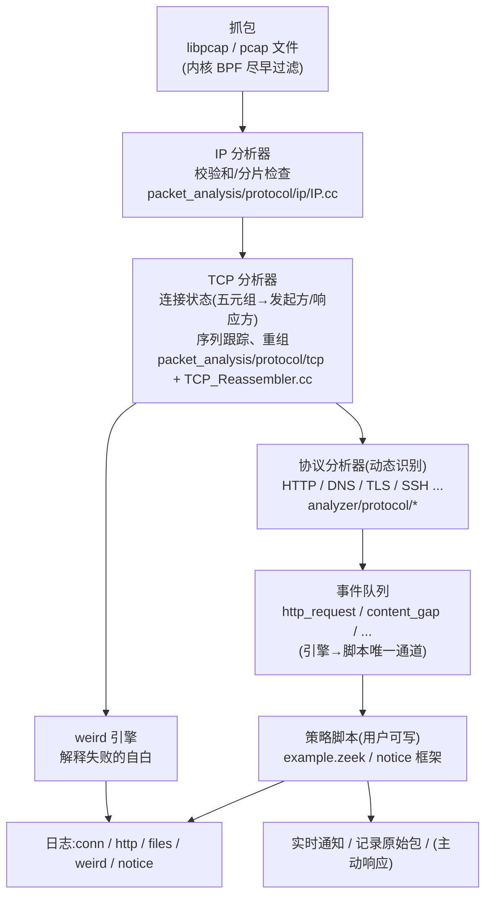
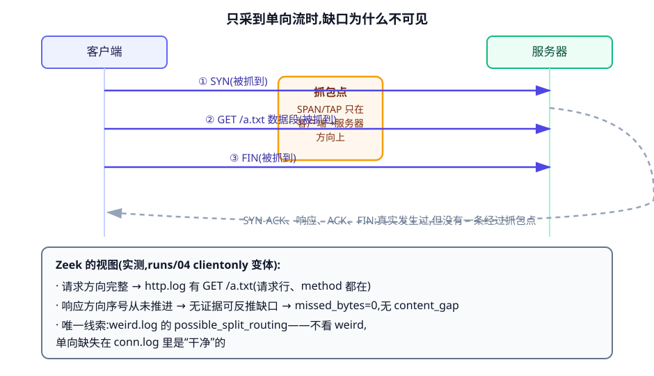
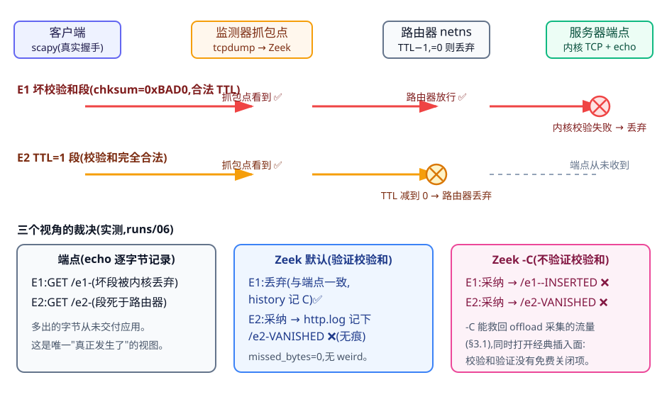
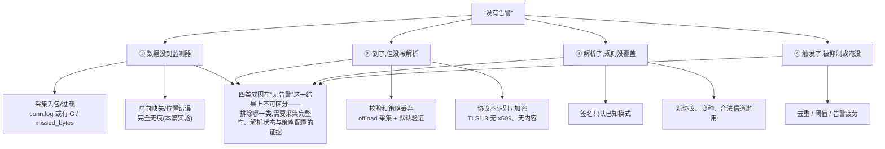

> 系列第二篇,承接[第一篇 Heartbleed](https://zewang0217.github.io/p/security-study-01-heartbleed/)——那一篇从"端点看到的字节"讲到内存泄露,这一篇换到监测器的位置:网络中间的观察者怎样理解流量,它的理解何时与端点一致。真实对象:Vern Paxson 的 Bro 论文(1998/1999)、Ptacek & Newsham 1998 规避分析、Zeek 9.0.0(固定版本)及其源码,以及我们在隔离环境中亲手生成的 TCP/HTTP/TLS 流量。所有"本地实验"都实际运行过;端点侧与监测器侧的证据成对出现,命令与原始输出都有存档。

先看一条日志。这是我们的 Zeek 9.0.0(默认配置,未加任何特殊参数)在一次离线分析中写进 `http.log` 的原始行(制表符分隔,截取前 10 列,uri 在末列,host 列为 `-`):

```text
1792251368.494174  CrQlkT1uuEU4LiPJfe  10.9.1.2  41002  10.9.2.2  9000  1  GET  -  /e2-VANISHED
```

它声称:客户端 10.9.1.2:41002 向 10.9.2.2:9000 发过一条 HTTP 请求,请求行是 `GET /e2-VANISHED HTTP/1.1`。而同一时刻,服务器上我们运行的回显服务器(echo server,把内核 TCP 交付的每个字节原样记录)写下的是:

```text
ECHO port=41002 bytes=8 data=b'GET /e2-'
```

**端点只收到 8 个字节;监测器却完整"看到"了多出来的那段 `VANISHED HTTP/1.1`,并把它当作真实请求记进了日志。**这不是 Zeek 的 bug,也不是我们构造的异常条件——中间那台真实路由器因为 IP 包的 TTL(Time to Live,生存时间)减到 0 而丢弃了这个包,而监测器的抓包点在路由器之前。1998 年 Ptacek 和 Newsham 把这类攻击叫 insertion(插入):"An IDS can accept a packet that an end-system rejects"[3]。我们的实验只是把它在受控环境里重演了一遍,并拿到了两侧的证据。

这篇文章沿五个问题展开:

1. 网络监测、防火墙、入侵检测与端点防御各自解决什么问题,Bro/Zeek 在这张图上的哪个位置;
2. 包怎样变成连接、协议事件和日志——Bro 为什么这样设计,事件引擎与策略脚本如何配合;
3. 监测器的理解在什么条件下与端点一致:校验和与采集点、缺包、TCP 重组与重传、观察位置、资源限制各自怎样制造偏差——其中哪几种会在日志里留下痕迹,哪几种**完全无痕**;
4. 这套 1990 年代的设计怎样变成了今天的 Zeek;加密通信又拿走了哪些可观测条件;
5. 一份日志、一次"没有告警",分别能支持什么判断。

所有关键论断都尽量给两侧证据:端点侧(内核与服务器应用实际处理了什么)和监测器侧(抓包文件与 Zeek 日志)。只有监测器视图的演示,我们不当成"端点发生了什么"来写。

## 一、网络防御的分工:Bro/Zeek 在哪里

把几类防御放进同一张图,分界线有三条:**在不在转发路径上**、**看包还是看进程**、**故障时断网还是失明**。

防火墙在路径上:每个包必须过它,规则决定放行或拒绝;它出故障,网络不通——fail-closed(故障关闭)。入侵检测系统(intrusion detection system,IDS)传统上在路径外:交换机把流量镜像(SPAN 端口)或分光器(TAP)复制一份给它,它只看不拦;它出故障,什么都不会发生,直到事后需要证据时才发现什么都没留下——Ptacek 与 Newsham 把这写成被动监测的结构性属性:"A 'fail-open' system ceases to provide protection when it is disabled by a DOS attack... a network IDS is inherently fail-open"[3]。第三类在端点上:内核与应用是每个字节的最终解释者(下一节会看到这为什么关键),EDR 类产品观测进程、文件与内存,但前提是信任端点自身没有失陷。

Bro 选的位置是旁路、被动、记录优先。Paxson 在 1999 年论文里交代了站点背景:几千台异构主机的非密研究网络,边界一条 DMZ 链路,"we do not try to achieve 'airtight' security... We instead emphasize monitoring over blocking"[2]——不断网,但把经过边界的一切变成可回溯的证据。这条路线后来有了名字:网络安全监测 NSM(network security monitoring)。Bejtlich 的教材定义是:"NSM... is the collection, analysis, and escalation of indications and warnings to detect and respond to intrusions",外加那句被反复引用的动机句——"NSM does not involve preventing intrusions because prevention eventually fails"[19]。NSM 的历史起点恰好是网络 IDS 本身:Heberlein 1988 年的 Network Security Monitor 是第一个用网络流量产生告警的系统[19];Bro(1995 年开始运行,1998/1999 年成文)是这条线的学术与工程双支柱。



*图 1:防御分工与 Bro/Zeek 的位置。图 3、图 4 讲的都是"镜像副本"这条虚线上会出什么问题;端点框里的"真实接受/拒绝每个包"是全篇的对照组。*

顺带一提检测方式的分野:签名检测(把已知攻击模式写成规则)与异常检测(学"正常",报偏离)不是新旧关系,而是判定器来源不同——第一篇讲过的 test oracle 问题在这里第三次出现(协议实现自查、fuzzer 的 ASan、这里的站点策略)。Zeek 的设计把两类都留给了策略脚本层:签名、统计、关联都可以写,引擎只负责把字节流忠实地变成事件[2]。

## 二、包怎样变成日志:一次走读

### 从 20 个包到五类日志

Zeek 官方 Quickstart 给了一个 20 个包的练习抓包文件(quickstart.pcap,sha256 记录在档案)[5]。`zeek -r quickstart.pcap` 一条命令,输出五类日志:

```text
conn.log    2 条连接(含文件头共 11 行)
http.log    2 条 HTTP 请求
files.log   2 个 HTTP 响应体
weird.log   1 个异常
packet_filter.log
```

这五类日志正好是 Zeek 管线的五层产物。逐条看 `conn.log` 的一行(字段截取):

```text
ts=1747147647.668533  uid=CKlVuwrpiiQOHpxQ1
id.orig_h=192.168.1.8  id.orig_p=52917  id.resp_h=192.0.78.212  id.resp_p=80
proto=tcp  service=http  duration=0.098478
orig_bytes=71  resp_bytes=377  conn_state=SF  local_orig=T
missed_bytes=0  history=ShADadFf  orig_pkts=6  resp_pkts=4
```

一行 `conn.log` 就是"一条连接的档案":五元组(id)、谁发起(local_orig)、双向字节数、结束状态(SF=正常双向 FIN)、**以及 `history`——按时间顺序记录这条连接每个"事件"的字母串**。这个设计可以直接追到 1999 年论文:Bro 的 BPF(Berkeley packet filter,伯克利包过滤器)抓 SYN/FIN/RST 控制包(`tcp[13] & 7 != 0`),Paxson 写道,"by capturing on the order of only 4 packets (the two initial SYN packets exchanged, and the final two FIN packets exchanged), we can determine a great deal about a connection"[2]——今天 conn.log 里的每条非重点连接,仍是这个思想。

`history` 字母表写在源码注释里(`base/protocols/conn/main.zeek` L111-140)[4]:`s`=SYN、`h`=SYN+ACK、`a`=纯 ACK、`d`=数据、`f`=FIN、`r`=RST、`c`=**坏校验和**、`g`=**内容缺口**、`t`=**重传载荷**、`^`=**Zeek 翻转了方向猜测**……大写表示发起方,小写表示响应方。上面那行的 `ShADadFf` 按时间顺序读作:发起方 SYN(S)、响应方 SYN+ACK(h)、发起方纯 ACK(A)、发起方数据(D)、响应方纯 ACK(a)、响应方数据(d)、发起方 FIN(F)、响应方 FIN(f)。这串字母后面几节会反复用到——它是监测器留下"我看到了什么"的自供状。

### 事件引擎与策略脚本:分离的原始论证

Quickstart 的下一步是写脚本。教程的 `example.zeek` 逐字如下,我们也逐字跑过:

```zeek
# example.zeek
event http_request(c: connection, method: string, original_URI: string,
    unescaped_URI: string, version: string)
    {
    print fmt("HTTP request: %s %s (%s->%s)", method, original_URI, c$id$orig_h,
        c$id$resp_h);
    }
```

输出:

```text
HTTP request: GET / (192.168.1.8->192.0.78.212)
HTTP request: WEIRD / (192.168.1.8->192.0.78.150)
```

注意第二条:练习包里第二条连接的 HTTP 方法是字面量 `WEIRD`,Zeek 的 HTTP 分析器不认识它,于是走 `weird.log`(`unknown_HTTP_method`,addl=WEIRD),但请求本身照常解析。**"解释不了的先记下来,能解释的照常产事件"**——weird 机制是监测器对自身解释边界的持续自白。这个机制 1999 年叫 conn_weird/net_weird,当时已枚举 70 多种异常[2]。

为什么把"产事件"和"怎么办"分开?Paxson 的论证不是软件工程套话,而是三条具体理由:高流量下需要随时调整"怎么过滤、怎么查、怎么响应",硬编码会"cumbersome (and error-prone)";安全策略脚本必须写得像策略而不像 C 代码("we would not consider expressing the policy in C code");以及威胁模型——"We must assume that attackers will (eventually) have full knowledge of the techniques used by the monitor, and access to its source code",而站点自己的策略脚本是攻击者拿不到的[2]。引擎可以开源,策略留在本地;攻击者知道你会看什么机制,但不知道你为什么告警。



*图 2:包到日志的管线(Zeek 9.0.0;文件名取自 v9.0.0 源码树,Quickstart 实测产物标于右侧各层)。事件引擎(上四层)与策略脚本(下两层)的分离继承自 Bro[2]。*

这一节还有两个值得停一拍的细节。其一,引擎对没用的分析器不做功:Bro 论文的说法是,如果策略脚本没有定义某个事件的处理器,引擎"does not bother creating"对应的分析器[2]——分层不只为了清晰,还为了把每秒百万级包的算力花在策略真正关心的地方。其二,Quickstart 教程的后半段是 zeekctl:同一台机器上起一组 logger/manager/proxy/worker 进程,`zeekctl deploy` 之后流量进 worker——图 2 的整条管线在集群里被复制到每个 worker 上,每核一份(第四节展开)。

### 连接:监测器的第一重解释

看到 SYN,创建连接记录;看到 SYN+ACK,`connection_established`;RST 回应 SYN 是 `connection_rejected`……Bro 论文 §2.2 描述的这套状态机今天仍在。要注意的是:**"连接"是监测器从包里推断出来的对象,不是网络里真实存在的东西**。UDP 没有 连接,Zeek 照样为一次请求/应答建"伪连接"并写 conn.log——因为分析员需要"一次对话"这个单位。推断就有猜错的时候:后面会看到 `^` 标志——Zeek 自己承认"我把方向猜反了"。

## 三、一致的条件,与五种看错

现在进入核心问题:**监测器的解释什么时候和端点一致?**我们用一组本地实验回答。所有实验共用一个方法:流量在隔离的网络命名空间(netns)里真实发生,端点证据来自内核与服务器应用(访问日志/回显服务器的逐字节记录),监测器证据来自同一链路上的抓包文件与 Zeek 9.0.0 的输出。

### 3.1 看错之一:采集点与校验和——一次意外的真实失败

第一个实验就想教我们做人。拓扑很简单:两个 netns,中间一条 veth 虚拟网线;一边 `python3 -m http.server`,另一边 curl 请求三个 URL。

端点证据——服务器 access log,三条请求全部处理:

```text
10.9.0.2 - - "GET /a.txt HTTP/1.1" 200 -
10.9.0.2 - - "GET /b.txt HTTP/1.1" 200 -
10.9.0.2 - - "GET /no-such-file HTTP/1.1" 404 -
```

监测器证据——同链路 tcpdump 抓到 36 个包,`zeek -r baseline.pcap` 跑完:`http.log` **一条都没有**。conn.log 里每条连接裂成两个 uid,history 是我们没见过的 `C` 和 `^cC`,weird.log 里有一条 `bad_TCP_checksum`,还有 Zeek 自己的警告:

```text
warning: Your trace file likely has invalid TCP checksums, most likely from NIC
checksum offloading. By default, packets with invalid checksums are discarded
by Zeek unless using the -C command-line option...
```

校验和(checksum)是 TCP 每个段自带的完整性校验:发送方对头部+数据计算,接收方验证,不匹配就丢弃——**端点内核做了这件事,所以坏包根本到不了服务器应用**。那 pcap 里怎么会有"坏校验和"?仲裁花了三步(本地实验存档,原始输出留档[6]):tshark 说 36 个包校验和全部 "Good";scapy 逐包独立重算,36/36 的校验和字段值≠实际字节的计算值;再看 tshark 的详细视图,它其实在标注里写了真相——"matches partial checksum, not 0x9ec5, likely caused by 'TCP checksum offload'"。

原因:现代网卡的校验和卸载(checksum offload)。内核把包交给网卡时只填了伪头部分和,由硬件在发线路上补全;veth 这条"虚拟网线"把没补全的包直接递给了抓包点。**端点(内核)按约定补全校验,一切正常;抓包文件里存的却是"无效"校验和;Zeek 逐包验证、丢弃。**三个诚实的执行者,一个错误的世界。

这里要澄清"丢弃"的确切含义,否则 conn.log 里那两个 uid 会显得矛盾:Zeek 丢掉的是**进入协议分析**的资格——连接跟踪本身照常进行,而且会把"我丢过一个坏校验和包"记成 history 里的 `C`;由于被丢的恰是握手与数据段,监测器把前后两段包当成了两条"连接",于是同一五元组裂成两个 uid。**丢进分析≠不可见:证据在,只是换了一种更难读的形式。**

这正是 Ptacek-Newsham 分类里 evasion(规避)的成立条件——"An end-system can accept a packet that an IDS rejects"[3]——只不过这次没有任何攻击者,是**采集点位置+硬件特性**自己制造了监测器与端点的分歧。而 Quickstart 教程里那句 `zeek -i en0 -C` 里不起眼的 `-C`,现在有了确切含义:告诉 Zeek 别验证校验和。加 `-C` 重跑,http.log 三条请求与 access log 完全一致。

Zeek 的源码把这个默认行为写得很清楚(v9.0.0 `src/packet_analysis/protocol/tcp/TCP.cc:101`):

```cpp
if ( ! ValidateChecksum(ip.get(), tp, endpoint, len, remaining, adapter) ) {
    adapter->TapPacket(pkt, PacketAction::Skip, SkipReason::BadChecksum);
```

默认验证、失败即丢;`find-checksum-offloading.zeek` 统计到坏校验和超过 5% 时给出上面那条警告,但**只警告,不改行为**。这个保守默认是对的——理由马上在 3.4 看到。

### 3.2 看错之二:缺包——留痕的与不留痕的

第二个实验问:抓包点丢了一部分包,分析员能从日志里看出来吗?在 36 包基线上用 editcap 构造六种采集缺陷,对照端点事实(三条请求都发生了)看 Zeek 的视图(表摘录,完整数据在档案):

| 变体 | http.log | conn.log 留痕 | 说明 |
| --- | --- | --- | --- |
| 丢掉 GET 数据段 | /a.txt **消失**;但出现一行 method=`-`、status 200 的"孤儿"行 | missed_bytes=76;history 出现 `G`;content_gap(seq=1,len=76) | 请求没了,响应还在被解析成 HTTP |
| 丢掉响应数据段 | /a.txt 请求在,状态码空 | missed_bytes=186;history 出现 `g` | files.log 里该文件**整条消失** |
| 丢掉三次握手 | **/a.txt 也消失**(该连接未被识别为 HTTP,service=`-`);另两条连接照常 | history 无 `s/h`,local_orig 仍 T | SPAN 晚接入的连接可能整体失去协议识别 |
| **只采到客户端方向** | 请求在,响应空 | **missed_bytes=0,无 gap**;仅 weird:possible_split_routing 等 | **对向整体缺失→缺口完全不可见** |
| 只采到服务器方向 | 出现 method=`-` 的响应行 | history=`^hadf`(`^`=方向被翻转) | Zeek 把服务器猜成了发起方 |
| 抓包提前截断 | 完整 | conn_state=S1 | 连接没结束,日志照写 |

两个要点值得展开。

**第一,留痕机制依赖"对向证据"。**`content_gap` 事件不是在丢包那一刻产生的——监测器不可能知道自己没看到什么。它的推理是:后续包的序列号跳过了某个区间(比如客户端 FIN 的 seq 表明"我已发完 77 字节",而监测器只见过 1 字节),于是**由后续证据反推缺口**(v9.0.0 源码中 gap 检测在 `TCP_Reassembler.cc`,conn.log 的 missed_bytes 由 `base/protocols/conn/main.zeek` 的 content_gap 处理器累加[4])。所以"只采到单向"时,服务器方向的序列号从未推进,没有任何证据能暴露缺口:missed_bytes=0,conn_state 看起来只是"半开"。唯一线索是 weird.log 里的 `possible_split_routing`——Zeek 察觉"这条连接只有一边在说话,而且没见过完整握手",把它作为异常记录。**看到 weird 才知道缺数据;不看 weird,单向缺失在 conn.log 里是干净的。**Bro 论文 §7.3 把这叫 split routing,并指出它还摧毁了另一个假设:监测器本可以相信"至少一端是可信的",单向流连这个都没了[2]。



*图 3:单向采集的盲区机理(对应 §3.2 单向采集实验)。gap 检测靠对向序列号推进反推缺口;响应方向序号从未前进,于是 missed_bytes=0。注意图中灰色虚线:回程流量真实发生过,只是没有一条经过抓包点。*

**第二,丢包会制造"看起来合理的假记录"。**丢请求段后 http.log 并非空缺一行,而是多了一行 method=`-`、version=1.0、status=200、还带文件提取(fuid、MIME text/plain)的行——HTTP 分析器只看到服务器响应,照样按 HTTP 解析,只是请求字段全空。一个只扫 http.log 的分析流程,会把这行当成"一次匿名成功响应"记入统计,而不会想到"请求根本没被看见"。

### 3.3 看错之三:重传与重叠——两套重组器,两种裁决

TCP 重组(reassembly)是监测器对字节流最深的解释:把带序列号的段拼回连续流。问题是**重叠段(overlap)**:两个段覆盖同一序列区间、内容不同,听谁的?Ptacek-Newsham 1998 年测了当时的主流系统:Figure 14 里 Linux/Irix/HP-UX/AIX/Solaris/FreeBSD 都"偏新数据",Windows NT 4.0"总是偏旧数据";而 IP 分片层(Figure 12)Solaris 又偏旧——"Unless the IDS knows which OS the system is running, it will have absolutely no way of knowing what form of conflict resolution was performed"[3]。Bro 的回应是保留先到的数据、比对重传内容、不一致就告警[2]。

我们的实验分两步。

**第一步:顺序场景,两者一致。**scapy 手工完成 TCP 握手后发四种流量,服务器是回显服务器(端点证据=内核交付给应用的字节):(a) 正常段;(b) 逐字节相同的重传;(c) 重叠段(先发 `GET /t3-first`,再发从中间开始、携带不同字节的 `OVERLAP`);(d) **同序列号、不同内容**的"改写重传"(先 `GET /t4-safe`,再 `GET /t4-pwnd`)。结果:

| 测试 | 端点(内核→应用)收到 | Zeek http.log 的 uri | conn history |
| --- | --- | --- | --- |
| t1 正常 | `GET /t1-normal HTTP/1.1` | `/t1-normal` | 无 t |
| t2 相同重传 | 与 t1 相同(重传只算一次) | 相同 | 有 `T` |
| t3 重叠 | `GET /t3-firstHTTP/1.1`(重叠新字节被丢弃) | `/t3-firstHTTP/1.1` 一致 | 有 `T` |
| t4 改写重传 | `GET /t4-safe`(保留首版) | `/t4-safe` 一致 | 有 `T`,**无任何告警** |

2026 年的 Linux 内核对已接收字节保留旧数据,Zeek 的重组器(先到的块保留,新段重叠部分裁掉)行为一致——四组全部吻合。注意 t4:这正是 Ptacek-Newsham 说"只有端点知道哪个版本被处理了"的同序号不同数据场景[3],但双方恰好同策略,所以一致。也注意"无任何告警":Bro 论文的比对告警防御,在今天的 Zeek 里是 `rexmit_inconsistency` 事件(v9.0.0 `TCP_Reassembler.cc:396-410`,`memcmp` 比对重叠字节),**但默认没有脚本处理这个事件,日志里什么都不会出现**。而且源码显示它只比较"仍在重组缓冲里的块"——t4 的首版早已交付、被裁剪,比对根本不会发生。

**第二步:乱序场景,两者分歧——这是本单元最重要的实测结果。**让高序列号段先到(因低序有洞,Zeek 与内核都会把它缓冲起来),再发低序列号段、与已缓冲数据重叠且内容不同:

```text
端点(echo 服务器,内核交付):GET /real HTTP/1.1\r\nA-AAAAAAAAAA
Zeek(http.log 请求行):      GET /real HIJACK-DATA-AAAAAAAAA
```

(两行的空格对齐在宽屏可见;窄屏上的关键差异:第 10 个字节之后,端点收到的是 `HTTP/1.1`,Zeek 重组出的是 `HIJACK-DAT`。)

两次实验可以统一成一条端点规则来读:Linux 对**已经接收/交付**的字节从不改写(t3/t4 的旧数据因此胜出);但当一个**在序段**填上乱序洞时,重叠区间最终交付的是这个在序段的字节(06b 的观察,由交付结果推断,未读内核源码)。而 Zeek 的规则是单一的:**先进重组缓冲的块保留**。于是"顺序到达"时两者读法一致,"乱序先行"时在序段还没进 Zeek 的缓冲、却已能决定端点的交付——同一条流,两个读法。差异的 10 个字节里,想放什么都行——把攻击特征放在一个版本、把无害文本放在另一个版本,签名匹配的对象就取决于"谁在看"。Ptacek-Newsham 1998 年预言的分歧类别,在 2026 年的 Zeek 9.0.0 与 Linux 6.18 之间仍然真实;而且不是单例——2025 年一项系统化研究用区间代数穷举重叠类型,测了 Suricata/Snort/Zeek 对 Windows/Debian/FreeBSD/OpenBSD/Solaris 的重组一致性,结论是"Zeek only reassembles consistently with Windows OSes the TCP overlaps",三款 NIDS 至今都可被重叠插入/规避(Suricata 因此拿到 CVE)[16],与我们这个单例实验互证。这一次 `rexmit_inconsistency` 事件**触发**了——补跑一次带处理器的分析,事件参数留档为 old=`HIJACK-DAT`、new=`HTTP/1.1\r\n`(runs/06c),恰好就是那 10 个冲突字节。也就是说:机制在,证据在,默认配置下没人听。

顺带一个诚实的历史注脚:Bro 论文自己承认这个比对有假阳性——§7.3 报告了他们在线上真的见过"重传时发送不同数据"的(损坏的)TCP 实现,"it can be extremely difficult to discern between the 'USER nice' / 'USER root' subterfuge attack... and a broken TCP implementation"[2]。异常检测的判定器从来不是免费的。

### 3.4 看错之四:观察位置——TTL 实验与"监测器原理性不知道"

回到开篇的 `/e2-VANISHED`。完整实验:三个 netns,客户端—路由器—服务器;监测器抓包点在客户端与路由器之间。scapy 客户端完成真实握手后发两段:

- **E1 坏校验和段**:TCP 校验和被我们改成 0xBAD0(pcap 逐包核验该段 status=bad)。端点内核验证失败丢弃——echo 只收到 `GET /e1-`。监测器两种配置,加上端点,共三个视角:Zeek 默认(验证校验和)同样丢弃,history 记 `C`,与端点一致;`-C` 模式照单全收,http.log 出现 `/e1--INSERTED`——PN98 意义上的 insertion(插入)成立。
- **E2 TTL=1 段**:校验和完全有效,TTL 恰好够到抓包点、不够过路由器。端点 echo 只收到 `GET /e2-`;路由器把包吃了(TTL 耗尽)。**Zeek 默认与 -C 都采纳该段**——http.log 记下 `/e2-VANISHED`,missed_bytes=0,weird.log 空,history 干净。

| 段 | 端点内核 | Zeek 默认 | Zeek -C |
| --- | --- | --- | --- |
| E1 坏校验和 | **丢弃** | **丢弃**(一致;history=`C`) | **采纳**(插入成立) |
| E2 TTL=1(死在路由器) | **从未收到** | **采纳**(插入成立,无痕) | **采纳**(插入成立,无痕) |



*图 4:E1/E2 两段包在拓扑中的路径与三个视角的裁决(依据 §3.4 实验数据绘制;端点列即 echo 服务器的逐字节记录)。*

图 4 的三列裁决把 3.1-3.4 串成了一个闭环:校验和验证挡得住 E1(这解释了为什么默认该验证——也解释了 3.1 里 offload 捕获为什么要 `-C`,代价是同时放行 E1);**TTL 这一类没有任何端上可见的信号**——包到达了监测器,校验和有效,序列合法,"路由器之后会发生什么"不在包里。Paxson 的结论:"Fundamentally, the monitor cannot confidently know which of the two versions to accept"[2]。PN98 更早给出了认识论理由:"there isn't enough information on the wire on which to base conclusions about what is actually happening on networked machines"[3]。

对策因此不在"更聪明地看",而在改变条件:把监测器放到与端点相同的位置(每台主机/每个网段),或者把歧义消灭在监测器之前——流量归一化(traffic normalization),由内联设备重写/丢弃歧义包,让"任何观察者看到的流"唯一化。这个方向在 Bro 论文里以 future work 出现("traffic 'normalizers' that remove ambiguities from traffic streams")[2],Paxson 与 Handley 1999 年在 RAID 做出预备版,2001 年由 Handley、Paxson、Kreibich 系统化:归一化器是内联的"bump in the wire",在监测器看到流量之前消解歧义;作者也自己承认它不完备(TCP urgent 指针的歧义在不知道端点 socket 选项时无法归一化,"not an all encompassing solution")[18]。

### 3.5 看错之五:资源——监测器自己先倒下

最后一种偏差不需要攻击者构造任何包:监测器只要跟不上流量,就自己制造缺口。Paxson 把"不丢包"列为设计目标而非工程指标,理由是攻击者可以**并行地**压垮监测器与入侵:"This argument, however, is completely undermined if we assume that an attacker might, in parallel with a break-in attempt, attack the monitor itself"[2]。Bro 的自监测从那时就有一半:`net_stats_update` 事件周期性报告收包数、内核丢包数、网卡丢包数三个计数[2]。

今天的 Zeek 把这条线发展成了四层,值得逐层认识(均为 v9.0.0 文档/源码):

1. **计数器层**:NetStats 记录(pkts_recvd / pkts_dropped / pkts_link...),`zeekctl netstats` 查询各节点"captured and dropped packets"的累计值[20];
2. **指标层**:6.0 起暴露 `zeek-net-dropped-packets`、`zeek-net-packet-lag-seconds` 等指标,7.0 起"Prometheus-first"——每个进程开一个 HTTP 指标端点[21];
3. **语义层**:随版分发的 `policy/misc/capture-loss.zeek` 不数网卡计数器,而是**从 TCP 语义估损**——"对端 ACK 了我们没看到的数据"即 gap 事件,按占比每 15 分钟一报,超过 10% 发 Notice;脚本头注直接点名部署现实:"If you are capturing from a switch with a SPAN port, it's very possible that the switch itself could be overloaded and dropping packets"[22];
4. **连接层**:就是 §3.2 里的 conn.log `missed_bytes` 与 history 的 `G`/`g` 字母——采集损失在每个连接记录上的投影。

注意这条链的完整含义:**工具自己承认"我看到的不全",并把测量不完整性的责任交给了分析师**。而镜像副本这条物理链路的脆弱是部署常识:交换机过载时"forwarding may take precedence over spanning"——转发优先于镜像,SPAN 口先被牺牲[23](厂商来源)。TAP(分光器)不依赖交换机配置,是更可靠的取流方式,但成本与运维复杂度更高——采集完整性与预算的权衡,从 1999 年的"large BPF packet buffers"[2] 到今天没有变过。

## 四、从 Bro 到 Zeek:什么变了,什么没变

2018 年 10 月 11 日,Paxson 亲自发布了改名公告:Bro → Zeek。原因写得很直白——"we heard clear concerns from the Bro community that the name 'Bro' has taken on strongly negative connotations, such as 'Bro culture'"。他同时交代了两个来历:当年选 "Bro" 是取 "an Orwellian reminder that monitoring comes hand in hand with the potential for privacy violations" 的警示意味(1998 年论文原话[1]),这个提醒仍然成立,但名字本身成了负担;而 "Zeek" 出自团队喜欢的 The Far Side 漫画,更早可以追溯到 LBL 1995 年生产部署时运行 Bro 的伪用户名就叫做 "zeek"[24]。顺带澄清一个流传说法:检索不到任何官方公告支持"因商标问题改名"——公告只在描述筛选候选新名时顺带提到某些候选名"had trademark issues",那不是改名动因;官方给出的动因只有社区语义这一条。

版本结构上,这条线每一步都有 release notes 可查:

| 版本 | 年份 | 结构性变化 |
| --- | --- | --- |
| 4.0 | 2020 | packet analysis framework(本篇走读的 IP/TCP 分析器挂在这层)、包管理器 zkg |
| 5.0 | 2022 | Spicy 解析器生成器并入默认构建 |
| 5.2 | 2023 | AF_PACKET 原生包源;集群按对称流哈希分片 |
| 6.0 | 2023 | Spicy 分析器开箱可用;暴露 `zeek-net-dropped-packets` 等自监测指标 |
| 7.0 | 2024 | 指标转向 Prometheus-first |
| 8.0 | 2025 | ZeroMQ 依赖;可插拔连接跟踪 |
| 9.0 | 2026-09-14 | 集群通信默认 ZeroMQ;封装流量原生接入;systemd 编排(本篇实验固定版本,当前 LTS) |

发布节奏约四个月一版,LTS 维护一年[20][21]。

两个"没变"比这些"变了"更能说明架构的生命力。

**第一,单线程事件循环没变。**文档原话:"Zeek is not multithreaded... Zeek's main event loop is single threaded and can't natively utilize all of the cores"[20]。这是 1999 年的显式选择——Bro 拒绝每个事件处理器一线程,"because of concerns that it could lead to subtle race conditions"[2];今天的扩展方式仍是那一套:worker 进程钉核,前端(cPacket/AF_PACKET/PF_RING)按流哈希把流量摊给每核一个 worker,manager/logger/proxy 三种辅助进程处理集中视图、落盘与状态代理[20]。集群文档里 worker 的定义——"sniffs network traffic and does protocol analysis on the reassembled traffic streams"——正是图 2 那条管线的多进程复制。

**第二,"引擎产事件、脚本做策略"没变。**Quickstart 里 30 行的 example.zeek 与 1999 年论文 §6 的 Finger/FTP 策略脚本是同一种东西;weird 机制(1999 年 >70 种异常)如今是实验 03/04 里那些 bad_TCP_checksum、possible_split_routing 的出处;conn.log 仍然是全部日志的主键表。分析器生态换了代(旧 binpac → Spicy,"parser generator that makes it easy to create robust C++ parsers",经 zkg 分发),但接入点仍是"产事件"这一层[21]。

还有一个漂亮的闭环:我们在 §3.3 独立设计的乱序重叠实验,在 Zeek 自己的测试库里有一个官方对应物——`testing/btest/core/tcp/quantum-insert.zeek`,注释写着"Quantum Insert like attack, overlapping TCP packet with different content",挂的正是 `rexmit_inconsistency` 事件处理器[21]。我们的 06b 实验与项目回归测试在设计与断言上互相印证;差别在于:官方测试证明"事件会触发",我们的实验进一步证明了"默认配置下没人听,且监测器与 Linux 端点读到不同的流"。

## 五、加密之后,监测器还看得见什么

前面所有的"看错"都发生在明文世界里——监测器至少有机会读到与端点相同的字节。加密把这一层拿走。我们的最后一个实验对照 TLS 1.2 与 TLS 1.3:自签证书的 HTTPS 服务器,curl 分别以默认(TLS 1.3)和 `--tls-max 1.2` 访问,抓包给 Zeek(同一拓扑、offload 已关、校验和真实):

| 观测对象 | TLS 1.2 连接 | TLS 1.3 连接 |
| --- | --- | --- |
| ssl.log:版本/密码套件/SNI | ✅ TLSv12/TLS_ECDHE_RSA_WITH_AES_256_GCM_SHA384/server.local | ✅ TLSv13/TLS_AES_256_GCM_SHA384/server.local |
| x509.log:证书 subject/issuer | ✅ CN=server.local, O=ZeekStudy | ❌ **无记录** |
| http.log:请求 URI | ❌ | ❌ |
| 服务器 access log(端点侧) | `GET /index.html` 200 | `GET /index.html` 200 |

证书行的消失不是 Zeek 的局限,而是协议变化:RFC 8446 规定 ServerHello 之后的服务器握手消息(包括 Certificate,§4.3/§4.4.2 与密钥调度 §7.1)用 `server_handshake_traffic_secret` 派生的密钥加密[12]。TLS≤1.2 时代监测器能白拿的证书主体、颁发者、有效期,在 1.3 里都进了密文。端点看得到一切(它本来就在解密);被动监测器的可观测面收缩为:五元组、时序、双向字节量、ClientHello 里仍明文的 SNI(server name indication,服务器名称指示)、ALPN(application-layer protocol negotiation,应用层协议协商),以及握手指纹。

这个收缩还在继续。ECH(Encrypted Client Hello)把 ClientHello 里的 SNI 也加密掉——2026 年发表的测量(2025-02 快照)显示,1342.8 万个受监测域名中已有 110.7 万(8.2%)部署 ECH,其中 **99.99% 由 Cloudflare 一家运营**,且全部部署里只有 15 条记录带 DNSSEC 签名;作者总结句是"ECH currently offers a false sense of security"[11]。对监测的意味是双重的:域名级观察退化为"某个外层 SNI(如 cloudflare-ech.com)下的一段加密流",而全部流量向单一提供商聚拢。顺带一句审查视角的反讽:同一篇测量引用了俄罗斯按外层 SNI 封锁整个 Cloudflare ECH 的做法——加密掩护了单个域名,却让"封锁整家 CDN"变得更省事。

不加密就失去内容可见性,加密就用元数据方法。加密流量分类是活跃研究方向:按 2019 年的综述,方法沿"端口→DPI→流统计/机器学习"演进,可用特征归四类(时序序列、未加密头部字段、握手明文段、全流统计);但对 TLS 1.3 与 QUIC,综述的判词是"only a few fields in the first packet remain unencrypted which is not clear if they suffice for classification",并且模型跨采集点、跨 OS/厂商的准确率会掉——有研究报过训练与测试环境不同时准确率下降最多 26% 的量级[10]。也就是说,元数据方法可行,但其结论高度绑定训练分布,这正好回到第一篇讲过的评价问题。

第三条路是企业自己解密:在边界部署中间盒终结 TLS。代价被测量过:2015-2016 年的数据,Firefox 更新通道、电商、Cloudflare 会话中分别有 4.0%、6.2%、10.9% 被拦截;**被拦截的 Firefox 连接中 65% 安全性下降、37% 存在严重缺陷**;12 款企业中间盒默认配置下 11 款削弱连接安全[9]。为了保住检测能力而主动降级全网连接安全——这是"可见性"的明码标价。

小结这一节:加密没有杀死网络监测,但把它从"内容解释"推进到"元数据解释+端点协同"。conn.log 仍然完整(五元组、时序、字节量、history),ssl.log 还有版本与 SNI;能下的结论变窄了——"这台主机与该 IP 保持了 2.1 GB 的 TLS 会话"仍然为真,"它传输了什么"不再可答。宣称能答的后两类方案,各有自己的代价与前提。

## 六、一份日志能证明什么:从证据到评价

最后一问:**"没有告警"能推出"安全"吗?**把本篇的实验摆在一起,答案的结构已经出来了。



*图 5:"没有告警"的成因分解。①② 的每个分支都来自本篇的实测;③④ 需要策略配置与告警管道的证据。*

给四类成因起好名字再往下走:**①数据未到**(采集丢包、单向缺失、位置错误)、**②到了未解析**(校验和丢弃、协议不识别、加密)、**③解析未覆盖**(规则与策略的盲区)、**④触发被淹没**(去重、阈值、告警疲劳)。①②我们已经逐个演示:offload 采集加默认校验让 http.log 整体消失(§3.1),单向缺失无任何缺口痕迹(§3.2),TTL 插入让监测器相信端点没见过的字节(§3.4),TLS 1.3 拿走证书与内容(§5)。③是检测规则的覆盖问题——而且签名匹配的对象本身取决于重组裁决(§3.3)。④是告警管道的问题,它把我们引向评价文献。

### 基率:告警的可信度由分母决定

Axelsson 1999 年的基率谬误(base-rate fallacy)分析给出了定量骨架:假设一天 100 万条审计记录、1–2 次真实入侵、每次留下约 10 条记录,则任一条记录是入侵的先验概率只有 2×10⁻⁵(式(9))[7]。在这个先验下,他论文里给出的数字是——

- 摘要的结论:要做出"可用的"入侵检测,误报率必须达到 **1×10⁻⁵(即 1/100,000)量级**——"a perhaps unattainably low false alarm rate"[7];
- 在 1×10⁻⁵ 的误报率下:检测率 100% 时,贝叶斯检测率约为**三分之二**(每三条告警约两条为真);检测率降到 0.7,只剩 **58%**,"nearing fifty-fifty"[7];
- 论文设定的运维上限是每天 100 条误报(对应误报率 1×10⁻³):此时即使检测率拉满,告警可信度也只有约 **2%**——脚注给出的算法直白到残忍:每天最多 2 条真告警对 100 条误报,2/(2+100)≈2%,"by which time no-one will bother to care when the alarm goes off"[7]。

这不是工程细节,是贝叶斯算术:入侵稀有,误报不稀有,告警的分母被误报占据。它同样解释了为什么"提高先验"是正经出路——把监测范围从"全网所有连接"收窄到"暴露面+高危资产+威胁情报命中的子集",等于人工抬高了 P(I)。Axelsson 用一个流行病学例子开场:一项 99% 准确的检验,针对患病率 1/10,000 的疾病,阳性结果为真的概率只有约 1%——同样的算术,不同的领域。

### 评价方法:25 年绕了一圈的三代批评

检测系统的能力声明需要评价,而评价本身会错。三代文献构成一条完整的批评链:

**第一代,DARPA 98/99 数据集与 McHugh 的批评**(2000):背景流量没有做过误报特性验证("neither analytical nor experimental validation of the background data's false alarm characteristics were undertaken");300 次攻击注入 10 周数据、"an average of 3 to 4 attacks per day... surely unrealistic";ROC(receiver operating characteristic,受试者工作特征)曲线把不可比的单位放上两个轴;举证责任在实验者一边[8]。Mahoney 与 Chan 2003 年给出了实证补刀:此前 RAID 评测里表现最好的异常检测器 PHAD,其大量"检出"可以被一个尴尬的事实解释——**仿真攻击包的 IP 头 TTL 恰好比背景流量低 1**,单看这一个字节就能"检测攻击";他们据此构造了一个故意"不可能工作"的单字节检测器 SAD,它在 DARPA 数据上照样取得与顶尖系统相当的检出率(最好的变体只看源 IP 地址的第三个字节),而混入真实流量后,各系统"真正合法"的检出比例才浮出水面[17]。背景假,误报率假,两个轴都不可信。

**第二代,Sommer & Paxson 的方法论文**(2010):网络入侵检测用机器学习难,不是因为算法不行,而是任务结构——找的是极端罕见的异常(与 ML 擅长的找相似性相反)、错误代价不对称、语义鸿沟、良性流量的变异、对抗环境;其中评价困境一节的判词是"devising sound evaluation schemes... turns out to be **more difficult than building the detector itself**",而公开数据集"a decade old, and no longer adequate"[13]。

**第三代,MITRE ATT&CK Evaluations 与 Shen 等的再分析**(2024):MITRE 评测建立了标准化的攻击仿真与检测分类,贡献真实;但对 2018–2022 轮次的独立再分析指出:缺全图分析(逐步计分遮蔽因果与空间结构)、缺解释空间被厂商利用——CrowdStrike 宣称的"100% 检测覆盖率",按子步核对实际漏掉 174 步中的 22 步、152 个可见步中 88 步无告警——以及评测框架年年变化、难以跨年比较[14]。与 McHugh 对 DARPA 的批评几乎同构:数据构造、指标口径、解释权。

把三代批评放回本篇的语境:评价一个监测体系,至少要问——采集是否完整(①)、解析覆盖多少(②)、规则依据什么(③)、告警管道的基率与疲劳(④),以及**这些声明分别由什么证据支撑**。检测率数字脱离分母与数据分布没有意义,这与第一篇 fuzzing 评估(Klees 的七问)是同一条方法论线索在不同领域的重现。

### 运维现场:告警的另一端是人

SOC(security operations center,安全运营中心)的定性研究补充了另一半图景:分析师自报"我们知道 99% 的告警是误报,但仍然必须每条都看"——但研究者拆开这个词发现,大部分"误报"其实是**良性触发**(benign triggers):技术上正确的告警,只是描述的是组织内合法行为;FP 一词在运维语义下含混,不能直接当技术指标[15]。告警疲劳、脱敏、无人再在乎警报响不响——Axelsson 的算术(§基率一节)在四分之一个世纪后有了人形注脚。同一套结构在 agent 运行时监测里重现:判定器(策略/人工/评判模型)决定哪些行为成为"告警",观测源不完整(①②)与语义鸿沟(Sommer-Paxson 的挑战之三)在 agent 场景同样成立;"没有告警"证明的是管道没触发,不是安全。

## 七、回答五个问题

**网络监测、防火墙、入侵检测与端点防御各在哪里?** 防火墙与 IPS 在路径上,故障是 fail-closed(断网);被动监测在路径外看副本,故障是 fail-open(静默失明)——PN98 把这一点写成被动 IDS 的结构性属性[3]。端点是字节流的最终解释者,端点防御观测进程与文件但信任端点自身。Bro/Zeek 选的是旁路、被动、记录优先的位置:不断网、可回溯、假定监测器本身会被攻击。

**包怎样变成日志?** 分层的解释链:抓包(内核过滤)→ IP/TCP 分析(校验、连接状态、序列跟踪与重组)→ 动态识别的协议分析器 → 事件 → 站点策略脚本 → 日志与通知。每层都在做推断(连接是推断,"解析成功"是推断,重组裁决是推断),推断的假设一旦失效——校验和、缺包、重叠、位置——就进入我们演示过的那些看错。事件引擎与策略脚本的分离是这套架构的生命力所在:引擎开源、策略本地、随时可改,这个 1999 年的论证在 Zeek 9.0.0 的目录结构里仍然成立。

**一致的条件与偏差?** 端点与监测器一致,需要四个前提同时成立:采集完整(含双向)、校验和语义一致、重组裁决一致、观测位置与端点等价。我们实测了每个前提各自的失效方式:offload 采集让默认校验拒绝端点已接受的字节(非对抗的"规避条件");单向缺失完全无痕(missed_bytes=0);Zeek 与 Linux 对乱序重叠的裁决不同(同流不同读);TTL 让包死在监测器与端点之间(无解,除非归一化或端点侧传感)。留痕程度也各不相同——G/missed_bytes/weird 留下线索,TTL 插入与单向缺失不留。评价任何"没看到"的结论,先检查这些前提,而不是先怀疑攻击或先庆幸安全。

**经典设计怎样变成今天的 Zeek;加密改变了什么?** 2018 年更名、2020 年起 packet analysis framework/Spicy/ZeroMQ 集群逐版落地,但两根支柱未动:单线程事件循环(并发靠进程与流分片,不靠线程)与"引擎产事件、脚本做策略"的分层——Quickstart 的 30 行脚本与 1999 年的策略脚本是同一种东西。加密没有推翻架构,而是收窄了它的输入:conn.log 依旧完整,内容解析整体退到元数据层;TLS 1.3 拿走证书,ECH 正在拿走 SNI,而企业解密中间盒的代价已被量化(65% 被拦截连接安全性下降[9])。监测的价值重心从"读内容"移向"完整记录+元数据+与端点证据的协同"。

**一份日志/一次无告警能证明什么?** 日志证明"监测器在它的采集与解析条件下,以它的重组与协议解释,看到了这些字节"——每一层条件都可验证、可失效,而日志本身不携带这些条件的自白(missed_bytes=0 既可能是真完整,也可能是单向盲区)。无告警在四类成因上不可区分,要排除任何一类都需要那类成因自己的证据。基率算术决定了告警的可信度取决于分母;三代评价批评(数据构造、指标口径、解释权)决定了能力声明需要看证据链而非分数。"没有告警"是采集、解析、策略、管道四层管道都没有触发——它是这四层的合取,不是安全的定义。

**证据边界**:本篇结论止于何处,哪些部分留待核验——

- ① 单向缺失、重叠分歧、TTL 插入均为受控环境单例(重叠分歧另有 2025 年系统化研究互证[16];单向盲区与 TTL 插入未做跨版本/跨 OS 对照);
- ② Zeek 行为以 9.0.0 与默认配置为准,集群模式、其他 packet analysis 配置未测;
- ③ Axelsson 数字取自 CCS'99 会议版的文字层副本(关键句经独立代数复算自洽;期刊版未逐字核对);
- ④ Mahoney&Chan 的关键句经研究档案笔记定位核对,主笔未逐句通读全文;
- ⑤ 归一化论文的页码级引文以档案笔记为准;
- ⑥ 部署/运维经验(丢包率、采集工程)依赖厂商与从业者来源,属性已标但样本有限。

这些不动摇主线,但读者应当知道。

下一篇(OpenSSH 的权限分离)将把视角从"观测者"换到"被观测的系统本身":一个承认自己会有 bug 的服务,怎样用架构把 bug 的爆炸半径限制住。

---

## 参考文献

[1] Paxson, V. Bro: A System for Detecting Network Intruders in Real-Time. Proc. 7th USENIX Security Symposium, 1998. https://www.usenix.org/legacy/publications/library/proceedings/sec98/full_papers/paxson/paxson.pdf

[2] Paxson, V. Bro: A System for Detecting Network Intruders in Real-Time. Computer Networks 31(23–24), 2435–2463, 1999. https://www.icir.org/vern/papers/bro-CN99.html(引用节:§1 设计目标与威胁假设、§2 架构/libpcap/4 控制包、§4 weird 机制、§5.1–5.3 攻击与规避、§7.3 Crud/split routing、§8 未来方向)

[3] Ptacek, T. H., Newsham, T. N. Insertion, Evasion, and Denial of Service: Eluding Network Intrusion Detection. Secure Networks Inc., 1998.(引用:§2 被动监测认识论与 fail-open、§3.1–3.2 insertion/evasion 定义、§5.4 流重组与重叠、Figure 12/14、§9 结论)

[4] Zeek 9.0.0 源码,github.com/zeek/zeek tag v9.0.0(实际引用以档案为准:src/packet_analysis/protocol/tcp/TCP.cc L101-102/L166-175、src/Reassem.cc(NewBlock/CheckOverlap)、src/analyzer/protocol/tcp/TCP_Reassembler.cc L396-410、base/protocols/conn/main.zeek L100-160/L293-301、base/misc/find-checksum-offloading.zeek)。本地走读存档:research/zeek/refs/zeek-src/

[5] Zeek v9.0.0 官方文档 Quickstart 与 quickstart.pcap(sha256=090244c2…)。https://docs.zeek.org/en/v9.0.0/quickstart.html

[6] 本地实验档案:research/zeek/runs/(环境记录、七组实验的脚本/输入/pcap/端点侧证据/Zeek 原始输出;索引见 runs/README.md)。

[7] Axelsson, S. The Base-Rate Fallacy and its Implications for the Difficulty of Intrusion Detection. Proc. ACM CCS 1999, 1–7.(引用:§3 流行病学例、§4–4.2 数值例与式(9)(10)、§5–6.1 设计启示;数字取自会议版 OCR 转写,经贝叶斯公式复算自洽)

[8] McHugh, J. Testing Intrusion Detection Systems: A Critique of the 1998 and 1999 DARPA Intrusion Detection System Evaluations as Performed by Lincoln Laboratory. ACM TISSEC 3(4), 262–294, 2000.(引用:§4.1 背景流量、§4.2/§4.3 攻击注入、§6.3–6.5 指标与基率换算、§8 结论)

[9] Durumeric, Z., Ma, Z., Springall, D., et al. The Security Impact of HTTPS Interception. NDSS 2017.(引用:§V 拦截率、§VI-C 安全性下降数字;2015-2016 测量口径)

[10] Rezaei, S., Liu, X. Deep Learning for Encrypted Traffic Classification: An Overview. IEEE Communications Magazine 57(5), 76–81, 2019.(引用:§II-D 特征四类、§IV-A TLS1.3/QUIC 判词、§II-B 局限)

[11] Hajda, J., Oezdil, B., Bauer, J., Hoffmann, F., Bajpai, V. The Fragile Privacy of Encrypted Client Hello: Quantifying Systemic Gaps in a Centralized Ecosystem. IFIP 2026.(引用:§V 规模与集中化、§VIII 结论;ECH 数字为 2025-02 测量口径)

[12] RFC 8446: The Transport Layer Security (TLS) Protocol Version 1.3, §4.3。https://www.rfc-editor.org/rfc/rfc8446

[13] Sommer, R., Paxson, V. Outside the Closed World: On Using Machine Learning for Network Intrusion Detection. Proc. IEEE S&P 2010.(引用:§I 主命题、§III-A/C/E 六挑战与评价困境、§V 判词)

[14] Shen, X., Li, Z., Burleigh, G., Wang, L., Chen, Y. Decoding the MITRE Engenuity ATT&CK Enterprise Evaluation: An Analysis of EDR Performance in Real-World Environments. ACM AsiaCCS 2024.(引用:§2.1 评测机制、§2.2 三条批评、Finding 5)

[15] Alahmadi, B. A., Axon, L., Martinovic, I. 99% False Positives: A Qualitative Study of SOC Analysts' Perspectives on Security Alarms. USENIX Security 2022, 2783–2800.(引用:§3 方法、§6 RQ2"99%"引语与良性触发、§8.1 REACT)

[16] Aubard, L., Mazel, J., Guette, G., Chifflier, P. Overlapping data in network protocols: bridging OS and NIDS reassembly gap. DIMVA 2025 / arXiv:2504.21618.(引用:§4 测试对象、§8 一致性结论;测试版本 Zeek v6.2.0)

[17] Mahoney, M. V., Chan, P. K. An Analysis of the 1999 DARPA/Lincoln Laboratory Evaluation Data for Network Anomaly Detection. RAID 2003.(引用:TTL 仿真痕迹与混合真实流量结论;原文数字未逐句亲证,见证据边界④)

[18] Handley, M., Paxson, V., Kreibich, C. Network Intrusion Detection: Evasion, Traffic Normalization, and End-to-End Protocol Semantics. Proc. 10th USENIX Security Symposium, 2001.(引用:Abstract/§1 normalizer 定义、§3 取舍、§6.3 不完备性、§7.2 性能)

[19] Bejtlich, R. The Practice of Network Security Monitoring: Applying NSM for Incident Detection and Response. No Starch Press, 2013,第 1 章(官方样章 PDF,本地存档 refs/Bejtlich2013_PNSM_Ch01_sample.pdf;引用:NSM 定义句、"prevention eventually fails"、Heberlein 1988 NSM 起点)。

[20] Zeek 官方文档与站点(2026-10 时点):Get Zeek 页(版本/LTS 政策,CURRENT LTS Zeek 9.0.0 / PREVIOUS LTS 8.0.10)、docs.zeek.org/en/v9.0.0/cluster-setup.html(Cluster Architecture、单线程原句、AF_PACKET 分片)、tutorial/invoking-zeekctl.html 与 zeekctl doc(netstats)。本地存档 refs/zeek-get-zeek-2026-10.html、zeek-cluster-setup-v9.0.0.html、zeekctl-doc.rst。

[21] Zeek release notes(v4.0.0/v5.0.0/v6.0.0/v7.0.0/v8.0.0,GitHub 固定 tag)、zeek.org 2026-09 "Introducing Zeek 9"、Spicy 官方文档、zeek 仓库 testing/btest(v9.0.0;quantum-insert.zeek 本地存档 refs/zeek-src/btest-quantum-insert.zeek)。本地存档 refs/zeek-2026-introducing-zeek-9.html 等。

[22] Zeek v9.0.0 源码 scripts/policy/misc/capture-loss.zeek(全文精读;gap 估损、SPAN 警告、10% Notice)。

[23] Bejtlich, R. No Tap? No Problem! Corelight Blog, 2019-10-22(厂商来源;"forwarding may take precedence over spanning";本地存档 refs/corelight-2019-no-tap-no-problem.html)。另:Bejtlich, R. Investigating the Effects of TLS 1.3 on Corelight Logs (Part 1). Corelight Blog, 2019-05-29(厂商来源)。

[24] Paxson, V. Renaming the Bro Project. zeek.org, 2018-10-11(改名公告;"Bro culture"、Orwellian reminder、"The Far Side"、LBL zeek 伪用户;本地存档 refs/zeek-2018-renaming-the-bro-project.html)。

---

*研究档案:本篇的来源清单、阅读笔记、论断映射与全部实验日志均有完整存档;文中"本地实验"均可由存档脚本复现。*
