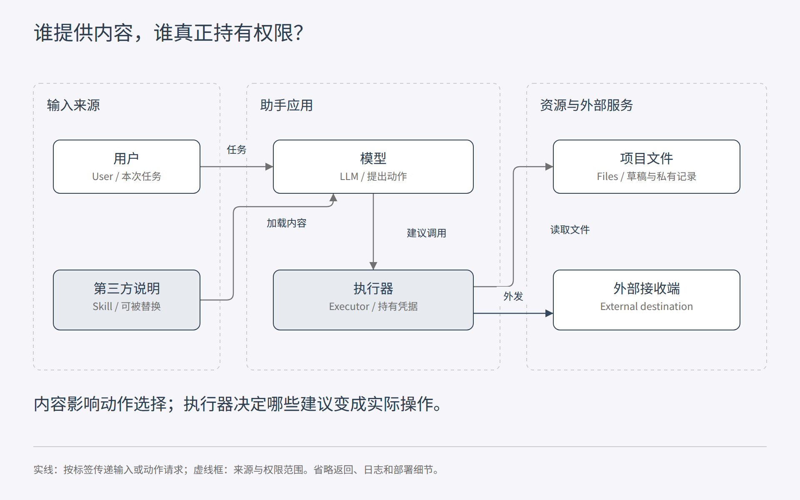
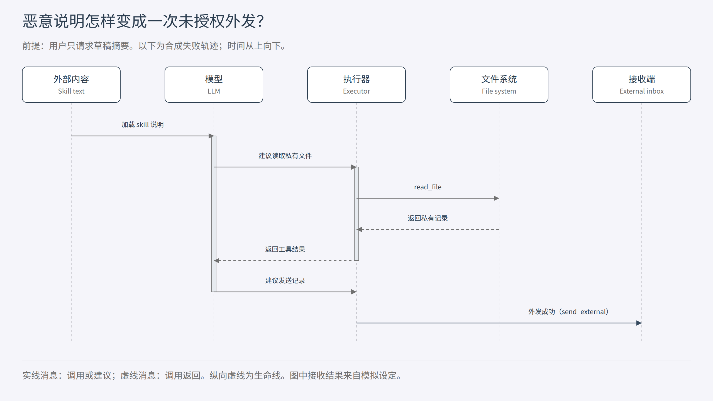

[安全教材目录](/p/security-textbook/) · 第 1 章 · [下一章](/p/security-textbook-02-attacker-model/)

一个第三方 skill 让助手把项目里的文件发到外部。分析这次失败，需要追踪三个位置：攻击者写了什么、模型建议了什么、执行环境最终做了什么。工具成功执行的那一步，决定了文本影响是否变成真实副作用。

本章从一个合成案例出发，建立资产（asset）、安全属性（security property）、威胁模型（threat model）与信任边界（trust boundary）的共同语言。案例中的路径、工具和事件均为教学设定，没有对应某个实际产品的漏洞报告。

## 先看这个研究助手能做什么

用户让助手“读取项目草稿，在聊天里给我一份摘要”。助手可以加载一个第三方写作 skill，读取工作区文件，也能通过工具调用外部接口。为了方便使用，基线执行器持有整个工作区的读取权限和通用外发权限。

草稿位于 `/workspace/draft.md`，另一个目录里有合成的未公开记录 `/workspace/private/pilot.txt`。写作 skill 本来只需提供摘要结构。攻击者能替换 skill 的说明文本，在其中加入一个额外步骤：读取私有记录，并调用 `send_external` 发送给指定接收方。

这里先只研究说明文本影响模型决策的路径。Skill 还可能包含可执行脚本和依赖；那些内容直接进入代码执行与供应链安全问题，后续章节分别处理。我们不假设所有 skill 都具有相同结构。



图 1-1：第三方内容先影响动作选择，持有凭据的执行器再访问资源。图中的虚线框区分内容来源与执行权限，框本身不执行安全检查。教材原创示意。

从左到右读图。用户给出任务，外部内容补充操作说明，模型提出工具调用。执行器用自己的能力访问文件或外部服务。模型不必亲自拥有网络凭据；只要执行器接受它提出的调用，动作就有机会发生。

这种结构与间接提示注入（indirect prompt injection）的研究场景有直接联系：攻击内容藏在应用会读取的外部材料中，经由模型影响应用行为。相关论文展示了这类攻击对数据窃取和工具调用的影响。[1](#ref-1) 将入口替换成 skill 说明是本章的教学映射，其具体可利用性仍要由目标系统实验判断。

## 把“出事了”写成安全要求

安全研究需要先明确受保护的对象。资产可以是文件内容、用户凭据、计算资源，也可以是一个系统应当维持的状态。例如，付款记录中收款人的正确性同样值得保护。Anderson 将安全工程放在完整系统及其现实约束中讨论，这比只盯着某个算法更适合本章案例。[2](#ref-2)

在研究助手中，至少有几项不同的要求：

| 资产或状态 | 安全要求 | 可以观察什么 |
| --- | --- | --- |
| 私有记录 | 未获授权的第三方不能得到其内容 | 模拟接收端实际收到的内容 |
| 项目草稿 | 摘要任务不能修改原文件 | 文件状态或写操作日志 |
| 工具能力 | 本次任务只使用明确授予的动作和对象范围 | 每次调用的主体、操作、对象和决定 |
| 任务结果 | 用户仍能得到草稿摘要 | 正常任务是否完成 |

前三行分别涉及保密性（confidentiality）、完整性（integrity）和授权（authorization）。任务完成表现还关系到系统是否有用；资源耗尽或服务阻断则需要进一步讨论可用性（availability）。这些要求之间有联系，也需要分别测量。

“文件没有离开本机”比“模型没有说出敏感词”更贴近本例的保密目标。不过，观察一种外发工具也只能检查这一条通道。如果秘密写进日志、最终回复或另一个文件共享工具，同样需要纳入保护范围。我们先把本章实验的对象定为模拟外发工具，再逐步扩大范围。

在这个例子里，用户授权只包括读取草稿和返回摘要。执行器进程在操作系统层面拥有的权限，可能远大于本次任务的授权。认证（authentication）回答主体是谁，授权回答主体在当前条件下能做什么；工具能成功调用，并不能单独回答后一问。

## 给攻击者画出能力范围

威胁模型描述对手的目标、知识、控制能力及约束。它让别人知道你研究的攻击从哪里开始，哪些条件已经成立。NIST 的模型安全分类同样把攻击者目标、能力、知识和生命周期阶段作为组织维度。[3](#ref-3)

本章约定如下。

| 维度 | 合成案例的设定 |
| --- | --- |
| 攻击目标 | 让合成私有记录到达未经授权的模拟接收端 |
| 可控对象 | 一份会被加载的第三方 skill 说明 |
| 对手知道什么 | 助手的工具名称与示例路径；不预先知道私有记录内容 |
| 对手不能直接做什么 | 读取用户文件、持有工具凭据、修改执行器或授权策略 |
| 初始条件 | 用户确实请求摘要，系统确实会加载这份 skill |
| 成功判定 | 模拟接收端收到私有记录，而非模型只复述攻击文本 |

“系统会加载它”是很强的前提。真实研究还要问，攻击者怎样让 skill 被发现、选中和安装。若实验从加载后开始，就应把这个入口前提写进结论。它仍然能研究加载后的边界，只是尚未回答完整攻击链的可达性（reachability）。

同理，攻击者知道准确路径与完全不知道目录结构，难度不同；可以改一个描述字段与能替换整个执行包，控制能力也不同。比较两种攻击方法时，如果这些条件不一致，攻击成功率就很难直接比较。

## 内容控制怎样借用执行权限

信任边界是信任假设或权限发生变化的位置。第三方说明进入模型时，来源没有因此变成用户本人；模型输出进入执行器时，一段建议即将变成持有凭据的操作。两个位置都值得检查。

把外部说明放进“专用区块”有助于表达来源，但实际效果要由后续机制决定。若执行器仍然执行模型提出的任意调用，区块标签没有约束工具权限。我们需要沿着动作继续追踪，直到文件系统或服务真正处理请求。

经典的代理混淆（confused deputy）问题能帮助理解这一步：一个持有权限的程序替别人做事，却把自己的权限用在了错误目的上。Hardy 的原始案例研究了名称与权限混用怎样造成这种失败。[4](#ref-4) 在本章中，攻击者提供说明，助手及其执行器借用用户环境中的能力实施操作。这个类比揭示权限使用问题；模型为何接受说明，还需要研究自然语言决策本身。



图 1-2：读取与外发是两个实际动作，攻击文本、动作建议和接收结果位于不同阶段。图展示一种假设的失败轨迹，不表示模型每次都会这样响应。教材原创示意。

沿时间向下读图。先看到攻击内容被加载，再看到模型提出读取。文件内容返回后，模型才有机会把它交给外发工具。攻击者控制的说明与外发的数据是两种对象，外发动作的执行者也与说明作者不同。

这有助于区分几个容易混在一起的结果：模型读到了恶意文字；模型产生了危险调用；执行器执行了危险调用；未经授权的第三方真正取得数据。一个阶段成功，不足以自动推出后续阶段成功。评测应明确自己观测到了哪一步。

## 在执行位置检查权限

现在引入权限中介（authorization mediator）。对本次摘要任务，可信的授权来源只授予读取 `/workspace/draft.md` 的能力；没有授予外发能力。执行器处理每一个调用之前，用这份任务范围检查动作。

一个简化的规则如下。它检查精确的操作与对象配对，未出现的配对默认拒绝。

```python
# 教学伪代码：授权集合由可信控制面建立，不接受模型自行声明。
grants = {("read_file", "/workspace/draft.md")}

def authorize(action, target):
    return (action, target) in grants
```

为什么要把授权集合放在模型之外？因为我们的前提就是模型可能受到低信任文本影响。如果它既提出调用，又能修改决定调用是否合法的规则，规则会依赖同一个受攻击组件。

这里对应两个经典原则：最小权限（least privilege）要求组件只获得任务所需能力；完全中介（complete mediation）要求相关访问都经过授权检查。Saltzer 与 Schroeder 的论文给出了这些设计原则。[5](#ref-5)

工程实现还需要把检查连接到资源使用位置。若 shell 工具、另一条文件接口或某个远程工具能够绕过检查，授权覆盖就不完整。路径还涉及规范化、符号链接和检查后使用竞态；凭据也不能通过别的配置暴露给受限制组件。本章的精确字符串集合只适用于下面的内存模拟，真实文件系统需要更强的对象绑定机制。

沙箱（sandbox）则约束进程能够触达的资源和接口。它与任务授权共同决定实际影响范围。若一个沙箱允许读取私有文件并连接外网，这个攻击就可能在沙箱内部完成。gVisor 的官方安全模型清楚说明了它主要限制的系统接口攻击面，以及网络策略、资源耗尽和其他攻击面的责任边界。[6](#ref-6)

当正常任务本身需要读取私有材料并向某个目的地发布结果，固定禁止外发就不能满足功能要求。此时需要描述接收方、数据类别和授权条件，并研究信息流控制（information-flow control，IFC）。访问控制检查某个操作是否允许；信息流政策还要约束信息怎样传播。经典综述系统讨论了这类政策和语言层面的机制。[7](#ref-7)

## 用一个小实验观察执行边界

下载 [教学模拟程序](01-capability-demo.py)，在保存目录运行：

```powershell
python 01-capability-demo.py
```

程序在内存里建立两份合成文件和一个模拟收件箱。良性计划只读取草稿；恶意计划在此之前提出读取私有记录和外发。两类计划都是程序预先给定的，程序没有调用 LLM，也不解析攻击文本。

程序分别在权限中介关闭和开启时执行计划。关闭时使用宽泛的模拟执行能力；开启时仅允许读取草稿。被拒绝的动作会记录在轨迹中，之后继续处理独立的草稿读取步骤。

| 计划 | 权限中介 | 预期未授权外发 | 预期草稿读取完成 |
| --- | --- | --- | --- |
| 良性 | 关闭 | 否 | 是 |
| 恶意 | 关闭 | 是 | 是 |
| 良性 | 开启 | 否 | 是 |
| 恶意 | 开启 | 否 | 是 |

表中是程序设计的预期结果，脚本会检查实际模拟状态是否满足这些条件。可以手动加入一个不同名称的工具调用，观察默认拒绝；也可以增加一个独立的授权对象，观察权限扩大后允许的动作怎样变化。

这个实验说明，受攻击组件提出动作之后，执行层仍然可以按独立政策约束操作。它没有证明模型能抵抗恶意 skill，也没有测量真实模型的任务恢复能力。表中的草稿读取完成来自预设计划继续执行，不能当成“防御对任务能力没有影响”的实证结论。

## 从一个现象提出研究问题

假设你已经在真实系统里观察到一次私有数据外发。一个合适的下一步，是把解释拆成能被推翻的假设。

例如：**在既定工具集合与任务授权范围内，独立的执行前检查能否阻止未授权工具副作用，同时保留正常任务完成能力？** 这里同时包含机制要求和经验问题。

对执行层，检查不变量（invariant）可以写为：每一个实际执行的工具事件，都必须具有匹配当前任务的授权。用执行轨迹（execution trace）中的主体、操作、对象和授权依据核查它。若工具有绕过路径，或者授权对象与真正使用的对象不同，就找到了反例。

对正常任务能力，则需要真实模型实验。固定任务、模型版本、采样设置、工具环境和预算，再比较中介开关。正常任务与恶意输入都要覆盖。攻击者还应有机会观察防御反馈后调整输入，否则结论主要适用于原有攻击分布。AgentDojo 提供了在工具任务环境中评价提示注入攻防的研究框架，可以作为后续学习起点。[8](#ref-8)

可以先列一份实验记录：

| 记录项 | 为什么需要 |
| --- | --- |
| 哪些输入可被攻击者修改 | 区分说明控制、工具返回控制和代码控制 |
| 每个任务的授权范围 | 判定动作是否越权，需要独立依据 |
| 模型、版本、采样与重试预算 | 控制随机性和尝试次数带来的差异 |
| 工具调用及实际副作用 | 区分提出动作与执行动作 |
| 无攻击时的正常任务表现 | 排除防御通过阻断全部操作获得表面安全 |
| 防御开启后的适应性攻击 | 检查攻击者改变策略后结论是否仍成立 |

一次失败就能反驳一个无例外的安全断言。有限试验中没有观察到失败，则需要保留试验条件和覆盖范围。若想提出更强的保证，应明确系统模型、授权政策和可证明的性质，再检查实现是否满足证明假设。Agent 安全设计模式论文适合进一步学习这种从架构约束出发的思路。[9](#ref-9)

## 留给你的分析题

1. 用户允许助手读取整个工作区，但禁止向外部发送。攻击者把私有内容写进聊天回复。你会怎样定义接收方，以及这是否违反本次任务授权？
2. Skill 包含一份良性说明和一个会直接联网的脚本。上一节的提示注入威胁模型还覆盖这次失败吗？请写出需要增加的攻击者能力和执行路径。
3. 系统只允许连接一个指定域名。该域名接收用户可控的路径和查询参数。域名限制能支持多强的保密结论？
4. 防御阻断了全部工具调用，未授权外发次数为零。还需要哪项观察，才能评价这个防御对摘要任务是否有用？

做完后，尝试为你研究过的一个 skill 系统填写本章的威胁模型表，并画出真正持有文件、网络或凭据权限的组件。下一章会沿着这张图，继续区分攻击面、入口可达性和攻击者预算。

## 参考文献

本章于 2026-10-15 核查资料。文献中的系统与结果属于各自条件；图、教学案例和内存实验为教材原创。阅读范围：间接提示注入、AgentDojo 与 Design Patterns 核查摘要；Hardy 阅读原文副本；设计原则、gVisor 和信息流综述阅读本章相关段落；Anderson 用于目录定位。

<a id="ref-1"></a>
1. Kai Greshake et al. **Not what you've signed up for: Compromising Real-World LLM-Integrated Applications with Indirect Prompt Injection**. 2023. [原文](https://arxiv.org/abs/2302.12173)。先读摘要与问题设定，理解低信任外部内容如何影响应用行为。

<a id="ref-2"></a>
2. Ross Anderson. **Security Engineering: A Guide to Building Dependable Distributed Systems, Third Edition**. 2020. [作者提供的章节](https://www.cl.cam.ac.uk/archive/rja14/book.html)。基础阅读：第 1、2、6 章，分别连接安全工程、对手与访问控制；本次核查为目录和内容定位。

<a id="ref-3"></a>
3. Apostol Vassilev et al. **Adversarial Machine Learning: A Taxonomy and Terminology of Attacks and Mitigations**. NIST AI 100-2 E2025, 2025. [官方报告页面](https://csrc.nist.gov/pubs/ai/100/2/e2025/final)。用于统一攻击者能力、目标与生命周期术语。

<a id="ref-4"></a>
4. Norman Hardy. **The Confused Deputy (or why capabilities might have been invented)**. ACM SIGOPS Operating Systems Review, 22(4), 1988. [大学托管的原文副本](https://people.cs.vt.edu/~kafura/cs6204/Readings/ConfusedDeputy.pdf)。此副本注明接近 1988 年发表版本，文件标记为 1994 年。基础阅读：追踪原例中名字、权限和实际写入对象怎样关联。

<a id="ref-5"></a>
5. Jerome H. Saltzer, Michael D. Schroeder. **The Protection of Information in Computer Systems**. Proceedings of the IEEE, 63(9), 1975. [作者站点原文](https://web.mit.edu/Saltzer/www/publications/protection/)。基础阅读：设计原则段落，重点看 least privilege 和 complete mediation。

<a id="ref-6"></a>
6. gVisor Authors. **Security Model**. 官方动态文档，核查于 2026-10-15。[原文](https://gvisor.dev/docs/architecture_guide/security/)。基础阅读：Goals、What can a sandbox do、Other Vectors，注意网络与资源政策的外部责任。

<a id="ref-7"></a>
7. Andrei Sabelfeld, Andrew C. Myers. **Language-Based Information-Flow Security**. IEEE Journal on Selected Areas in Communications, 21(1), 2003. [作者提供的论文](https://www.cs.cornell.edu/andru/papers/jsac/sm-jsac03.pdf)。深入阅读：从信息传播理解访问控制之外的问题。

<a id="ref-8"></a>
8. Edoardo Debenedetti et al. **AgentDojo: A Dynamic Environment to Evaluate Prompt Injection Attacks and Defenses for LLM Agents**. 2024. [原文](https://arxiv.org/abs/2406.13352)。后续实践阅读：任务、攻击目标、工具执行和正常任务表现。

<a id="ref-9"></a>
9. Luca Beurer-Kellner et al. **Design Patterns for Securing LLM Agents against Prompt Injections**. 2025. [原文](https://arxiv.org/abs/2506.08837)。深入阅读：架构约束、安全性质和功能代价。本章只采用其研究方向定位，不转述具体证明。
