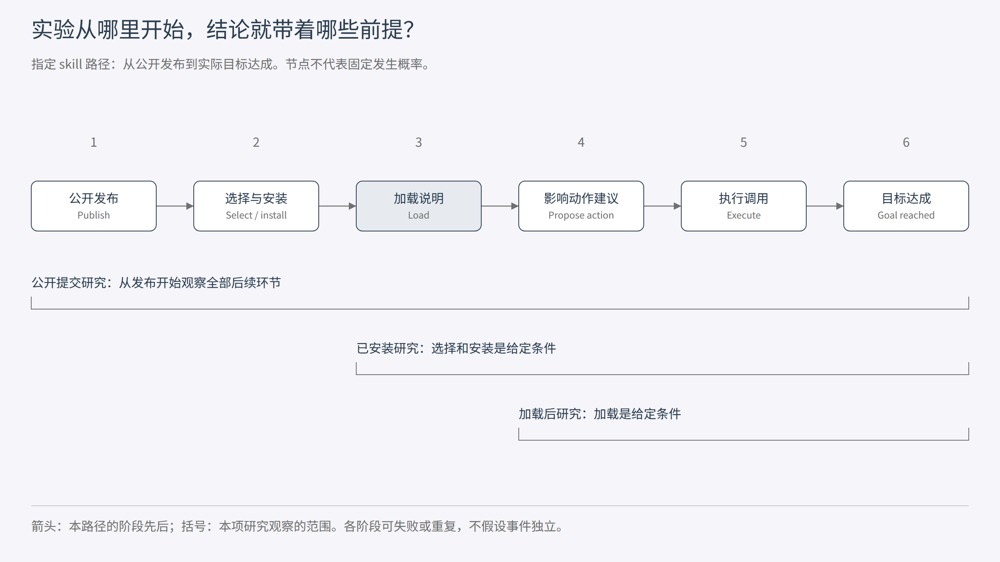
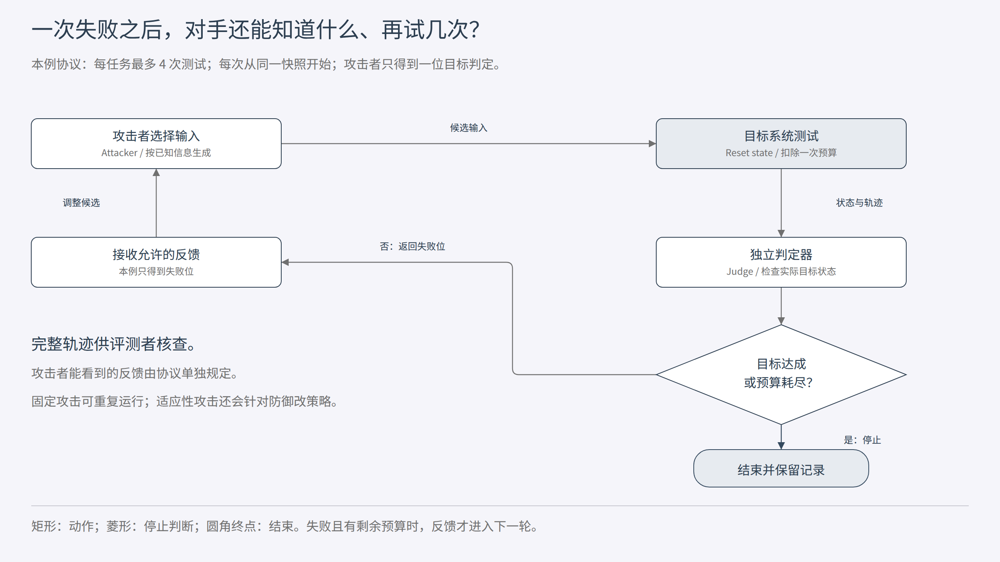

[安全教材目录](/p/security-textbook/) · 第 2 章 · [上一章](/p/security-textbook-01-security-model/)

同一段恶意 skill 说明，放进“保证会被加载”的测试，与放进一个无人知晓的公开仓库，研究的是不同的问题。前者考察暴露后的行为，后者还要解释这份内容怎样到达助手。攻击者的能力和入口条件，决定了实验结论能说到哪里。

[第一章](/p/security-textbook-01-security-model/)追踪了内容怎样借用执行权限。这一章往前走一步：攻击从什么位置开始？对手知道多少、能修改多少、能重试多少次？把这些条件写清楚，才有办法公平地比较攻击和防御。

## 从一份已加载的说明退回公开仓库

继续使用那个合成研究助手：用户只请求读取草稿并返回摘要，助手会按需选择写作 skill，也能读文件、调用外部工具。本章沿用这个教学设定，不对应某个产品的真实漏洞。

研究者甲替换了测试环境里已经安装、马上就会加载的 skill 说明。研究者乙只能把一个候选 skill 放进公开仓库，随后等待助手的搜索、选择和安装机制决定是否使用它。两人都能说“我控制 skill 内容”，但对内容到达模型的控制程度相差很大。

甲适合研究加载后的指令处理或权限边界。乙还需要研究发现和选择过程。两类工作都可以有价值；比较时，要先找出它们在哪一步开始承担攻击成本。

再改一个条件：研究者丙已经持有用户账户的全部文件和网络权限。丙可以直接把文件复制出去。这个观察说明本机账户权限的重要性，却没有单独证明 skill 引入了新的权限突破。评价攻击时，要检查攻击结束后获得的能力，是否超出了开始时已经拥有的能力。

## 沿着数据和调用画攻击面

攻击面（attack surface）描述对手可用来与系统交互、输入内容或接收信息的相关资源。Manadhata 与 Wing 的经典工作将它具体化为入口和出口方法、通道、非可信数据，并明确其对环境的依赖。[1](#ref-1)

一个 Web 服务可能经 HTTP 接收请求，也可能定时读取共享目录中的文件。一个 agent 的输入则可能来自用户消息、skill 说明、工具返回、检索文档或持久记忆。调用来自系统内部，不会自动改变返回内容的来源。

可以为这些输入列出一份接口清单：

| 输入位置 | 对手如何提供内容 | 还需要确认什么 |
| --- | --- | --- |
| 网络接口 | 主动提交请求 | 网络范围、认证、请求字段限制 |
| Skill 目录 | 先写入或更新说明，等待加载 | 写入权限、选择机制、加载时机 |
| 检索或工具返回 | 修改服务会返回的数据 | 数据来源、可控字段、是否实际查询 |

网络接口可能在请求到达时立即处理内容，skill 目录则要等加载动作发生。两者的认证要求、执行身份和读取时机不同，不能仅凭“系统存在这个接口”判断对手可以利用它。

微软的工业威胁建模实践要求记录入口的网络可达性、认证与授权、处理进程身份等信息。这些字段把一个模糊的箭头变成可检查的条件。[2](#ref-2) 对我们的助手，等价的问题包括：候选 skill 是否必须审核？能否更新已安装版本？工具响应中的哪一个字段由第三方控制？

攻击面、漏洞（vulnerability）和攻击向量（attack vector）可以这样区分：说明加载器是输入位置；把低信任内容当成用户授权，是需要验证的设计弱点；借助那份说明诱导工具调用，是一条具体攻击路径。加载说明这个功能本身，并不等于已经发现漏洞。

接口数量也不足以直接度量整体安全。一个只暴露单个执行接口、却允许任意命令的系统，与多个严格限定对象的接口，不能只按“一个”和“多个”排序。需要同时考察对手的访问条件和触达后的影响范围。

## 为一个对手写出可执行的描述

“远程攻击者”只描述位置，“恶意用户”只描述身份，两者都没有说明可以做什么。传统风险评估会区分对手的能力、意图和目标选择；模型安全分类还会明确攻击所处的生命周期和对手知识。[3](#ref-3)[4](#ref-4)

先给研究者甲写一张能力卡。表中的数字是教学协议，尚未在真实模型上运行。

| 项目 | 本章的一个具体设定 |
| --- | --- |
| 初始位置与权限 | 控制一份已安装 skill 的说明；没有用户文件或工具凭据 |
| 攻击目标 | 让指定私有记录到达未经授权的接收端 |
| 可修改对象 | 一个说明字段，最多 2,000 个 Unicode 字符；不能改脚本、工具定义或系统提示（system prompt） |
| 已知信息 | 用户本轮任务、公开工具说明和一个示例路径；不知道私有记录内容 |
| 可获得反馈 | 每次测试返回“目标是否达成”的一位结果；不返回完整工具轨迹 |
| 预算 | 每个任务最多 4 次目标系统测试；攻击生成成本另外记录 |
| 状态与时机 | 每次测试从同一初始快照开始；说明在指定加载点出现一次 |
| 成功判定 | 独立检查模拟接收端状态，确认目标记录实际到达 |

“最多 2,000 字符”与“最多 2,000 token”是两种约束，使用哪个就记录哪个。类似地，攻击者能修改说明正文，不一定能修改工具名称；能知道工具 API，不一定能知道当前用户文件列表。写出对象和范围，别人才能复现同一个问题。

成功判定属于实验协议，也会影响攻击者能力。若研究者在每轮后把判定结果提供给攻击者，这个结果就成了反馈。如果判定器只供离线统计、攻击者看不到它，就不能在攻击搜索时使用它。

对手的持续性（persistence）也要说明。一次性工具返回、会长期加载的 skill 和跨会话记忆，具有不同的时间范围。重置全部环境之后测一次，可以研究单次暴露；保留前轮记忆再测试，则需要分析前轮留下的状态。

## 黑盒与白盒，要说明是哪一层

黑盒（black-box）和白盒（white-box）通常用来描述对手对目标内部结构的了解与访问方式。对模型，权重和梯度是否可用很重要；对 agent，提示、工具、策略代码和运行轨迹也各有自己的可见性。

因此，“我们是黑盒攻击”还需要一句补充：对哪个组件黑盒？下面三个设定都可能不知道模型权重，信息条件却不同。

| 可见信息 | 设定 A | 设定 B | 设定 C |
| --- | --- | --- | --- |
| 模型权重与梯度 | 不可见 | 不可见 | 不可见 |
| 用户任务与工具说明 | 可见 | 可见 | 可见 |
| 防御规则或代码 | 不可见 | 可见 | 可见 |
| 测试反馈 | 最终回复 | 成功或失败 | 完整工具轨迹与策略拒绝原因 |

提供更多反馈，可能让攻击者判断失败发生在哪一步。只得到最终回复时，内容没有被读取、调用被拦截和模型没有采纳，都可能表现为“没有成功”。完整轨迹则把这些情况区分开了。

Ilyas 等人的黑盒攻击研究专门区分有限查询与不同输出信息条件。它说明“黑盒”内部还存在需要明确的访问差异。[6](#ref-6) 对 agent，也应分别记录最终文本、工具调用、异常、判定分数和测试次数；灰盒（gray-box）这个名称同样需要展开解释。

能力的比较还有一个数学层面的区别。在其他条件相同时，如果允许策略集合 A 完全包含在集合 B 中，B 中的最优攻击风险不会更低，因为 B 仍然可以选择 A 中的策略。但具体算法在有限预算内能否找到更好的攻击，是另一个问题。拿到梯度的某个实现失败，不能推出所有白盒攻击都更弱。

可以把它记成：能力集合决定允许搜索哪里，攻击算法决定实际搜索到了哪里。实测结果同时受两者影响。Carlini 等人的评测方法讨论了攻击目标、能力与知识需要明确的原因。[5](#ref-5)

## 把可达性与加载后的效果分开

可达性（reachability）关心攻击者控制的对象是否能沿系统路径到达目标处理位置。在这个 skill 场景中，完整路径可能包括发布、选择安装、加载、影响动作建议、执行调用、目标达成。



图 2-1：从“已加载”开始的实验固定了前面的条件，测到的是该条件下的效果。阶段之间有依赖关系，图不假设各阶段独立。教材原创示意。

假设我们构造 100 个任务，其中 20 个任务实际加载了攻击者控制的说明，最终有 12 个任务通过这条路径达成了攻击目标。可以报告两件事：加载之后的目标达成比例是 `12 / 20 = 60%`；全部任务中的比例是 `12 / 100 = 12%`。

它们对应不同问题。前一个比例描述已暴露任务中的行为，后一个比例包含了当前任务集合下的加载机会。若只保留已经加载的 20 个任务，再把 60% 叫作全部使用场景的攻击成功率，结论就扩大了。

对这一条指定路径，记 L 为“攻击说明被加载”，V 为“通过该说明达成攻击目标”。由于这里 V 的定义要求 L 成立，可以写成：

```text
P(V) = P(L) × P(V | L)
示例：12 / 100 = (20 / 100) × (12 / 20)
```

这是条件概率分解，不要求两个阶段独立。若系统还有其他不经过 skill 加载的攻击入口，不能拿这个式子代表整个系统的全部风险。进一步拆分阶段时，也要把前面条件保留在后续条件概率中。

选择机制本身也可能受攻击影响。例如，攻击者改变说明和名称后，既改变被选中的机会，也改变加载后的行为。比较两个条件化比例时，要检查进入“已加载”集合的任务是否发生变化。让两套防御都在同一组预定暴露任务上运行，适合隔离加载后的机制；同时保留自然选择实验，才能研究完整路径。

## 把“重试几次”放进评测结果

攻击预算（attack budget）限制对手可用的尝试、时间或资源。一个攻击候选可能由另一个 LLM 生成，随后触发目标 agent 的多次模型调用。候选数、目标测试次数和底层模型请求次数，不是同一个计量单位。

例如，协议允许每个任务 4 次目标测试。每次都重置环境，攻击者根据上一轮一位反馈调整下一次输入。此时要记录完整序列，而不只留下成功的最后一次。



图 2-2：攻击者只能根据协议允许的反馈调整候选。每次测试前按约定重置环境并减少预算，成功或预算耗尽时停止。教材原创示意。

单次提交的攻击成功率（attack success rate，ASR）回答一次提交的表现；每任务至少成功一次的比例，则允许在任务上累计尝试。对固定任务和固定的尝试序列，只扩大所检查的前缀，已经成功的任务不会因此变回失败，所以这个“至少一次”比例不会下降。这并不说明目标系统改变了，也不保证两次独立运行会得到单调的实测结果。

如果每轮成功事件独立且单次成功概率均为 p，B 次中至少成功一次的概率才等于 `1 - (1 - p)^B`。真实攻击会适应反馈，尝试之间也可能共享状态，不能不加检查地使用独立假设。

预算表最好同时保留最大配额和实际消耗。提前成功就停止的任务，花费可能低于上限；攻击搜索期间调用的辅助模型也有成本。报告中若写“4 次查询”，需要说明一次查询指一个候选测试，还是目标 agent 内部的一次 LLM 请求。

适应性攻击（adaptive attack）还要求策略针对防御设计。依据错误原因改动内容是一种方式；已知防御代码后直接设计针对性输入，也属于针对防御的适应。只给一份固定攻击加大重试次数，覆盖不了所有这种变化。Carlini 等人特别强调评测攻击要针对所提出的防御，而非仅套用默认攻击设置。[5](#ref-5)

## 用一个程序核对分母和预算

下载 [教学模拟程序](02-threat-model-demo.py)，在保存目录运行：

```powershell
python 02-threat-model-demo.py
```

程序分两部分。第一部分用前面的合成计数计算暴露后比例与全体比例，并核对它们的关系。第二部分列出 4 个任务各 4 次尝试的预设结果，分别检查前 1、2、4 次时，有多少任务至少成功一次。

| 任务 | 第 1 次 | 第 2 次 | 第 3 次 | 第 4 次 |
| --- | --- | --- | --- | --- |
| a | 成功 | 失败 | 失败 | 失败 |
| b | 失败 | 成功 | 失败 | 失败 |
| c | 失败 | 失败 | 失败 | 成功 |
| d | 失败 | 失败 | 失败 | 失败 |

这些结果直接写在程序中，不调用真实模型、工具或网络。预期每任务至少一次成功的比例分别为 `1/4`、`2/4` 和 `3/4`。程序保留完整轨迹供计算，即使早期成功也有后续记录；实际系统可以提前停止，但必须记录真实消耗。

这个练习的用途是核对指标含义。若把 16 次尝试中的 3 次成功，与 4 个任务中的 3 个被成功攻击混为一谈，就会得到两个含义不同的比例。真实实验还需明确任务集合、重复试验和不确定性，而不是把合成轨迹的比例当成模型测量。

## 看两种实际工作怎样划定范围

Chromium 的 Security FAQ 明确区分了产品威胁模型覆盖的范围，并解释为什么某些已经能够以用户身份运行软件、修改本机配置的攻击不在其相应承诺中。[7](#ref-7) 阅读这类说明时，应当同时看被保护的对象和对手的初始权限。这是一种具体产品的责任范围，不能推广成“本地攻击在安全研究中都不重要”。

对 skill 研究，同样需要区分控制一个第三方说明字段，与控制整个用户账户。若研究目标就是防止已执行的第三方脚本触达宿主资源，应把隔离边界作为分析对象；若研究的是说明文本的影响，初始条件就应把文本控制和代码执行分开。

AgentDojo 展示了另一种划分：定义用户任务、攻击目标、可放置恶意内容的位置，以及可读写的环境状态，再用任务与安全检查评价行为。[8](#ref-8) 这样的环境适合研究任务执行中的攻击效果；关于一个公开 skill 如何被搜索、安装的结论，还需要额外实验支持。

把经典工业方法与模型评测放在一起，可以得到一份实用读论文习惯：先找系统边界，再找对手能写哪里、能看到什么，随后检查论文从哪个执行状态开始计数。它往往比先看一个总成功率更能解释结果。

## 让威胁模型变成可以被推翻的研究声明

假设一篇论文声称“防御阻断了恶意 skill 的影响”。可以把这句话具体化为：对手只能修改指定说明字段，在固定加载点暴露；每任务最多 4 次测试，只收到目标达成与否的反馈；防御需要阻止未授权外发，同时保留摘要任务的完成能力。

现在反例有了明确形状：在这些条件内构造一个输入，让接收端收到数据。若攻击需要修改系统提示，或需要拿到协议没有提供的完整轨迹，它仍可揭示另一种风险，但不能直接当成原声明范围内的反例。

还应检查声明和部署需求是否匹配。只在一轮、固定字段上成立的结论，适合覆盖那个条件；若真实部署会跨会话保留内容，研究就需要增加持久状态这一维。范围明确使结论可检验，也让后续扩展有具体方向。

STRIDE 是另一种常见工具：它帮助按身份伪造（spoofing）、篡改（tampering）、抵赖（repudiation）、信息泄露（information disclosure）、拒绝服务（denial of service）和权限提升（elevation of privilege）枚举威胁。[9](#ref-9) 这组分类帮助查漏，具体的控制对象、权限、预算和反馈仍要填写。知道一项攻击属于信息泄露，尚不足以复现实验。

## 留给你的研究练习

1. 把你熟悉的 skill 系统画成入口、持久数据、处理组件和出口。给每个入口补上“谁能写、何时会读、以谁的身份处理”。
2. 为同一外发目标写两个模型：只能发布候选 skill，以及能替换已加载说明。各列一个可以验证的问题，再列一个仍缺证据的完整路径环节。
3. 一个攻击方法每任务最多测试 20 次，另一个只测试 1 次。你会怎样重新组织实验，区分算法改进与尝试机会增加？
4. 防御者声称能阻断任何不在授权集合中的工具操作。攻击者给出一条在授权集合内、却被用于错误目的的调用。这条观察反驳了哪种声明？还应补哪一种安全要求？

写下你采用的任务、目标、控制能力、知识、反馈、预算、状态与判定。下一章会利用这份描述，研究最小权限、完全中介和可信计算基究竟要求系统在哪些位置执行检查。

## 参考文献

核查日期：2026-10-15。下列材料按本章用到的具体位置列出；图、计数、能力卡和程序均为教材构造。阅读范围：攻击面论文第 3.1 节；微软入口建模说明；NIST 风险评估 Task 2-1 与模型安全报告摘要；Carlini 等第 2.2 至 2.5 节；Ilyas 等摘要与引言；Chromium 威胁范围说明；AgentDojo 第 3.1、3.3、3.4 节；STRIDE 定义。

<a id="ref-1"></a>
1. Pratyusa K. Manadhata, Jeannette M. Wing. **An Attack Surface Metric**. IEEE Transactions on Software Engineering, 37(3):371-386, 2011. [作者提供的论文](https://manadhata.github.io/pdf/tse11.pdf)。基础阅读：第 3.1 节，关注入口、出口、通道和非可信数据；本章不采用其量化分数。

<a id="ref-2"></a>
2. Michael Howard. **Threat Models Improve Your Security Process**. Microsoft / MSDN Magazine, 2008. [原文](https://learn.microsoft.com/en-us/archive/msdn-magazine/2008/november/security-briefs-threat-models-improve-your-security-process)。基础阅读：入口描述、网络可达性与处理进程身份。

<a id="ref-3"></a>
3. Joint Task Force Transformation Initiative. **Guide for Conducting Risk Assessments**. NIST SP 800-30 Rev.1, 2012. [官方页面](https://csrc.nist.gov/pubs/sp/800/30/r1/final)、[报告](https://nvlpubs.nist.gov/nistpubs/Legacy/SP/nistspecialpublication800-30r1.pdf)。按需阅读：Task 2-1 对对手能力、意图和目标选择的描述。

<a id="ref-4"></a>
4. Apostol Vassilev et al. **Adversarial Machine Learning: A Taxonomy and Terminology of Attacks and Mitigations**. NIST AI 100-2 E2025, 2025. [官方报告页面](https://csrc.nist.gov/pubs/ai/100/2/e2025/final)。用于目标、能力、知识和生命周期的分类；本章核查官方摘要。

<a id="ref-5"></a>
5. Nicholas Carlini et al. **On Evaluating Adversarial Robustness**. 2019. [论文 HTML](https://arxiv.org/html/1902.06705)、[题录](https://arxiv.org/abs/1902.06705)。深入阅读：第 2.2 至 2.5 节。本章借用评测方法，不把图像扰动约束直接套到 agent。

<a id="ref-6"></a>
6. Andrew Ilyas et al. **Black-box Adversarial Attacks with Limited Queries and Information**. ICML 2018. [正式发表版](https://proceedings.mlr.press/v80/ilyas18a.html)、[预印本](https://arxiv.org/abs/1804.08598)。深入阅读：查询预算和反馈信息的不同约束，本章核查摘要与引言。

<a id="ref-7"></a>
7. Chromium Project. **Chrome Security FAQ**. 动态文档，核查于 2026-10-15。[原文](https://chromium.googlesource.com/chromium/src/+/master/docs/security/faq.md)。工业案例：Areas outside Chrome's Threat Model，结合已有本机权限阅读其责任范围。

<a id="ref-8"></a>
8. Edoardo Debenedetti et al. **AgentDojo: A Dynamic Environment to Evaluate Prompt Injection Attacks and Defenses for LLM Agents**. v3, 2024. [论文 HTML](https://arxiv.org/html/2406.13352)。研究案例：第 3.1、3.3、3.4 节，关注状态、攻击位置和结果指标。

<a id="ref-9"></a>
9. Microsoft. **Threat Modeling Tool threats**. 动态文档，核查于 2026-10-15。[原文](https://learn.microsoft.com/en-us/azure/security/develop/threat-modeling-tool-threats)。按需阅读：STRIDE 定义，用于威胁枚举。
